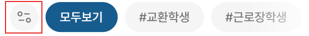
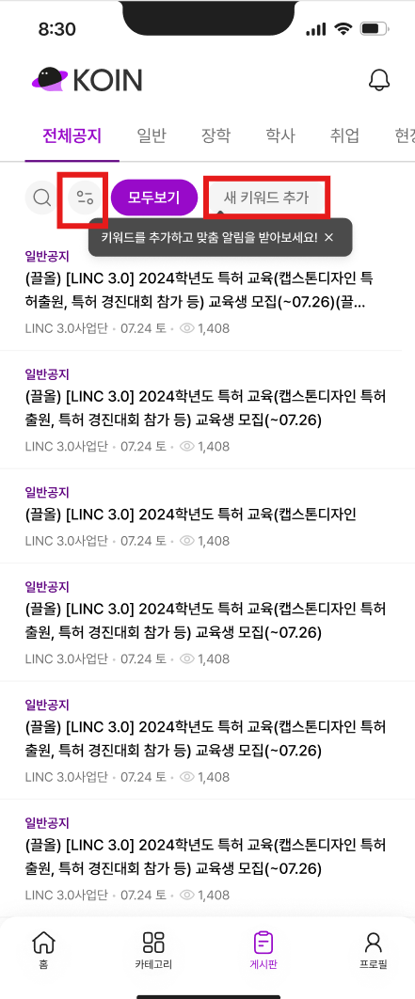

# 7-1. 키워드 관리_클릭

원문 페이지 ID: 21b0221954bc83df9625811c79c56819

> 원문 스냅샷. 명세 확정·앱 배포·수집 완료를 뜻하지 않습니다.

## 원문 속성

```json
{
  "platform": [
    "ANDROID",
    "IOS"
  ],
  "url": "source-page-id:21b0221954bc83df9625811c79c56819",
  "상태": "로깅 필요",
  "이름": "7-1. 키워드 관리\\_클릭",
  "태그": [
    "7. 키워드 관리(APP)"
  ]
}
```

<details>
<summary>이전 로깅</summary>




</details>

<details>
<summary>새 로깅 (26.10.05) — 초안</summary>

- 설명: 공지사항 목록의 키워드 관리 아이콘을 눌러 관리 화면 진입.
- screen\_view: <code>main_notice</code>
- event\_name: <code>DA2</code>
- event\_label: <code>board__main_notice__keyword_manage__entry__click</code>
- value: 설정 아이콘 or 새 키워드 추가
  - 클릭하는 진입점에 따라 달리 해주세요
- event\_category: <code>click</code>

<details>
<summary>검토사항</summary>

- label 통일 (2026-10-27): <code>board__main_notice__keyword_manage__entry</code> → <code>board__main_notice__keyword_manage__entry__click</code>
</details>

<details>
<summary>참고사진 · 모바일</summary>

<b>모바일</b>


</details>
</details>
