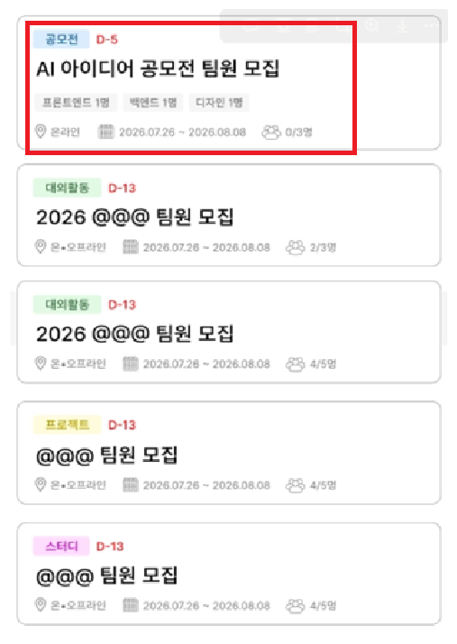
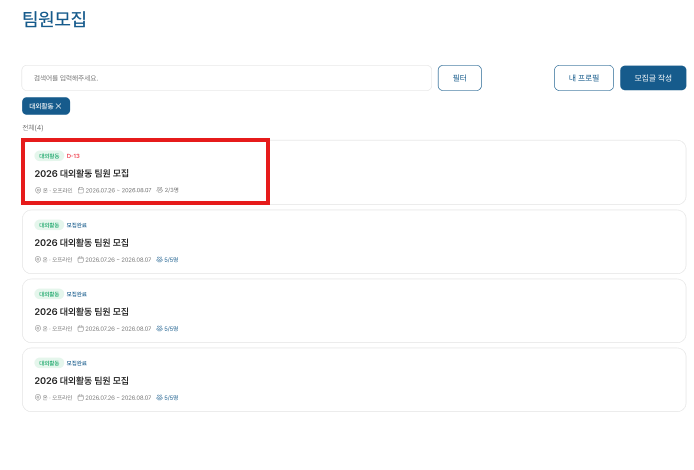
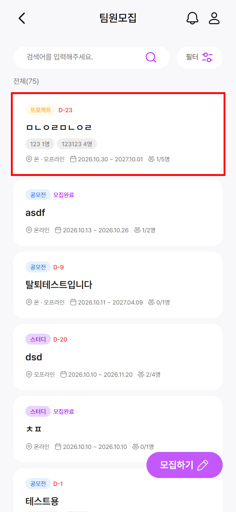

# 3. 게시글 클릭

원문 페이지 ID: 2270221954bc82b0b503014eeec62447

> 원문 스냅샷. 명세 확정·앱 배포·수집 완료를 뜻하지 않습니다.

## 원문 속성

```json
{
  "platform": [
    "WEB",
    "ANDROID",
    "IOS"
  ],
  "url": "source-page-id:2270221954bc82b0b503014eeec62447",
  "구분": "모집글 검색 및 필터",
  "상태": "로깅 필요",
  "생성일": "2026-11-12T05:08:07.896Z",
  "이벤트 이름": "3\\. 게시글 클릭"
}
```

<details>
<summary>과거 로깅</summary>

- event\_label : team\_recruitment\_post\_select
- value : 사용자가 선택한 게시글 이름으로 나오게 해주세요
- event\_category : “click”




</details>

<details>
<summary>새 로깅</summary>

- 설명: 팀원 모집 목록 화면에서 모집글 카드를 클릭해 모집글 상세 화면(/team/recruitment/\{id\})으로 들어가는 경우
- screen\_view: <code>team_list</code>
- event\_name: <code>DA1</code>
- event\_label: <code>team_recruit__team_list__team_detail__entry__click</code>
- value: \{카테고리\}\_\{모집글 id\} (예: 프로젝트\_103)
- event\_category: <code>click</code>

### 참고사진 (게시글 클릭)

<columns>
<column ratio="50">
<b>웹</b>

<b>참고사진 · 웹</b>

웹 — 사진 없음 (추가 필요)
</column>
<column ratio="50">
<b>모바일</b>

<b>참고사진 · 모바일</b>

모바일 — 게시글 클릭 (출처: stage 실제 캡처, 빨간 네모 = 클릭 위치)


</column>
</columns>
</details>
