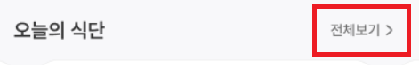
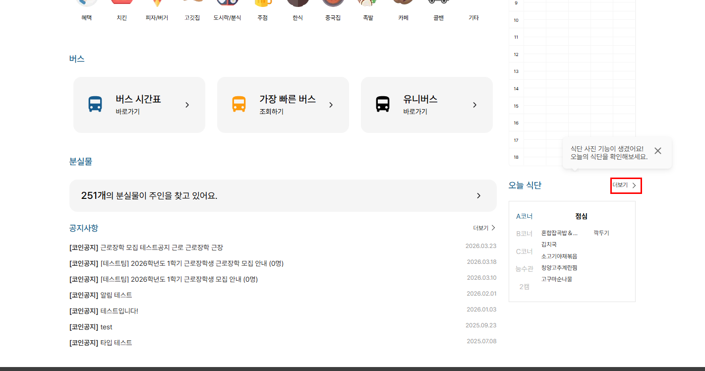
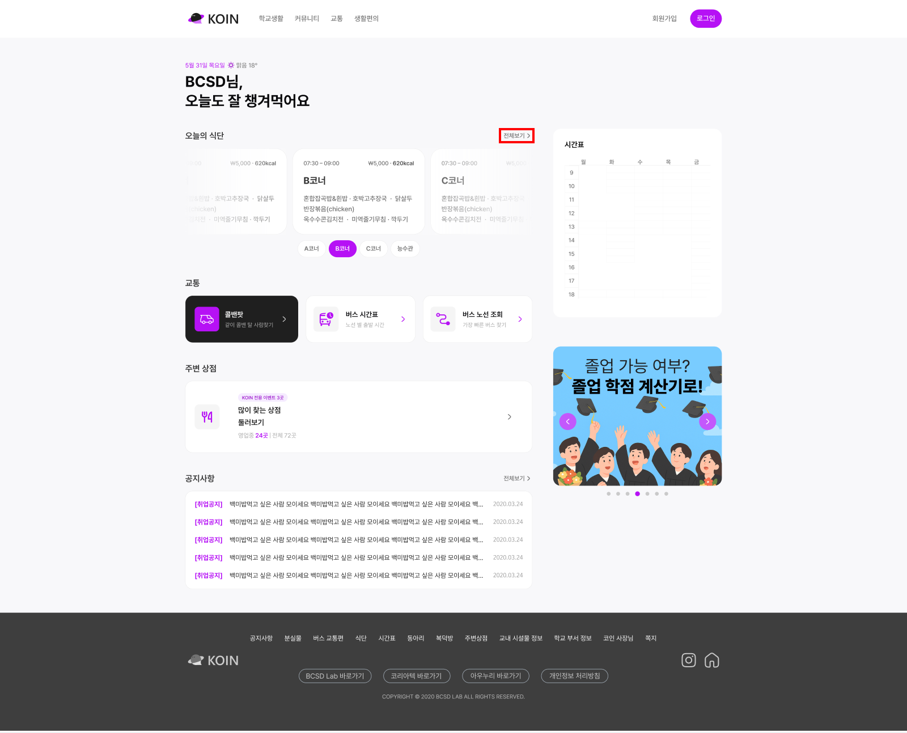
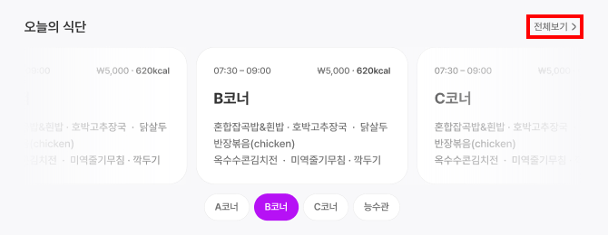
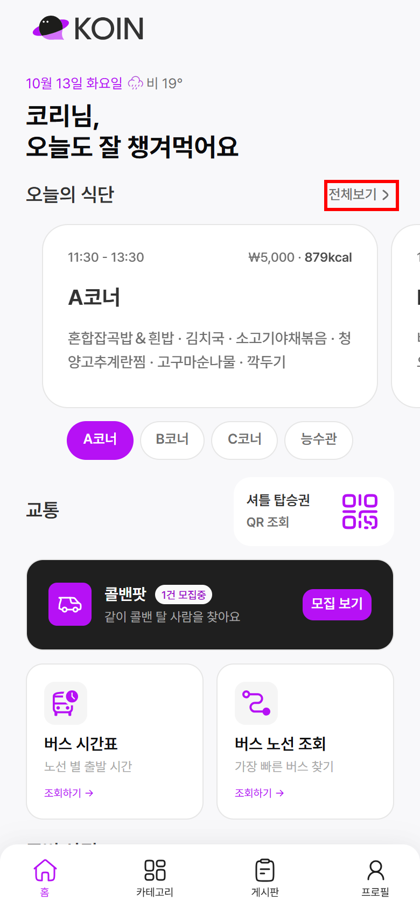

# 1-3 오늘의 식단 전체보기 클릭

원문 페이지 ID: 2430221954bc839da344811d15eaa112

> 원문 스냅샷. 명세 확정·앱 배포·수집 완료를 뜻하지 않습니다.

## 원문 속성

```json
{
  "platform": [
    "ANDROID",
    "IOS",
    "WEB"
  ],
  "url": "source-page-id:2430221954bc839da344811d15eaa112",
  "구분": "홈화면",
  "상태": "완료",
  "생성일": "2026-11-08T10:52:03.796Z",
  "이벤트 이름": "1-3 오늘의 식단 전체보기 클릭"
}
```

<callout icon="📌" color="blue_bg">
<b>현행 홈 로깅 기준 명세</b>

- 2026-11-04 사용자 결정으로 새 로깅을 이 페이지로 이관했다. 이전의 이 페이지 레거시 지정은 이 결정으로 대체한다.
- 이관 전 명세: 1-1.메인_식단_더보기버튼_클릭 (홈화면 리디자인 로깅으로 찍히고 있음) → 따라서  1-1부터 1-7까지 전부 다 수정할 필요 없음 (레거시) (원문 ID: 3df0221954bc833a9f6381766084d23b) — 레거시 보존.
- 현행 event\_label: <code>main__main__more__click</code>. 아래 ‘새 로깅’을 구현·전달 기준으로 사용한다.
</callout>

<details>
<summary>이전 로깅 · 참조 및 레거시 지정 이력 (현재 결정으로 대체됨)</summary>

<callout icon="📁" color="gray_bg">
<b>레거시 명세 · 이력 보존</b>

- 사용자 결정: 2026-11-04. 이 페이지는 레거시로 보존하며 별도 새 로깅 구현·추가 전송의 기준으로 사용하지 않는다.
- 관련 현행 기준 명세: 1-1.메인_식단_더보기버튼_클릭 (홈화면 리디자인 로깅으로 찍히고 있음) → 따라서  1-1부터 1-7까지 전부 다 수정할 필요 없음 (레거시) (원문 ID: 3df0221954bc833a9f6381766084d23b).
- 기존 label·value·category·사진·플랫폼과 원문은 이력으로 유지한다. 기준 명세와의 value/category 차이가 모두 해소되었다는 뜻은 아니며, 이 문서 정리로 실제 SDK 수집 중단이나 중복 제거가 확인된 것은 아니다.
</callout>

- event\_label : today\_meal
- value : 전체보기
- event\_category : click





<details>
<summary>기준 명세 참조 (레거시 이력)</summary>

이력의 WEB 전체·확대 사진은 아래 현행 새 로깅과 동일 파일이므로 중복 첨부만 정리했다. 현재 클릭 위치 사진은 이 페이지의 ‘새 로깅 (26.11.04)’ 참고사진에 보존하며 이관 전 원본은 기존 레거시 페이지에 보존한다.

<details>
<summary>검토사항 · 중복·연관 명세 참조 (26.11.01)</summary>

- WEB 참고사진 반영 (2026-11-04 사용자 요청 정정): 아래 새 WEB 캡처와 빨간 네모·확대본을 기준으로 클릭 위치를 확인한다. 리디자인 전 WEB 사진은 이력으로 보존하며 모바일 사진·명세와 이전 로깅은 유지한다.
- WEB 리디자인 반영 (2026-11-04 사용자 승인): WEB: 홈 ‘오늘 식단’ 영역 우측 ‘전체보기’ 클릭은 식단 페이지 진입이다. 기존 기준 명세의 more 라벨을 참조하고 별도 이벤트를 추가하지 않는다. 코너 전환·위젯 표시와 구분하며 원문의 value와 기준 명세의 시간대별 value 차이는 보존한다.
- WEB 설계 근거: [Figma 참고 / 실제 화면 미확인](https://www.figma.com/design/DPlcYuiFxhyT5ULbqec59i/KOIN-Web?node-id=11541-33352). 기존 사진은 교체하지 않았으며 리디자인 화면의 위치 근거로 사용하지 않는다. SDK 구현·배포 시점·실제 수집은 미확인이다. 이 WEB 규정은 해당 화면의 과거 WEB 설명보다 우선하며 모바일·이전 로깅·기존 필드 값·DB 플랫폼 속성은 보존한다.
- 메인 식단 전체보기/더보기: 현행 관련 명세 1-1.메인_식단_더보기버튼_클릭 (홈화면 리디자인 로깅으로 찍히고 있음) → 따라서  1-1부터 1-7까지 전부 다 수정할 필요 없음 (레거시) (원문 ID: 3df0221954bc833a9f6381766084d23b)를 참고한다.
- 홈 원문의 value 전체보기와 기준의 시간대별 value 형식은 다르다. 실제 호출 대응·value 마이그레이션 확인 전 동일 계약으로 등록하지 않는다.
- 사용자 요청에 따라 중복·연관 항목에는 별도 새 event\_label을 추가하지 않는다. 기존 원문·CAMPUS 지시·value·category·사진·DB 플랫폼과 상태를 보존한다. 레거시 보존 여부는 위 최신 사용자 결정에 따른다. SDK 중복 발화 여부와 실제 수집 중단 시점은 미확인이다.
- 같은 클릭에 문서 수만큼 이벤트를 추가하지 않는다. 실제 호출·플랫폼별 적용과 단일 전송은 개발 확인 필요다.
</details>

### 참고사진 (식단 전체보기 클릭)

<b>웹</b>

<details>
<summary>참고사진 · 웹</summary>

WEB 리디자인 · [Figma 시안](https://www.figma.com/design/DPlcYuiFxhyT5ULbqec59i/KOIN-Web?node-id=11541-33352) · 2026-11-04. 빨간 네모는 이 명세의 클릭 위치다. 원본 캡처에 코드로 테두리만 표시했으며 실제 서비스 캡처·배포 완료를 의미하지 않는다.

<b>전체 화면</b>

<b>클릭 위치 확대</b>
</details>

<b>모바일</b>

<details>
<summary>참고사진 · 모바일</summary>

이번 WEB 이미지 작업에서 별도 확인하지 않음. 기존 원문 사진과 모바일 명세는 그대로 보존한다.
</details>
</details>

<details>
<summary>구디자인 WEB 참고사진 이력 · 현행 WEB 기준 아님</summary>

새 로깅의 WEB 영역에서 분리한 기존 사진이다. 파일을 삭제하거나 변경하지 않았다.

<details>
<summary>이전 WEB 참고사진 (리디자인 전)</summary>

웹 — 메인 식단 더보기 클릭 (출처: stage 실제 캡처, 빨간 네모 = 클릭 위치)


</details>
</details>
</details>

<details>
<summary>새 로깅 (26.11.04)</summary>

- 설명: 홈 식단 영역의 전체보기·더보기 버튼을 눌러 식단 페이지로 진입할 때 기록한다. 일반 식단 카드 본문 클릭과 코너 선택은 포함하지 않는다. iOS 식단 없음 안내 카드의 공유 콜백은 검토사항의 예외를 따른다.
- screen\_view: <code>main</code>
- event\_name: <code>DA1</code>
- event\_label: <code>main__main__more__click</code>
- value: \{아침, 점심, 저녁\}\_더보기 (예: 점심\_더보기)
- event\_category: <code>click</code>

<details>
<summary>검토사항</summary>

- 클릭 영역 검증 (2026-11-05): Android HomeScreen·iOS HomeView·모바일웹 MobileHomeRedesign에서 전체보기와 일반 식단 카드 본문은 서로 다른 핸들러다. 이 홈 1-3은 전체보기·더보기, 식단 1-2 1-2.메인_식단_클릭 (원문 ID: 77e0221954bc82b7b9030139d648368f)는 일반 카드 본문으로 구분해 유지한다. 아래 ‘앱 위젯 전체/오늘·내일 클릭’이라는 포괄 설명은 구버전 기록이며 일반 카드 본문에 이 more 라벨을 함께 보내라는 뜻이 아니다. 라벨·value·event\_name·category·screen\_view·플랫폼·사진은 보존한다.
- iOS 빈 상태 예외: HomeDiningView의 EmptyDiningCard는 onTapAll을 공유하므로 today\_meal이 기록될 수 있다. 일반 DiningMenuCard의 onTapMenu와 구분한다. 빈 카드가 전체보기 계약에 포함되는지와 전환 시 처리는 개발 검증 대상으로 남기며 이번 작업에서 전송 조건을 추가하거나 SDK를 바꾸지 않는다.
- 코드 근거: [Android 전체보기/본문](https://github.com/BCSDLab/KOIN_ANDROID/blob/ee67a50f554030a76cfb7d8948b89d8efc806e9d/feature/home/src/main/java/in/koreatech/koin/feature/home/HomeScreen.kt#L207), [iOS 전체보기/본문](https://github.com/BCSDLab/KOIN_iOS/blob/f9286701b52668451840aa4b3432a3bcc8bd7aa8/Koin/Presentation/Home/Home/HomeView.swift#L51), [iOS 빈 카드](https://github.com/BCSDLab/KOIN_iOS/blob/f9286701b52668451840aa4b3432a3bcc8bd7aa8/Koin/Presentation/Home/Home/SubViews/DiningView/HomeDiningView.swift#L40), [모바일웹 전체보기](https://github.com/BCSDLab/KOIN_WEB_RECODE/blob/13f1a5d3c315a913b32b51a87e6700ea5b12d8d4/src/components/IndexComponents/HomePage/MobileHomeRedesign.tsx#L124).
- 식단 카드와 전체보기 중복 방지 (2026-11-05): WEB 리디자인의 전체보기는 이 홈 1-3만 적용하며 코너 선택이나 카드 본문 노출로 전송하지 않는다. 식단 1-2 1-2.메인_식단_클릭 (원문 ID: 77e0221954bc82b7b9030139d648368f)의 meal 라벨을 같은 전체보기 클릭에 함께 적용하지 않는다. 모바일 위젯 본문·오늘/내일 식단과 전체보기의 SDK 호출 경계는 미확인이므로 기존 앱 조건·값은 보존하고 추가 전송은 하지 않는다.
- WEB 사진 기준 정리 (2026-11-04 사용자 지시): 새 로깅의 WEB 참고사진에는 리디자인 시안만 둔다. 구디자인 WEB 사진은 이전 로깅 이력으로 이동했다. 리디자인에서 버튼이 확인되지 않으면 사진 없이 미확인으로 표시한다. 라벨·value·category·event\_name·screen\_view·플랫폼과 모바일 사진은 유지한다.
- 현행 기준 이관 (2026-11-04 사용자 지시): 1-1.메인_식단_더보기버튼_클릭 (홈화면 리디자인 로깅으로 찍히고 있음) → 따라서  1-1부터 1-7까지 전부 다 수정할 필요 없음 (레거시) (원문 ID: 3df0221954bc833a9f6381766084d23b)의 새 로깅 본문·사진을 이 페이지로 이관했다. 원본 페이지는 레거시로 보존하며 현행 기준은 이 홈 페이지다.
- 첫 구간 변경 (2026-11-04 사용자 지시): <code>cafeteria__main__more__click</code> → <code>main__main__more__click</code>. service\_name만 <code>main</code>으로 바꾸고 screen\_view·기능/detail·event\_name·value·category·발생 시점은 이관 원본대로 유지한다. 이전 홈 원문의 다른 value/category는 이전 로깅 이력이며 새 계약에 섞지 않는다.
- 적용 플랫폼은 이관 원본의 ANDROID / IOS / WEB 범위다. DB 플랫폼 속성은 변경하지 않았다. 실제 SDK 적용·배포·한 번 전송과 신규 라벨 수집은 미확인이다.
- 아래 과거 검토 메모의 변경 이력·동일 라벨 설명은 이관 전 계약에 대한 기록이다. 현재 적용 라벨과 기준 위치는 위 최신 결정이 우선한다. 문서 이관은 이벤트를 추가로 전송하라는 뜻이 아니다.
- WEB 참고사진 반영 (2026-11-04 사용자 요청 정정): 아래 새 WEB 캡처와 빨간 네모·확대본을 기준으로 클릭 위치를 확인한다. 리디자인 전 WEB 사진은 이력으로 보존하며 모바일 사진·명세와 이전 로깅은 유지한다.
- WEB 리디자인 반영 (2026-11-04 사용자 승인): WEB: 리디자인 홈 ‘오늘 식단’ 영역의 ‘전체보기’를 클릭해 식단 페이지로 진입할 때 적용한다. 코너 선택·카드 표시만으로 발생시키지 않는다. 기존 cafeteria\_\_main\_\_more\_\_click, DA1, 시간대별 value와 category는 유지한다. 모바일의 기존 오늘/내일 식단 위젯 정의는 유지한다.
- WEB 설계 근거: [Figma 참고 / 실제 화면 미확인](https://www.figma.com/design/DPlcYuiFxhyT5ULbqec59i/KOIN-Web?node-id=11541-33352). 기존 사진은 교체하지 않았으며 리디자인 화면의 위치 근거로 사용하지 않는다. SDK 구현·배포 시점·실제 수집은 미확인이다. 이 WEB 규정은 해당 화면의 과거 WEB 설명보다 우선하며 모바일·이전 로깅·기존 필드 값·DB 플랫폼 속성은 보존한다.
- 통합 가이드·후속: [로깅 통합 가이드](3c30221954bc8214b1c481c5bbb6fba5.md)
- 홈화면 리디자인 로깅으로 찍히고 있어 1-1\~1-7 수정 불필요 (페이지 제목 참고)
- 명세 중복 정리 (2026-10-27): <code>cafeteria__main__more__click</code>의 기준 명세는 [1-3 오늘의 식단 전체보기 클릭](2430221954bc839da344811d15eaa112.md). 기존 1-1의 같은 더보기 이벤트를 설명하는 중복 참고 명세다. 같은 사용자 동작은 한 번만 전송하며, 문서가 여러 개라는 이유로 추가 이벤트를 보내지 않는다. 기존 value·플랫폼·발생 시점은 유지한다.
- 참고사진 모바일 파일명이 caf\_1-1\_all\_mobile.png(전체 화면)이다. 사진 플랫폼 확인 완료 (이미지 비율 기준: 모바일 780x1688, 웹 1422x748)
</details>

### 참고사진 (메인 식단 더보기 클릭)

<b>웹</b>

<details>
<summary>참고사진 · 웹</summary>

WEB 리디자인 · [Figma 시안](https://www.figma.com/design/DPlcYuiFxhyT5ULbqec59i/KOIN-Web?node-id=11541-33352) · 2026-11-04. 빨간 네모는 이 명세의 클릭 위치다. 원본 캡처에 코드로 테두리만 표시했으며 실제 서비스 캡처·배포 완료를 의미하지 않는다.

<b>전체 화면</b>



<b>클릭 위치 확대</b>


</details>

<b>모바일</b>

<details>
<summary>참고사진 · 모바일</summary>

모바일 — 메인 식단 더보기 클릭 (출처: stage 실제 캡처, 빨간 네모 = 클릭 위치)


</details>
</details>
