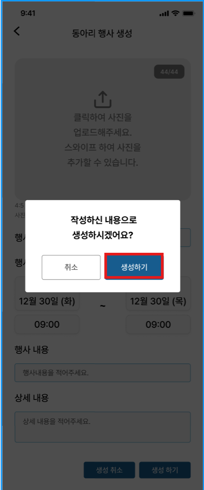
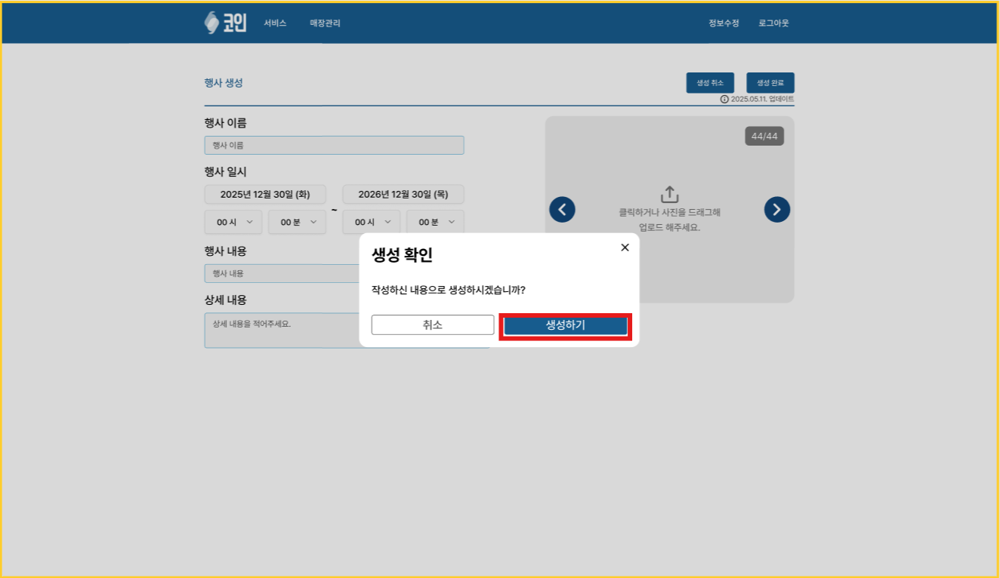

# 6.4동아리_행사생성확정 클릭

원문 페이지 ID: 24f0221954bc83f8915481e2d3dcd930

> 필터 밖 원본 행 복구 스냅샷. 중복·빈 페이지도 원본 ID와 속성, 본문을 개별 보존합니다. 명세 승인이나 앱 적용 완료를 뜻하지 않습니다.

대조 기록: [숨겨진 원본 42개 복구](../hidden-recovery.md)

관련 기존 보관본: [레거시 6.4동아리_행사생성확정 클릭](3160221954bc827e874f81cd040061d2.md), [레거시 6.4동아리_행사생성확정 클릭](0310221954bc83ab99c1014de82f0a4e.md)

## 원문 속성

```json
{
  "platform": [
    "ANDROID",
    "IOS",
    "WEB"
  ],
  "url": "source-page-id:24f0221954bc83f8915481e2d3dcd930",
  "상태": "로깅 필요",
  "이름": "6.4동아리\\_행사생성확정 클릭"
}
```

<ul>
<li>
설명: 동아리 행사 탭에서 행사 생성하기 클릭 후 생성 하기 클릭
</li>
<li>
event\_name : “CAMPUS”
</li>
<li>
event\_label : “club\_event\_confirm”
</li>
<li>
value : \{동아리명\}
</li>
<li>
event\_category : “click” 
</li>
<li>
참고사진
</li>
</ul>





- 웹 참고사진



