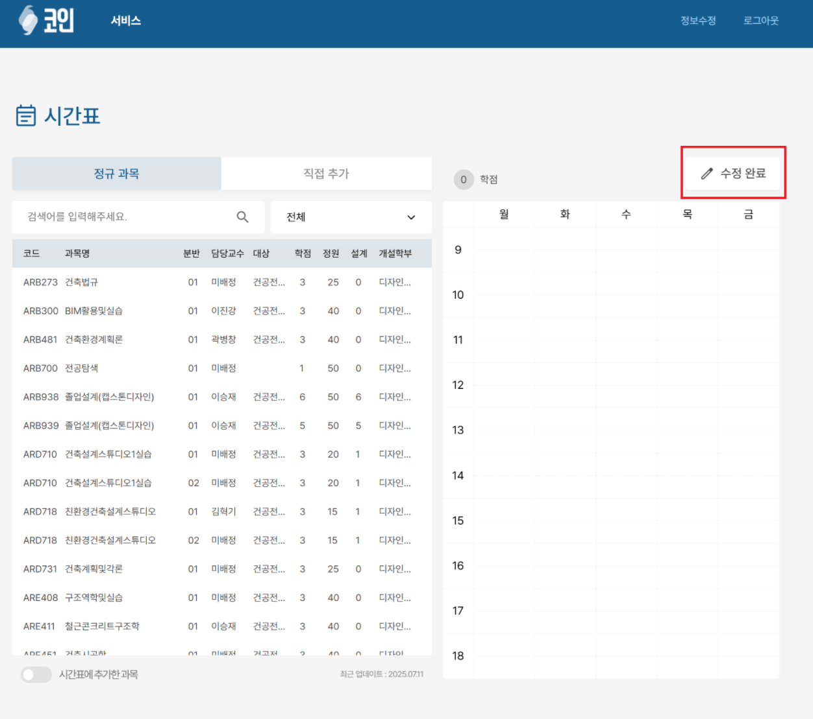
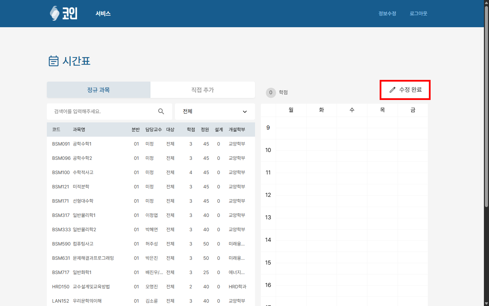

# 2-17. (웹) 시간표_수정 완료 (클릭)

원문 페이지 ID: 2610221954bc8399ad8801c10bc0a915

> 원문 스냅샷. 명세 확정·앱 배포·수집 완료를 뜻하지 않습니다.

## 원문 속성

```json
{
  "platform": [
    "WEB"
  ],
  "url": "source-page-id:2610221954bc8399ad8801c10bc0a915",
  "상태": "로깅 필요",
  "생성일": "2026-11-08T10:52:10.564Z",
  "이벤트 이름": "2-17. (웹) 시간표\\_수정 완료 (클릭)",
  "태그": [
    "시간표"
  ]
}
```

<details>
<summary>이전 로깅</summary>

- event\_label : “timetable”
- value : “수정 완료”
- event\_category : “click”
- 참고 이미지


</details>

<details>
<summary>새 로깅 (26.10.17)</summary>

- 설명: 웹 시간표 수정 화면 오른쪽 위 수정 완료 버튼을 눌러 수정을 끝내고 시간표 화면으로 돌아가는 경우
- screen\_view: <code>timetable_edit</code>
- event\_name: <code>DA1</code>
- event\_label: <code>timetable__timetable_edit__timetable_edit__confirm__click</code>
- value: 수정 완료
- event\_category: <code>click</code>

<details>
<summary>검토사항</summary>

- 통합 가이드·후속: [로깅 통합 가이드](3c30221954bc8214b1c481c5bbb6fba5.md)
- 모바일: 없음 (모바일은 시간표 수정 시 'PC환경만 지원합니다' 안내만 뜸)
- label DA2 기준 정렬 (2026-10-27): <code>timetable__timetable_edit__submit__click</code> → <code>timetable__timetable_edit__timetable_edit__confirm__click</code>
</details>

### 참고사진 (기능 표시)

<columns>
<column ratio="50">
<b>웹</b>

<details>
<summary>참고사진 · 웹</summary>

웹 — 수정 완료 (출처: stage 실제 캡처, 로그인 상태, 빨간 네모 = 클릭 위치)


</details>
</column>
<column ratio="50">
<b>모바일</b>

<details>
<summary>참고사진 · 모바일</summary>

해당 없음 (웹 전용)
</details>
</column>
</columns>
</details>
