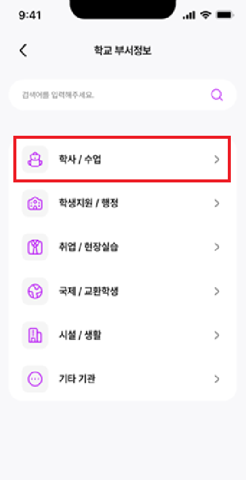
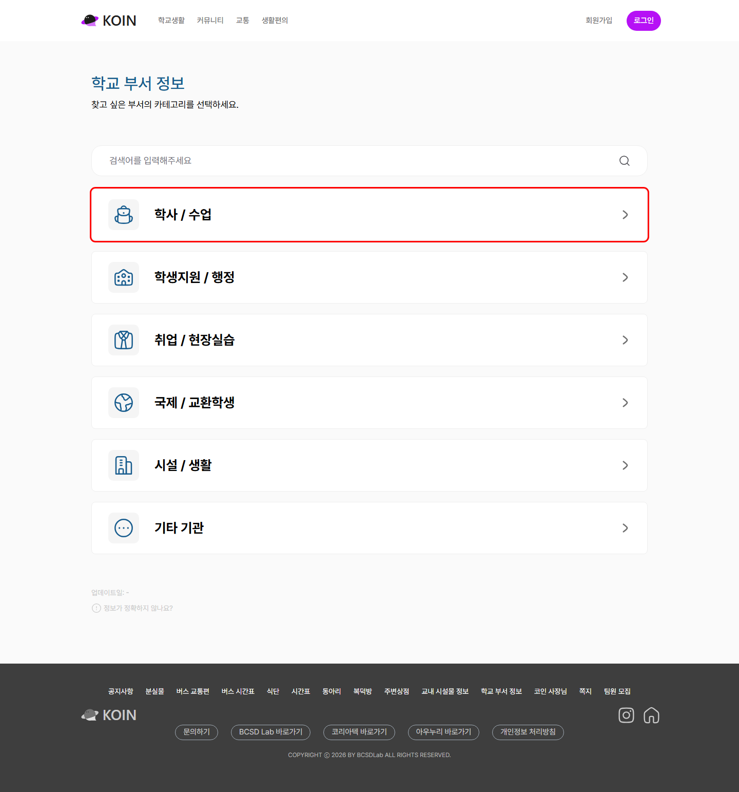
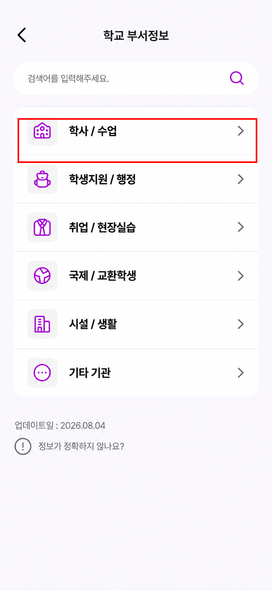

# 1-1 카테고리 클릭 

원문 페이지 ID: 2980221954bc83de9226016dbc7fee01

> 원문 스냅샷. 명세 확정·앱 배포·수집 완료를 뜻하지 않습니다.

## 원문 속성

```json
{
  "platform": [
    "ANDROID",
    "IOS",
    "WEB"
  ],
  "url": "source-page-id:2980221954bc83de9226016dbc7fee01",
  "구분": "학교 부서정보",
  "상태": "완료",
  "생성일": "2026-11-12T05:08:05.518Z",
  "이벤트 이름": "<p>\n1-1 카테고리 클릭 \n</p>"
}
```

<details>
<summary>과거 로깅</summary>

<p>
팀 : CAMPUS 
</p>

나머지 로깅들도 전부 CAMPUS로 해주세요\~\~


- event\_label : department\_category
- value : \{학사 / 수업\} or \{학생지원 / 행정\} or \{취업 / 현장실습\} 등등
- event\_category : click



</details>

<details>
<summary>새 로깅</summary>

- 설명: 부서 분류 선택 화면에서 학사/수업 등 분류 항목을 클릭한다.
- screen\_view: <code>department_main</code>
- event\_label: <code>department__department_main__department_category__click</code>
- event\_name: <code>DA2</code>
- value: \{학사 / 수업\} or \{학생지원 / 행정\} or \{취업 / 현장실습\} 등등
- event\_category: <code>click</code>

### 참고사진 (기능 표시)

<b>웹(데스크톱)</b>

<b>참고사진 · 웹 (Stage 실제 화면)</b>

2026-11-08 [Stage 실제 서비스](https://stage.koreatech.in/department) · PC 1440px 브라우저에서 직접 촬영했다. 빨간 테두리는 이 명세의 해당 버튼 위치다. 현재 WEB 위치는 이 실제 캡처를 우선한다. 모바일 이미지·로깅 필드·DB 플랫폼은 유지하며 SDK 전송·GA4 수집 검수 완료를 뜻하지 않는다.



<b>모바일 (ANDROID, IOS) / 캡처 출처는 아래 참조</b>

<b>참고사진 · 모바일</b>

화면 정의의 Android 실제 캡처(2026-10-13), 선명도 개선본. 이번 작업은 기존 캡처를 사용.


</details>
