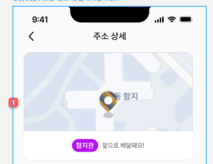

# 7-4 결제 → 교내 주문 페이지 교내 주소 맵 설정

원문 페이지 ID: 29f0221954bc834eae3081827a5d380a

> 원문 스냅샷. 명세 확정·앱 배포·수집 완료를 뜻하지 않습니다.

## 원문 속성

```json
{
  "platform": [
    "WEB"
  ],
  "url": "source-page-id:29f0221954bc834eae3081827a5d380a",
  "상태": "로깅 필요",
  "생성일": "2026-11-08T10:51:55.314Z",
  "이벤트 이름": "7-4 결제 → 교내 주문 페이지 교내 주소 맵 설정"
}
```




event\_params.key

<ul>
<li>
event\_label : payment\_campus\_map
</li>
<li>
value : 
</li>
<li>
event\_category :

- click
</li>
</ul>
