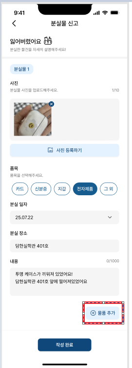

# 11-10.분실물_분실물신고_물품추가_클릭

원문 페이지 ID: 2a10221954bc82a5bd43813af587afdc

> 누락 원본 복구 스냅샷. 원본의 과거값·검토 기록을 보존하며 생성 계약으로 자동 승인하지 않습니다.

대조 기록: [87개 원본 복구 및 8개 차이 정리](../recovery-review.md)

관련 기존 보관본: [11-10.분실물_분실물신고_물품추가_클릭](d1e0221954bc8256aa1381a13a98a332.md), [11-10.분실물_분실물신고_물품추가_클릭](36f0221954bc837c87c001c99b06e9f6.md)

## 원문 속성

```json
{
  "platform": [
    "ANDROID",
    "IOS",
    "WEB"
  ],
  "url": "source-page-id:2a10221954bc82a5bd43813af587afdc",
  "상태": "완료",
  "이름": "11-10.분실물\\_분실물신고\\_물품추가\\_클릭"
}
```

- 설명: 분실물 신고 글쓰기 페이지에서 물품 추가를 클릭
- event\_label : “lost\_item\_add\_item”
- value : “물품 추가”
- event\_category : “click”
- 참고사진

mobile\_view, mobile\_Web\_view





WEB : 예시 화면이 습득물 신고인데 분실물 신고랑 기능이 동일해서 넣었습니다.


