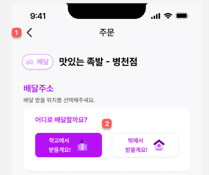

# 7-2 결제 페이지 배달 위치 클릭

원문 페이지 ID: 2ad0221954bc82e0a95401db3e457851

> 원문 스냅샷. 명세 확정·앱 배포·수집 완료를 뜻하지 않습니다.

## 원문 속성

```json
{
  "platform": [
    "WEB"
  ],
  "url": "source-page-id:2ad0221954bc82e0a95401db3e457851",
  "상태": "로깅 필요",
  "생성일": "2026-11-08T10:51:31.606Z",
  "이벤트 이름": "7-2 결제 페이지 배달 위치 클릭",
  "태그": [
    "7. 결제 페이지"
  ]
}
```




2번에 해당


event\_params.key

- event\_label : payment\_deliveryLocation
- value : 교내, 교외
- event\_category :
  - click
