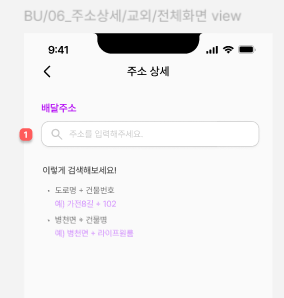

# 7-8 결제 → 교외 주문 페이지 이탈 

원문 페이지 ID: 2b10221954bc82499f00019b110dbe36

> 원문 스냅샷. 명세 확정·앱 배포·수집 완료를 뜻하지 않습니다.

## 원문 속성

```json
{
  "platform": [
    "WEB"
  ],
  "url": "source-page-id:2b10221954bc82499f00019b110dbe36",
  "상태": "로깅 필요",
  "생성일": "2026-11-08T10:51:31.632Z",
  "이벤트 이름": "<p>\n7-8 결제 → 교외 주문 페이지 이탈 \n</p>",
  "태그": [
    "7. 결제 페이지"
  ]
}
```




<p>
교외 주문 페이지에서 좌측 상단의 이탈 로깅입니다 
</p>


<span color="orange">event\_params.key</span>

<ul>
<li>
event\_label : payment\_off\_campus\_back
</li>
<li>
value : 
</li>
<li>
event\_category : 

<ul>
<li>
click 
</li>
<li>
swipe
</li>
</ul>
</li>
<li>
previous\_page : 교외
</li>
<li>
current\_page : 결제
</li>
<li>
duration\_time : 교외 페이지에서 머무르는 시간  
</li>
</ul>
