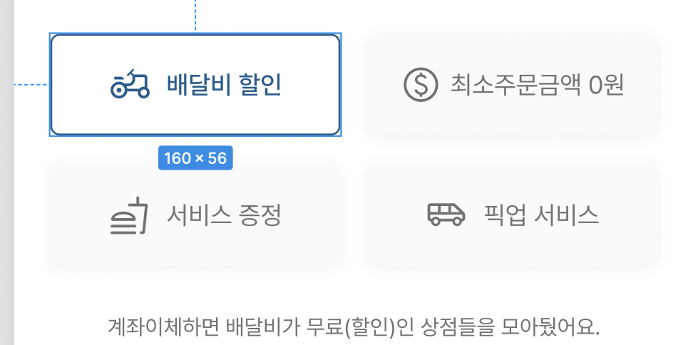

# 4-2 전화 주문 혜택 페이지 버튼 → 버튼 

원문 페이지 ID: 2b10221954bc82f186b101f212413511

> 원문 스냅샷. 명세 확정·앱 배포·수집 완료를 뜻하지 않습니다.

## 원문 속성

```json
{
  "platform": [
    "WEB",
    "ANDROID",
    "IOS"
  ],
  "url": "source-page-id:2b10221954bc82f186b101f212413511",
  "상태": "완료",
  "생성일": "2026-11-12T05:07:45.441Z",
  "이벤트 이름": "<p>\n4-2 전화 주문 혜택 페이지 버튼 → 버튼 \n</p>",
  "태그": [
    "4. 혜택 페이지"
  ]
}
```


<span color="orange">event\_params.key</span>

<ul>
<li>
event\_label : benefit\_shop\_categories
</li>
<li>
value : \{버튼\}   //  (배달비, 최소주문금액, 서비스, 픽업) 
</li>
<li>
event\_category : click <br />
</li>
<li>
previous\_page : \{이전카테고리\}
</li>
<li>
current\_page : \{현재 카테고리\}
</li>
<li>
duration\_time : 이전 카테고리에서 현 카테고리로 이동하는 시간 
</li>
</ul>





