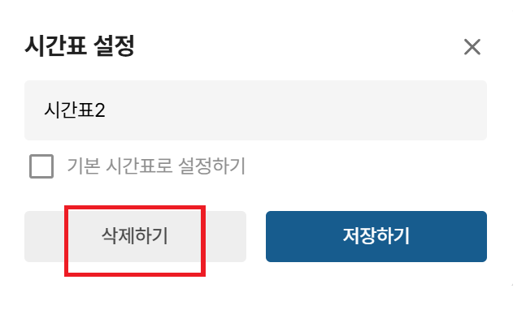
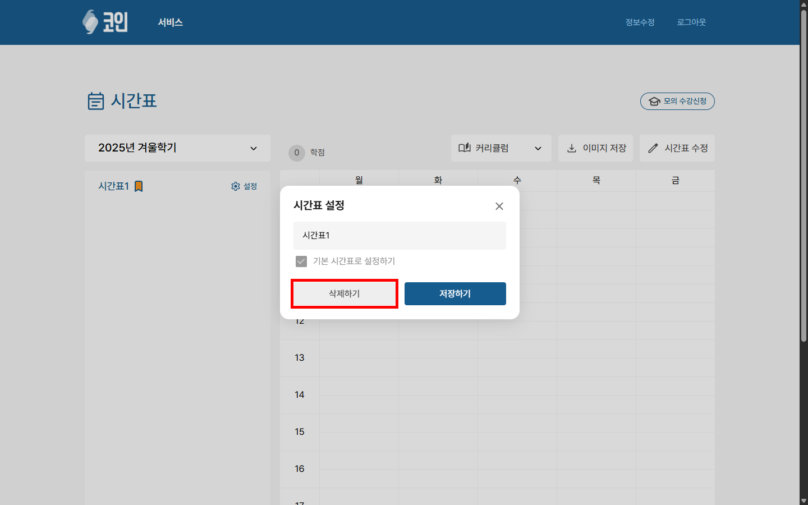
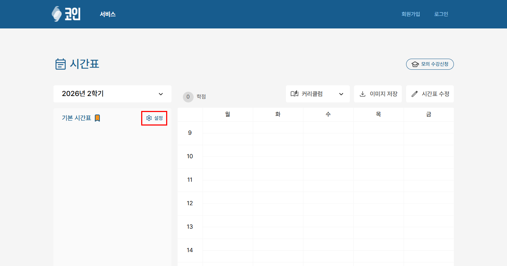

# 2-16. (웹) 시간표_삭제 (클릭)

원문 페이지 ID: 2c30221954bc8382bf6e0164facd4336

> 원문 스냅샷. 명세 확정·앱 배포·수집 완료를 뜻하지 않습니다.

## 원문 속성

```json
{
  "platform": [
    "WEB"
  ],
  "url": "source-page-id:2c30221954bc8382bf6e0164facd4336",
  "상태": "로깅 필요",
  "생성일": "2026-11-12T05:08:07.497Z",
  "이벤트 이름": "2-16. (웹) 시간표\\_삭제 (클릭)",
  "태그": [
    "시간표"
  ]
}
```

<details>
<summary>이전 로깅</summary>

- event\_label : “timetable”
- value : “삭제하기”
- event\_category : “click”
- 참고 이미지


</details>

<details>
<summary>새 로깅 (26.10.17)</summary>

- 설명: 웹 시간표 화면 시간표 목록의 설정 → 시간표 설정 팝업에서 삭제하기를 눌러 시간표를 지우는 경우
- screen\_view: <code>timetable</code>
- event\_name: <code>DA1</code>
- event\_label: <code>timetable__timetable__timetable_config__delete__click</code>
- value: 삭제하기
- event\_category: <code>click</code>

<details>
<summary>검토사항</summary>

- 통합 가이드·후속: 원문 (원문 ID: 4129ae650b598060bb4bdf347b7d4c7a)
- 모바일: 없음
- label DA2 기준 정렬 (2026-10-27): <code>timetable__timetable__setting__delete__click</code> → <code>timetable__timetable__timetable_config__delete__click</code>
</details>

### 참고사진 (기능 표시)

<columns>
<column ratio="50">
<b>웹</b>

<details>
<summary>참고사진 · 웹</summary>

웹 — 시간표 설정 팝업의 삭제하기 (출처: stage 실제 캡처, 로그인 상태, 빨간 네모 = 클릭 위치 / 시간표 설정 팝업)



웹 — 시간표 설정 버튼 (출처: stage 실제 캡처, 빨간 네모 = 시간표 설정 팝업을 여는 설정 버튼)


</details>
</column>
<column ratio="50">
<b>모바일</b>

<details>
<summary>참고사진 · 모바일</summary>

해당 없음 (웹 전용)
</details>
</column>
</columns>
</details>
