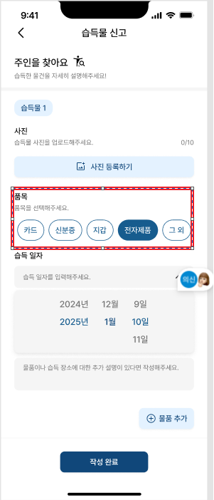
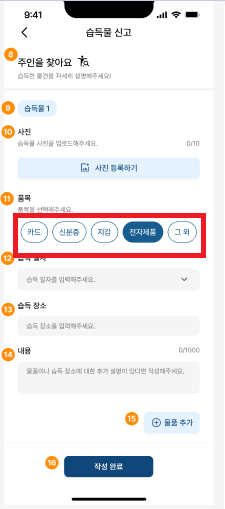

# 11-2.분실물_습득물신고_품목선택_클릭

원문 페이지 ID: 2c40221954bc82ea8ee1816775d44869

> 사용자 제공 ZIP 내보내기 보관본. 레거시·동결·검토 상태는 원문을 따르며 코드 생성 승인·앱 배포 완료를 뜻하지 않습니다.

platform: ANDROID, IOS, WEB
상태: 완료

- 설명: 습득물 신고 글쓰기 페이지에서 ‘품목을 선택해주세요.’ 버튼을 클릭하여 품목을 선택
- event_label : “find_user_category”
- value : {”카드”, ”신분증”, ”지갑”, ”전자제품”, ”~~그 외~~”} 5가지 값을 추가
- → “그 외”를 “기타”로 변경(2025-02-23)
- event_category : “click”
- 참고사진

WEB Mobile View

