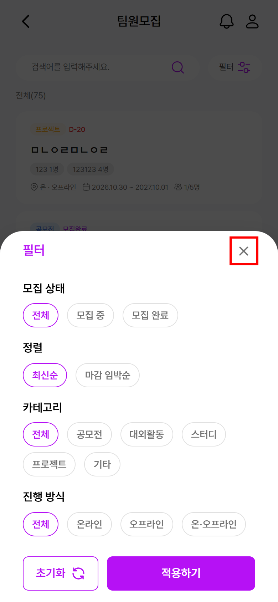

# 2-2. 필터 닫기 (클릭) - 추가된 로깅

원문 페이지 ID: 2c60221954bc833b859781bda5dc7821

> 원문 스냅샷. 명세 확정·앱 배포·수집 완료를 뜻하지 않습니다.

## 원문 속성

```json
{
  "platform": [
    "WEB",
    "ANDROID",
    "IOS"
  ],
  "url": "source-page-id:2c60221954bc833b859781bda5dc7821",
  "구분": "모집글 검색 및 필터",
  "상태": "로깅 필요",
  "생성일": "2026-11-08T10:52:09.401Z",
  "이벤트 이름": "2-2. 필터 닫기 (클릭) - 추가된 로깅"
}
```

<details>
<summary>이전 로깅</summary>

- 없음 (새로 추가한 로깅)
</details>

<details>
<summary>새 로깅 (26.10.17)</summary>

- 설명: 팀원 모집 목록 화면의 필터 팝업에서 오른쪽 위 X(닫기) 버튼을 클릭해 필터를 적용하지 않고 팝업을 닫는 경우
- screen\_view: <code>team_list</code>
- event\_name: <code>DA1</code>
- event\_label: <code>team_recruit__team_list__filter__close__click</code>
- value: 닫기
- event\_category: <code>click</code>

<details>
<summary>검토사항</summary>

- 통합 가이드·후속: [로깅 통합 가이드](3c30221954bc8214b1c481c5bbb6fba5.md)
- 웹 사진 추가 필요 (파일명 기준 모바일 캡처 1장만 있음)
</details>

### 참고사진 (필터 닫기)

<columns>
<column ratio="50">
<b>웹</b>

<details>
<summary>참고사진 · 웹</summary>

웹 — 사진 없음 (추가 필요)
</details>
</column>
<column ratio="50">
<b>모바일</b>

<details>
<summary>참고사진 · 모바일</summary>

모바일 — 필터 닫기 (출처: stage 실제 캡처, 빨간 네모 = 클릭 위치)


</details>
</column>
</columns>
</details>
