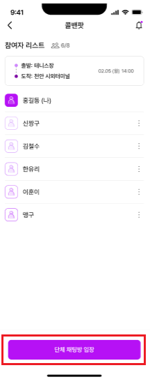
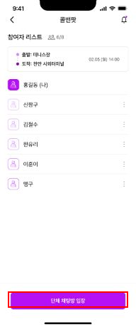

# 2-10 콜밴팟 채팅방 입장 클릭

원문 페이지 ID: 2f10221954bc8216b5690122e2276dd8

> 원문 스냅샷. 명세 확정·앱 배포·수집 완료를 뜻하지 않습니다.

## 원문 속성

```json
{
  "platform": [
    "ANDROID",
    "IOS"
  ],
  "url": "source-page-id:2f10221954bc8216b5690122e2276dd8",
  "상태": "로깅 필요",
  "이름": "2-10 콜밴팟 채팅방 입장 클릭",
  "태그": [
    "2. 콜밴팟 찾기"
  ]
}
```

<details>
<summary>과거 로깅</summary>


<ul>
<li>
event\_name : CAMPUS
</li>
<li>
event\_category : click
</li>
<li>
event\_label : callvan\_chat\_entry
</li>
<li>
value : 
</li>
</ul>



</details>

<details>
<summary>새 로깅</summary>

- 설명: 콜밴팟 참여자 목록의 단체 채팅방 입장 버튼을 클릭한다.
- screen\_view: <code>callvan_participant_list</code>
- event\_label: <code>callvan__callvan_participant_list__callvan_chat__participant_entry__click</code>
- event\_name: <code>DA2</code>
- value: 기존 미기재 유지
- event\_category: <code>click</code>

### 참고사진 (기능 표시)

<b>모바일 (ANDROID, IOS) / 캡처 출처는 아래 참조</b>

<b>참고사진 · 모바일</b>

Figma 참고 / 실제 화면 미확인. 사용자 확정에 따라 기존 사진을 유지하며 실제 캡처 교체를 대기 조건으로 두지 않는다. 앱 프레임 48921-194643.


</details>
