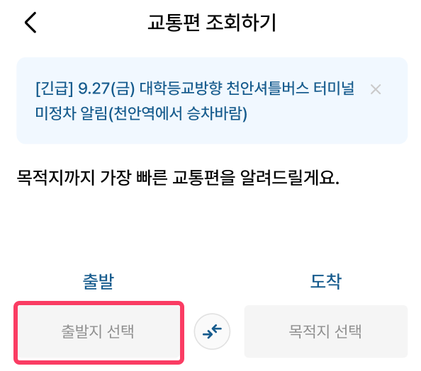
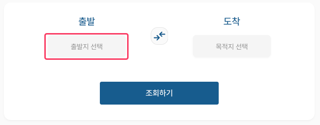
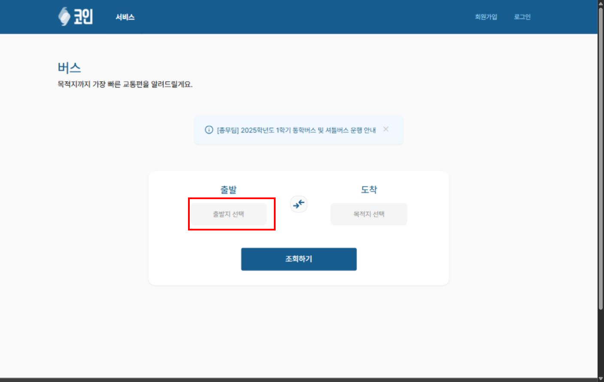
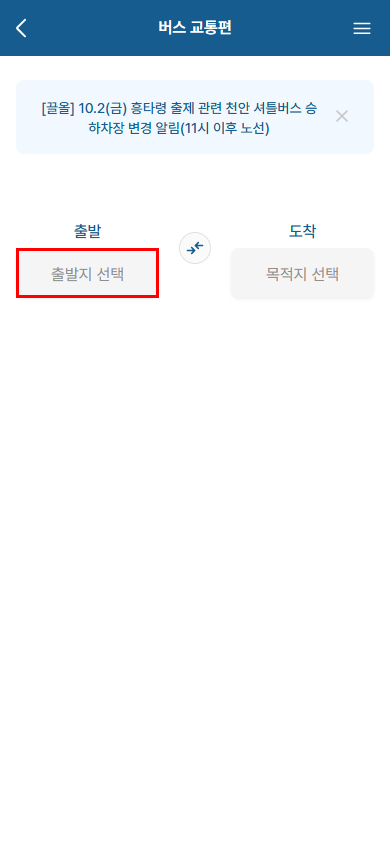

# 5-1. 출발지 박스_클릭

원문 페이지 ID: 30e0221954bc82ca8aa20106c9b7da03

> 원문 스냅샷. 명세 확정·앱 배포·수집 완료를 뜻하지 않습니다.

## 원문 속성

```json
{
  "platform": [
    "ANDROID",
    "IOS",
    "WEB"
  ],
  "url": "source-page-id:30e0221954bc82ca8aa20106c9b7da03",
  "구분": "출발지",
  "상태": "완료",
  "생성일": "2026-11-08T10:51:42.540Z",
  "이벤트 이름": "5-1. 출발지 박스\\_클릭",
  "태그": [
    "5. 교통편 조회하기"
  ]
}
```

<details>
<summary>이전 로깅</summary>

- event\_label : “departure\_box”
- value : “출발지 선택”
- event\_category : “click”
- 참고사진





AND, IOS, WEB(Mobile view)





WEB

</details>

<details>
<summary>새 로깅 (26.10.17)</summary>

- 설명: 버스 교통편 화면에서 출발지 선택 박스를 클릭하는 경우
- screen\_view: <code>bus_search</code>
- event\_name: <code>DA1</code>
- event\_label: <code>bus__bus_search__search__departure_open__click</code>
- value: 출발지 선택
- event\_category: <code>click</code>

<details>
<summary>검토사항</summary>

- 통합 가이드: [로깅 통합 가이드](3c30221954bc8214b1c481c5bbb6fba5.md)
- 웹/모바일 참고사진 추가 완료 (stage 캡처에 빨간 네모, 2026-10-28).
- label DA2 기준 정렬 (2026-10-27): <code>bus__bus_search__departure__click</code> → <code>bus__bus_search__search__departure_open__click</code>
</details>

### 참고사진 (기능 표시)

<columns>
<column ratio="50">
<b>웹</b>

<details>
<summary>참고사진 · 웹</summary>





WEB · 빨간 네모: 출발지 선택 박스 클릭. stage 실제 화면 캡처에 위치 표시.

</details>
</column>
<column ratio="50">
<b>모바일</b>

<details>
<summary>참고사진 · 모바일</summary>





모바일 웹 · 운영 [https://koreatech.in/bus/route](https://koreatech.in/bus/route) 실제 파란색 화면을 2026-10-30에 캡처. 빨간 테두리: 출발지 선택 박스. Android/iOS 네이티브 앱 캡처가 아니며 SDK 발화·한 번 전송은 미확인.

</details>
</column>
</columns>
</details>
