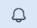
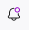

# 1-1 알림 클릭

원문 페이지 ID: 3110221954bc83c99b5381d4df9de7ae

> 원문 스냅샷. 명세 확정·앱 배포·수집 완료를 뜻하지 않습니다.

## 원문 속성

```json
{
  "platform": [
    "ANDROID",
    "IOS"
  ],
  "url": "source-page-id:3110221954bc83c99b5381d4df9de7ae",
  "구분": "홈화면",
  "상태": "완료",
  "생성일": "2026-11-08T10:52:02.148Z",
  "이벤트 이름": "1-1 알림 클릭"
}
```

- event\_label : notification
- value : 알림 아이콘
- event\_category : click







<details>
<summary>새 로깅 (26.11.01)</summary>

<b>알림 아이콘</b>

- 설명: 메인 화면의 알림 아이콘을 눌러 공용 알림 목록으로 들어갈 때 클릭 1회를 기록한다.
- screen\_view: <code>main</code>
- event\_name: <code>DA2</code>
- event\_label: <code>main__main__notification_list__entry__click</code>
- value: 알림 아이콘
- event\_category: <code>click</code>

<details>
<summary>검토사항</summary>

- 사용자 승인 (2026-11-01): 기존 동작을 공통 네이밍 형식으로 정리하고 새 명세의 event\_name을 DA2로 통일했다. 기존 CAMPUS 지시와 과거 label·value·category·사진은 위 원문에 보존한다. 새 사용자 동작이나 추가 전송을 만드는 작업이 아니다.
- 이전 → 새 label: <code>notification</code> → <code>main__main__notification_list__entry__click</code>.
- 기존 click category·고정 value·선택값 의미·클릭 시점을 유지한다. 기존 DB 플랫폼 속성을 보존했으며, 실제 지원 플랫폼·SDK 적용·배포·한 번 전송은 미확인이다.
- 공용 알림·하단 네비게이션의 service는 main이다. 담당자 event\_name DA2와 구분한다.
- 참고사진은 위 기존 사진을 그대로 참조한다. 이 작업에서 촬영·교체·플랫폼 재분류하지 않았다.
- 기준: [로깅 통합 가이드](3c30221954bc8214b1c481c5bbb6fba5.md), [event_label 기능·행동 네이밍 사전](38b0221954bc831b912c012d8af2c857.md), [화면 정의 및 로깅 검수](0e40221954bc823d92c301f83b5f68d0.md).
</details>
</details>
