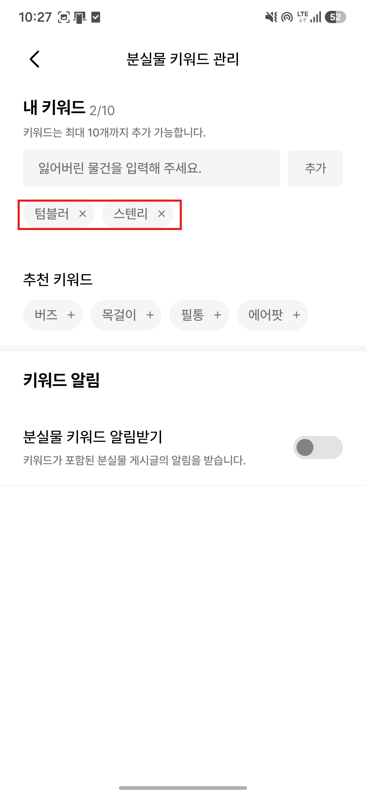

# 12-5. 키워드 삭제_클릭

원문 페이지 ID: 3190221954bc8304a7f3019766eafe36

> 원문 스냅샷. 명세 확정·앱 배포·수집 완료를 뜻하지 않습니다.

## 원문 속성

```json
{
  "platform": [
    "ANDROID",
    "IOS"
  ],
  "url": "source-page-id:3190221954bc8304a7f3019766eafe36",
  "상태": "로깅 필요",
  "이름": "12-5. 키워드 삭제\\_클릭",
  "태그": [
    "12. 분실물 키워드"
  ]
}
```

<details>
<summary>이전 로깅</summary>

- 설명: 설정된 키워드 삭제 클릭
- event\_label: “lost\_item\_keyword\_remove”
- value: 설정된 키워드 이름
- event\_category: “click”
- 참고사진


</details>

<details>
<summary>새 로깅 (26.10.12) — 초안</summary>

- 설명: 설정된 키워드 삭제 클릭
- screen\_view: <code>lost_item_keyword_manage</code>
- event\_name: <code>DA2</code>
- event\_label: <code>board__lost_item_keyword_manage__keyword_manage__delete__click</code>
- value: \{삭제한 키워드\}
- event\_category: <code>click</code>

<details>
<summary>검토사항</summary>

- label 통일 (2026-10-27): <code>board__lost_item_keyword_manage__keyword_manage__delete_click</code> → <code>board__lost_item_keyword_manage__keyword_manage__delete__click</code>
</details>

### 참고사진 (기능 표시)

<columns>
<column ratio="50">
<b>웹</b>

화면 정의에 웹 화면 없음.
</column>
<column ratio="50">
<b>모바일</b>

<details>
<summary>참고사진 · 모바일</summary>

<p>
모바일 — 등록된 키워드의 삭제. 2026-10-16 사용자가 현재 버전 캡처로 수정 완료한 사진을 유지한다. 
</p>


</details>
</column>
</columns>
</details>


