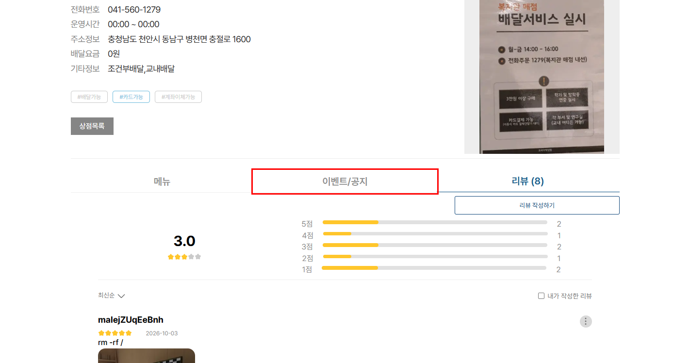
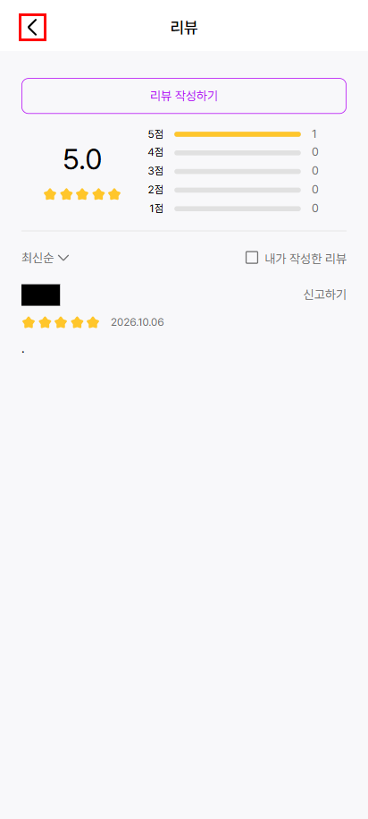

# 3-16~18 상점상세 리뷰 탭 탈출 (클릭) 

원문 페이지 ID: 3220221954bc8240966f81627023511f

> 원문 스냅샷. 명세 확정·앱 배포·수집 완료를 뜻하지 않습니다.

## 원문 속성

```json
{
  "platform": [
    "WEB",
    "ANDROID",
    "IOS"
  ],
  "url": "source-page-id:3220221954bc8240966f81627023511f",
  "상태": "완료",
  "생성일": "2026-11-12T05:07:36.089Z",
  "이벤트 이름": "<p>\n3-16\\~18 상점상세 리뷰 탭 탈출 (클릭) \n</p>",
  "태그": [
    "3. 상점 상세 페이지"
  ]
}
```

<details>
<summary>과거 로깅</summary>

<span color="orange">event\_params.key</span>

<ul>
<li>
event\_label : shop\_detail\_view\_review\_back
</li>
<li>
value : \{상점이름\} 
</li>
<li>
event\_category : 

- click
- click
- click<br />
</li>
<li>
previous\_page : 리뷰
</li>
<li>
current\_page : 

<ul>
<li>
\{탭\} (메뉴, 이벤트/공지) 
</li>
<li>
전화
</li>
<li>
\{카테고리\}
</li>
</ul>
</li>
<li>
duration\_time : 리뷰페이지에서 머무르는 시간  
</li>
</ul>


---


<h3>
문제 
</h3>


<p>
ios : 시간이 겹쳐서 찍히고 있는시점. 
</p>
</details>

<details>
<summary>새 로깅</summary>

- <b>설명:</b> 리뷰 화면 또는 리뷰 영역에서 버튼 클릭이나 iOS 뒤로가기 스와이프로 실제 이동했을 때 리뷰 이탈을 1회 기록한다. 독립 리뷰 화면에서는 뒤로가기 후 복귀한 화면을 기준으로 하며, 현재 UI에 없는 탭 전환은 포함하지 않는다. 취소된 스와이프는 기록하지 않는다.
- screen\_view: <code>shop_detail</code>
- event\_name: <code>DA1</code>
- event\_label: <code>shop__shop_detail__navigation__review_exit__click / shop__shop_detail__navigation__review_exit__swipe (iOS만 해당)</code>
- value: 뒤로가기 / 스와이프
- event\_category: <code>click / swipe (iOS만 해당)</code>

### 참고사진 (리뷰 탭 이탈)

<columns>
<column ratio="62.5">
<b>웹</b>

<b>참고사진 · 웹</b>

웹 — 리뷰 탭에서 이벤트/공지로 이동 예시 (출처: stage 실제 캡처, 빨간 네모 = 클릭 위치)




</column>
<column ratio="37.5">
<b>모바일</b>

<b>참고사진 · 모바일</b>





모바일 웹 · 운영 왕십리야식 보라색 리디자인 리뷰 화면. 빨간 테두리=뒤로가기. 현행 UI는 독립 리뷰 화면이며 과거 탭 전환 UI와 구분한다. 닉네임 검은색 마스킹.


구버전 모바일 사진을 제거하고 현행 보라색 모바일 웹 사진으로 보완했다.
</column>
</columns>
</details>


