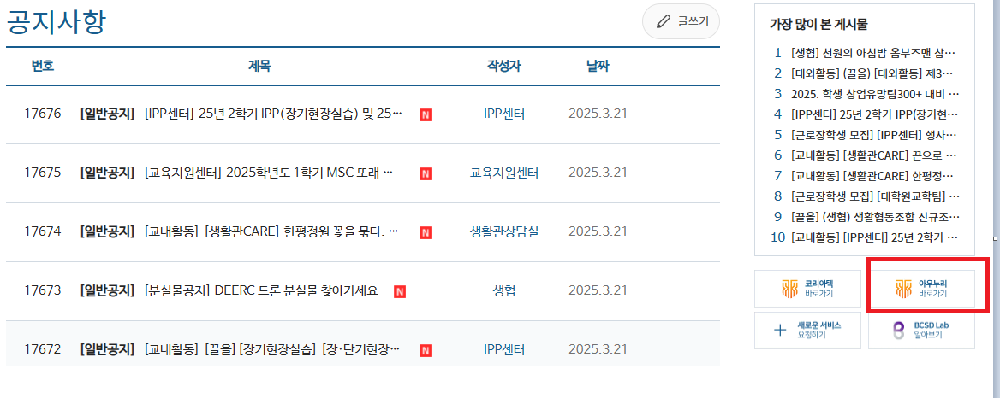

# 3-3. 공지사항_아우누리 바로가기_클릭

원문 페이지 ID: 3310221954bc83f48d500138f0d9b2a6

> 누락 원본 복구 스냅샷. 원본의 과거값·검토 기록을 보존하며 생성 계약으로 자동 승인하지 않습니다.

대조 기록: [87개 원본 복구 및 8개 차이 정리](../recovery-review.md)

관련 기존 보관본: [3-3. 공지사항_아우누리 바로가기_클릭](a460221954bc82aa8e1881676f81d484.md), [3-3. 공지사항_아우누리 바로가기_클릭](d540221954bc83ba95c7015aa20d2937.md)

## 원문 속성

```json
{
  "platform": [
    "WEB"
  ],
  "url": "source-page-id:3310221954bc83f48d500138f0d9b2a6",
  "상태": "완료",
  "이름": "3-3. 공지사항\\_아우누리 바로가기\\_클릭"
}
```

- 설명: 공지사항 페이지 에서 아우누리 바로가기 클릭
- event\_label : “short\_cut”
- value : “\{바로가기 타이틀\}”
- event\_category : “click”
- 참고사진



