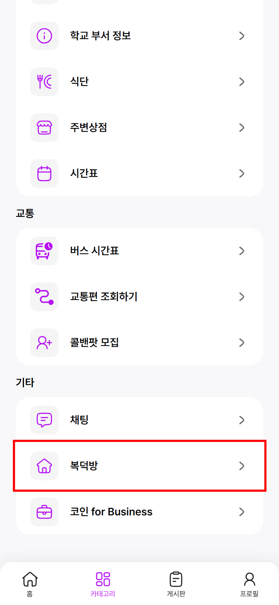

# 1-4 카테고리_복덕방 진입 (클릭) - 추가된 로깅

원문 페이지 ID: 3460221954bc821ba40201902750e7d8

> 원문 스냅샷. 명세 확정·앱 배포·수집 완료를 뜻하지 않습니다.

## 원문 속성

```json
{
  "platform": [
    "ANDROID",
    "IOS"
  ],
  "url": "source-page-id:3460221954bc821ba40201902750e7d8",
  "상태": "로깅 필요",
  "생성일": "2026-11-08T10:51:50.660Z",
  "이벤트 이름": "1-4 카테고리\\_복덕방 진입 (클릭) - 추가된 로깅"
}
```

<details>
<summary>이전 로깅</summary>

- 없음 (새로 추가한 로깅)
</details>

<details>
<summary>새 로깅 (26.10.17)</summary>

- 설명: 하단 네비게이션바 카테고리 화면에서 복덕방을 클릭해 복덕방 목록 화면으로 들어가는 경우
- screen\_view: <code>main_category</code>
- event\_name: <code>DA1</code>
- event\_label: <code>real_estate__main_category__real_estate_entry__category_entry__click</code>
- value: 복덕방
- event\_category: <code>click</code>

<details>
<summary>검토사항</summary>

- 통합 가이드: [로깅 통합 가이드](3c30221954bc8214b1c481c5bbb6fba5.md)
- 이 페이지는 ANDROID·IOS 앱 카테고리 진입 명세다. WEB 적용이 없다는 표기는 이 페이지의 플랫폼 범위를 뜻한다. 같은 라벨을 사용하는 모바일 웹 메뉴 경로는 [1-3 햄버거_복덕방 진입 (클릭)](9a60221954bc826a9ac60157bd796900.md)에서 별도로 설명하며, 웹 기능 자체가 없다는 뜻은 아니다. 실제 호출·한 번 전송은 미확인이다.
- 명세 중복 정리 (2026-10-27): <code>real_estate__main_category__real_estate_entry__category_entry__click</code>의 기준 명세는 [1-4 카테고리_복덕방 진입 (클릭) - 추가된 로깅](3460221954bc821ba40201902750e7d8.md). 서비스 진입 목적은 같고 웹 메뉴·앱 카테고리 등 플랫폼별 경로는 각 원문을 따른다. 같은 사용자 동작은 한 번만 전송하며, 문서가 여러 개라는 이유로 추가 이벤트를 보내지 않는다. 기존 value·플랫폼·발생 시점은 유지한다.
- label DA2 기준 정렬 (2026-10-27): <code>real_estate__main_category__entry__click</code> → <code>real_estate__main_category__real_estate_entry__category_entry__click</code>
</details>

### 참고사진 (카테고리 화면 복덕방)

<columns>
<column ratio="50">
<b>웹</b>

<details>
<summary>참고사진 · 웹</summary>

웹 — 앱 전용 화면 (웹 없음), 해당 없음
</details>
</column>
<column ratio="50">
<b>모바일</b>

<details>
<summary>참고사진 · 모바일</summary>

모바일 — 카테고리 복덕방 진입 (출처: stage 실제 캡처, 빨간 네모 = 클릭 위치)


</details>
</column>
</columns>
</details>
