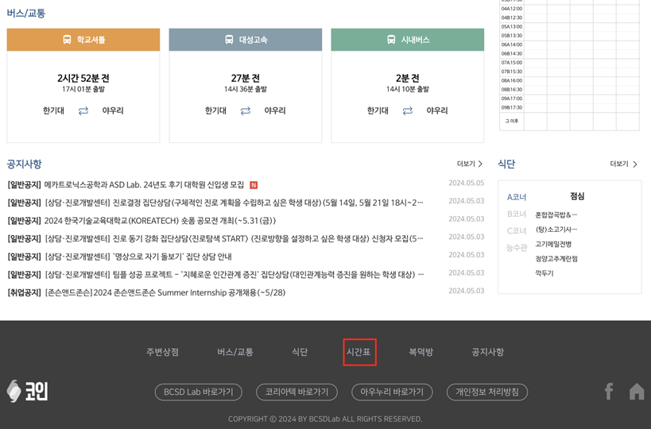
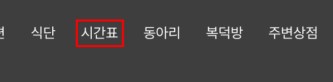
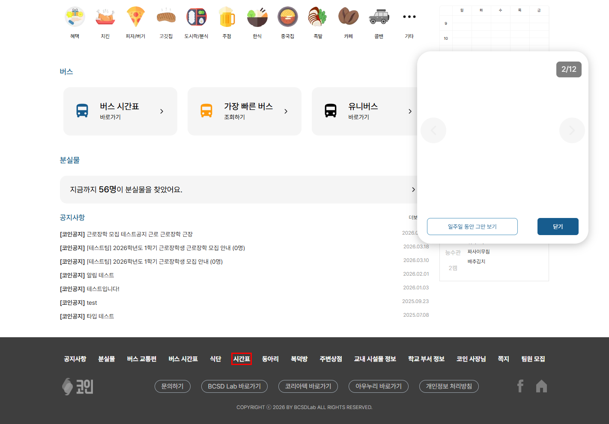

# 2-4. (웹) 푸터_시간표

원문 페이지 ID: 3460221954bc8302a0de01bf97cf6070

> 원문 스냅샷. 명세 확정·앱 배포·수집 완료를 뜻하지 않습니다.

## 원문 속성

```json
{
  "platform": [
    "WEB"
  ],
  "url": "source-page-id:3460221954bc8302a0de01bf97cf6070",
  "상태": "완료",
  "생성일": "2026-11-08T10:52:11.963Z",
  "이벤트 이름": "2-4. (웹) 푸터\\_시간표",
  "태그": [
    "시간표"
  ]
}
```

<details>
<summary>이전 로깅</summary>

- event\_label : “footer”
- value : “시간표”
- event\_category : “click”
- 참고 이미지


</details>

<details>
<summary>새 로깅 (26.10.17)</summary>

- 설명: 웹 하단 푸터의 서비스 링크에서 시간표를 클릭해 시간표 화면으로 들어가는 경우
- screen\_view: <code>footer</code>
- event\_name: <code>DA1</code>
- event\_label: <code>timetable__footer__timetable_entry__footer_entry__click</code>
- value: 시간표
- event\_category: <code>click</code>

<details>
<summary>검토사항</summary>

- screen\_view 확정 (2026-10-30 상민 직접 지시): event\_label의 두 번째 구간과 같은 <code>footer</code> 고정값을 사용한다. 이전 동적 화면명 표기안은 이 결정으로 대체한다. 라벨·category·value·발생 시점·플랫폼·사진은 유지하며 SDK 적용·실제 전송·한 번 전송은 미확인이다.
- 통합 가이드·후속: [로깅 통합 가이드](3c30221954bc8214b1c481c5bbb6fba5.md)
- 모바일: 없음
- label DA2 기준 정렬 (2026-10-27): <code>timetable__footer__entry__click</code> → <code>timetable__footer__timetable_entry__footer_entry__click</code>
</details>

### 참고사진 (WEB 리디자인 · 푸터 시간표)

<b>웹</b>

<details>
<summary>참고사진 · 웹</summary>

[Figma 원본](https://www.figma.com/design/DPlcYuiFxhyT5ULbqec59i/KOIN-Web?node-id=17664-28870) · 2026-11-04. 원본 캡처에 빨간 네모만 추가했다. 빨간 네모는 기존 명세의 시간표 클릭 위치다. 실제 SDK 적용·배포·전송은 미확인이다.


<b>클릭 위치 확대</b>


</details>

<b>기존 참고사진 (과거 디자인·원문 보존)</b>

### 참고사진 (기능 표시)

<columns>
<column ratio="50">
<b>웹</b>

<details>
<summary>참고사진 · 웹</summary>

웹 — 푸터의 시간표 (출처: stage 실제 캡처, 빨간 네모 = 클릭 위치)


</details>
</column>
<column ratio="50">
<b>모바일</b>

<details>
<summary>참고사진 · 모바일</summary>

해당 없음 (웹 전용)
</details>
</column>
</columns>
</details>
