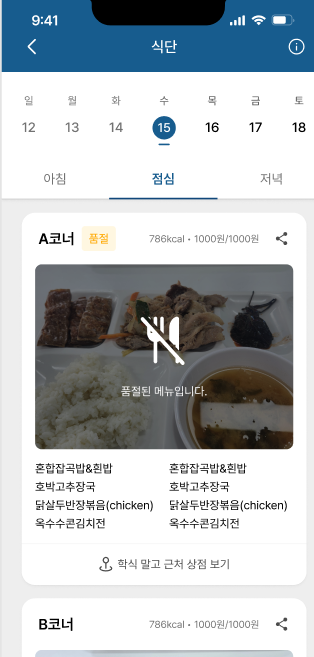
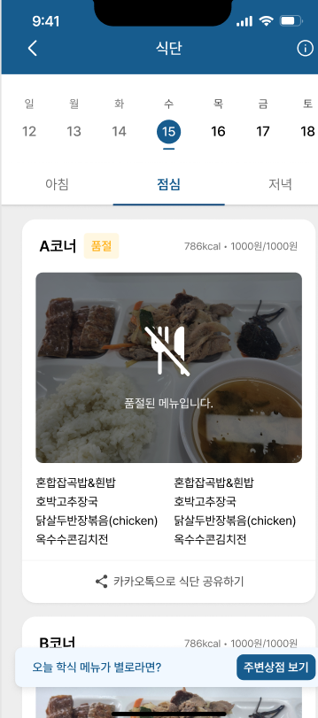

# 0-2. 식단_ABtest_진입 - 레거시

원문 페이지 ID: 3470221954bc83879704817579bcb39f

> 원문 스냅샷. 명세 확정·앱 배포·수집 완료를 뜻하지 않습니다.

## 원문 속성

```json
{
  "platform": [
    "ANDROID",
    "IOS",
    "WEB"
  ],
  "url": "source-page-id:3470221954bc83879704817579bcb39f",
  "상태": "완료",
  "생성일": "2026-11-12T05:07:49.960Z",
  "이름": "0-2. 식단\\_ABtest\\_진입 - 레거시",
  "태그": [
    "0. A/B TEST"
  ]
}
```

<details>
<summary>과거 로깅</summary>

- 설명: 사용자가 앱을 키는 순간 생성되는 이벤트입니다.
- event\_name : “AB\_TEST”
- event\_category : “a/b test 로깅(메인화면 식단 진입)”
- event\_label : “dining2shop\_1”
- value : design\_A / design\_B
- custom\_session\_id : \{dining2shop\}\_\{0\}\_\{플랫폼\}\_\{세션시작시간\}\_\{랜덤값\}


<p>
커스텀 세션 아이디 - 원문 (원문 ID: 2759ae650b5980f1bc4fee4a1a377139) 
</p>


- A안(control group)



- B안(variant group)


</details>
