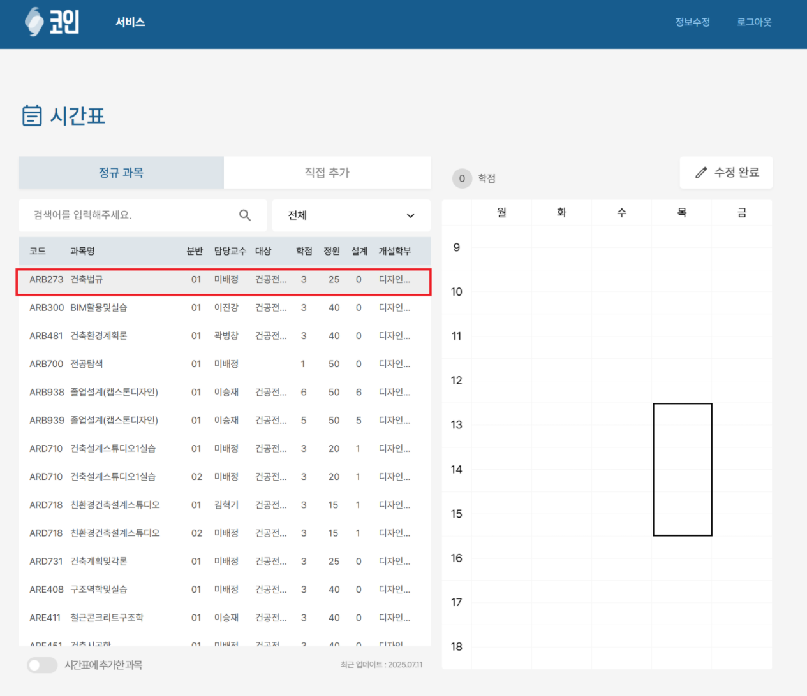
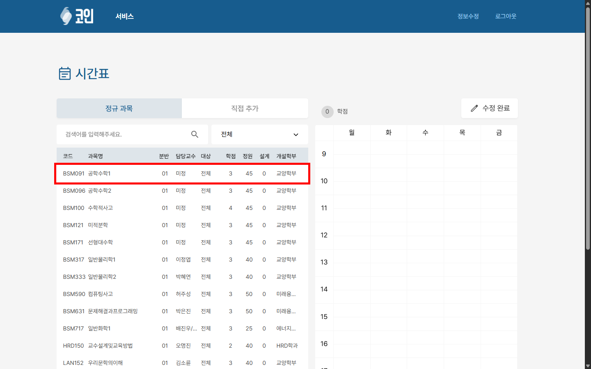

# 2-18. (웹) 시간표_수정_과목 선택 (클릭)

원문 페이지 ID: 3480221954bc8392ade881f0af0a7b5b

> 원문 스냅샷. 명세 확정·앱 배포·수집 완료를 뜻하지 않습니다.

## 원문 속성

```json
{
  "platform": [
    "WEB"
  ],
  "url": "source-page-id:3480221954bc8392ade881f0af0a7b5b",
  "상태": "로깅 필요",
  "생성일": "2026-11-08T10:52:10.638Z",
  "이벤트 이름": "2-18. (웹) 시간표\\_수정\\_과목 선택 (클릭)",
  "태그": [
    "시간표"
  ]
}
```

<details>
<summary>이전 로깅</summary>

- event\_label : “timetable”
- value : “course\_select\_\{과목명\}”
- event\_category : “click”
- 참고 이미지


</details>

<details>
<summary>새 로깅 (26.10.17)</summary>

- 설명: 웹 시간표 수정 화면(정규 과목 탭)의 과목 목록에서 한 번 클릭하여 시간표 미리 보기 대상을 선택하는 경우. 과목 추가·저장 성공 이벤트가 아니다.
- screen\_view: <code>timetable_edit</code>
- event\_name: <code>DA1</code>
- event\_label: <code>timetable__timetable_edit__lecture_add__lecture_entry__click</code>
- value: \{과목명\} (예: 건축법규)
- event\_category: <code>click</code>

<details>
<summary>검토사항</summary>

- 공개 코드 확인 (2026-11-01): [정규 과목 목록](https://github.com/BCSDLab/KOIN_WEB_RECODE/blob/a1bd96d8b0b426e8c6a4b54ea643e7a7e2a7bd23/src/components/TimetablePage/components/LectureList/index.tsx#L109-L120)에서 한 번 클릭은 updateTempLecture로 미리 보기 대상만 바꾸고, 더블클릭은 중복·겹침 검사를 거쳐 addMyLecture로 추가한다. [행 클릭 처리](https://github.com/BCSDLab/KOIN_WEB_RECODE/blob/a1bd96d8b0b426e8c6a4b54ea643e7a7e2a7bd23/src/components/TimetablePage/components/LectureTable/index.tsx#L98-L110)도 클릭 횟수 1/2를 구분한다. 기존 stage 관찰과 일치하므로 detail lecture\_entry를 유지한다. 이 커밋의 코드 확인이며 운영 배포 버전·SDK 전송 및 한 번 전송은 미확인이다.
- 통합 가이드·후속: [로깅 통합 가이드](3c30221954bc8214b1c481c5bbb6fba5.md)
- 모바일: 없음 (모바일은 시간표 수정 시 'PC환경만 지원합니다' 안내만 뜸)
- 실제 화면 확인 (2026-10-29): stage 웹 시간표 수정의 정규 과목 목록에서 공학수학1 행을 한 번 클릭하면 접근성 표시는 “시간표에서 미리 보기”와 선택 상태로 바뀌고 합계는 0학점을 유지했다. 즉시 추가·저장 완료로 단정하지 않고 detail <code>lecture_entry</code>를 유지한다. 추가·저장 단계 및 SDK의 실제 전송 시점·한 번 전송은 미확인.
- label DA2 기준 정렬 (2026-10-27): <code>timetable__timetable_edit__course__click</code> → <code>timetable__timetable_edit__course_application__lecture_entry__click</code>
- label 점검 정정 (2026-10-28): <code>timetable__timetable_edit__course_application__lecture_entry__click</code> → <code>timetable__timetable_edit__lecture_add__lecture_entry__click</code> (course\_application이 모의수강신청 feature와 충돌; 이 페이지는 시간표 수정 화면의 정규 과목 추가)
</details>

### 참고사진 (기능 표시)

<columns>
<column ratio="50">
<b>웹</b>

<details>
<summary>참고사진 · 웹</summary>

웹 — 과목 선택 (출처: stage 실제 캡처, 로그인 상태, 빨간 네모 = 클릭 위치)


</details>
</column>
<column ratio="50">
<b>모바일</b>

<details>
<summary>참고사진 · 모바일</summary>

해당 없음 (웹 전용)
</details>
</column>
</columns>
</details>
