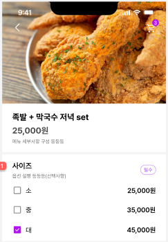

# 3-9-1, 3-9-2 메뉴 선택 후 뒤로 가기

원문 페이지 ID: 3550221954bc8375b37501444d5efcb1

> 원문 스냅샷. 명세 확정·앱 배포·수집 완료를 뜻하지 않습니다.

## 원문 속성

```json
{
  "platform": [
    "ANDROID",
    "IOS"
  ],
  "url": "source-page-id:3550221954bc8375b37501444d5efcb1",
  "상태": "로깅 필요",
  "생성일": "2026-11-12T05:07:45.670Z",
  "이벤트 이름": "3-9-1, 3-9-2 메뉴 선택 후 뒤로 가기",
  "태그": [
    "3. 상점 상세 페이지"
  ]
}
```




메뉴를 선택 후, 좌측 상단의 버튼 또는 스와이프로 이탈 로깅입니다.


<span color="orange">event\_params.key</span>

<ul>
<li>
event\_label : shop\_detail\_menu\_back
</li>
<li>
value : \{상점이름\} 
</li>
<li>
event\_category : 

<ul>
<li>
click 
</li>
<li>
swipe
</li>
</ul>
</li>
<li>
previous\_page : \{메뉴\}
</li>
<li>
current\_page : \{상점이름\}
</li>
<li>
duration\_time : 메뉴에서 상점상세 페이지로 들어간 시간(ms) 
</li>
</ul>


