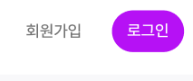
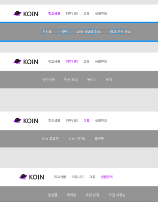
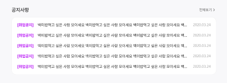
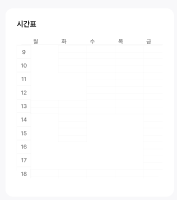

# 홈화면 리디자인

원문 페이지 ID: 3570221954bc83cf84c181b029458dce

> 원문 스냅샷. 명세 확정·앱 배포·수집 완료를 뜻하지 않습니다.

## 원문 속성

```json
{
  "title": "홈화면 리디자인"
}
```

<callout icon="📌" color="blue_bg">
<b>최신 기준: 홈 리디자인 유지 · 외부 중복 명세는 레거시</b>

2026-11-05 사용자 결정으로 홈의 로깅은 모두 유지한다. 프로필 로그인·로그아웃·메인 콜밴팟 모집보기·버스 노선 조회·학교 부서 카테고리는 홈 명세를 현행 기준으로 사용하며, 겹치는 다른 서비스 명세는 레거시다. 이전의 외부 대표 명세 지정·같은 라벨 공동 구현·부서 별개 유지 안내보다 이 결정이 우선한다.

| 현행 홈 명세 | 레거시 원문 |
| --- | --- |
| [4-2 로그인 클릭](0b20221954bc82eca20301a50ab63147.md) | [[레거시] 2-2 로그인 진입(클릭)](b980221954bc8253af06815cc1629848.md) |
| [4-3 로그아웃 클릭](d6b0221954bc820288550143b7dce11e.md) | [[레거시] 4-2 로그아웃(클릭)](fe30221954bc83949b21014f94991fc3.md) |
| [1-6 콜벤팟 모집 보기 클릭](df60221954bc833f92f28142f80b2646.md) | [[레거시] 1-1 메인 → 콜밴팟 모집 보기](1130221954bc82689c42016c8a03d063.md) |
| [1-8 버스 노선 클릭](2690221954bc82dea77301b070152451.md) | [[레거시] 1-14. 메인_버스_클릭](f450221954bc8321ab2e8140e800c375.md) |
| [3-6 카테고리 내부 클릭 (현재 로깅) 2026.08.30 이후 찍히는 로깅](bb10221954bc8337aae781494584adee.md) | [[레거시] 1-0-2 학교 부서정보 접근 (카테고리 진입)](b3e0221954bc8207884301a20c45b662.md) |

레거시의 라벨·값·사진·플랫폼·이전 로깅은 삭제하지 않는다. 같은 클릭에 레거시 라벨을 추가 전송하지 않는다. 코드 대조 결과 일반 식단 카드 본문과 전체보기는 별도 클릭이므로 식단 1-2는 카드 본문 명세로 유지한다. 홈 1-3은 전체보기·더보기만 담당하며 같은 탭에 두 라벨을 함께 보내지 않는다. iOS 빈 상태 카드의 공유 콜백과 카드 본문의 명시 로그 누락 후보는 개발 검증 대상으로 남긴다. SDK 중단·전환·단일 전송은 미확인이다.
</callout>

<details>
<summary>홈 리디자인 ↔ 전체 서비스 중복 점검 결과 (2026-11-05)</summary>

2026-11-05 기존 전수점검 548페이지·현행 라벨 384개 항목의 색인에서 홈 현행 21페이지(라벨 25개)를 전체 서비스와 대조했다. 진입 화면·설명·라벨로 추린 외부 후보 25페이지와 이관 원문·레거시 관계를 현재 Notion에서 다시 확인했다. 전체 548페이지를 이번에 모두 새로 조회한 것은 아니다. 문서 중복과 실제 SDK 이중 전송은 구분한다.

<b>같은 라벨·같은 이벤트를 설명하는 문서 3쌍</b>

| 동작 | 홈 대응 문서 | 현행 대표 명세 | 적용 원칙 |
| --- | --- | --- | --- |
| 프로필 로그인 | [4-2 로그인 클릭](0b20221954bc82eca20301a50ab63147.md) | [[레거시] 2-2 로그인 진입(클릭)](b980221954bc8253af06815cc1629848.md) | 같은 클릭 1회에 1개 이벤트. 문서 수만큼 추가 전송하지 않음 |
| 프로필 로그아웃 | [4-3 로그아웃 클릭](d6b0221954bc820288550143b7dce11e.md) | [[레거시] 4-2 로그아웃(클릭)](fe30221954bc83949b21014f94991fc3.md) | 같은 클릭 1회에 1개 이벤트. 문서 수만큼 추가 전송하지 않음 |
| 메인 콜밴팟 모집보기 | [1-6 콜벤팟 모집 보기 클릭](df60221954bc833f92f28142f80b2646.md) | [[레거시] 1-1 메인 → 콜밴팟 모집 보기](1130221954bc82689c42016c8a03d063.md) | 같은 클릭 1회에 1개 이벤트. 문서 수만큼 추가 전송하지 않음 |

<b>현행 홈으로 이관되어 원문은 레거시인 7쌍</b>

| 동작 | 현행 홈 | 이관 전 원문 |
| --- | --- | --- |
| 1-3 오늘의 식단 전체보기 클릭 | [1-3 오늘의 식단 전체보기 클릭](2430221954bc839da344811d15eaa112.md) | 1-1.메인_식단_더보기버튼_클릭 (홈화면 리디자인 로깅으로 찍히고 있음) → 따라서  1-1부터 1-7까지 전부 다 수정할 필요 없음 (레거시) (원문 ID: 3df0221954bc833a9f6381766084d23b) |
| 2-3 네비게이션 바 게시판 클릭 | [2-3 네비게이션 바 게시판 클릭](e720221954bc8366ab190191154be107.md) | [2-3. 공지사항_클릭 (레거시)](d300221954bc8330be2381687a8f27c1.md) |
| 1-9 주변 상점 전체보기 클릭 | [1-9 주변 상점 전체보기 클릭](e730221954bc825c92350132993b4f22.md) | [1-1-1 메인 → 주변상점 (클릭) -  (레거시)](eb00221954bc8243aa648128d0c8d47c.md) |
| 1-8 버스 노선 클릭 | [1-8 버스 노선 클릭](2690221954bc82dea77301b070152451.md) | [1-13. 교통편 조회하기_클릭 (레거시)](e410221954bc83e1aa4681d6391b6a86.md) |
| 1-7 버스 시간표 클릭 | [1-7 버스 시간표 클릭](6c10221954bc83fdbdb401bf8fc87fa6.md) | [1-12. 버스 시간표_클릭 (레거시)](3990221954bc827ab7f481cc03c33f9b.md) |
| 1-5 서틀 탑승권 클릭 | [1-5 서틀 탑승권 클릭](36c0221954bc836db2c2015d443eb2ea.md) | [1-11. 셔틀 탑승권_클릭 (레거시)](1e10221954bc8268a989013ec93c6966.md) |
| 1-4 식단 코너 클릭 | [1-4 식단 코너 클릭](3220221954bc83549c970136b8786c33.md) | 1-3.메인_식단_A코너_클릭 (레거시) (원문 ID: 1560221954bc83afacc8015e25700762) |

위 원문은 별도 신규 구현·추가 전송 대상이 아니다. 시설물·채팅·콜밴팟 카테고리 원문 [[레거시] 10-3. 카테고리_교내 시설물 정보_클릭](13a0221954bc82fa9bed81d79975357f.md), [[레거시] 11-15.카테고리_채팅(쪽지)_클릭](f330221954bc83579bf5816e70758bb1.md), [[레거시] 1-3 카테고리 → 콜밴팟 모집](6660221954bc83c39e5b01f01296f764.md)도 레거시이며 현행은 홈 3-6 [3-6 카테고리 내부 클릭 (현재 로깅) 2026.08.30 이후 찍히는 로깅](bb10221954bc8337aae781494584adee.md)이다. 합계 10쌍의 원문·현행 관계를 확인했다.

<b>추가 중복 위험 2곳</b>

- 버스 1-14 [[레거시] 1-14. 메인_버스_클릭](f450221954bc8321ab2e8140e800c375.md)의 WEB(모바일) 사진은 홈 1-8 [1-8 버스 노선 클릭](2690221954bc82dea77301b070152451.md)과 같은 버스 노선 조회 카드를 가리킨다. 새 홈 카드는 홈 1-8만 적용한다. 구 WEB 버튼과 네이티브 SDK 대응은 미확인이다.
- 식단 1-2 1-2.메인_식단_클릭 (원문 ID: 77e0221954bc82b7b9030139d648368f)와 홈 1-3 [1-3 오늘의 식단 전체보기 클릭](2430221954bc839da344811d15eaa112.md)의 모바일 위젯 설명이 겹칠 수 있다. WEB 전체보기는 홈 1-3만 적용한다. 앱 카드 본문·오늘/내일 식단·전체보기의 실제 호출 경계는 미확인이며 두 새 라벨을 동시에 추가하지 않는다.

<b>별개 유지 결정이 있는 예외</b>

학교 부서 카테고리 [[레거시] 1-0-2 학교 부서정보 접근 (카테고리 진입)](b3e0221954bc8207884301a20c45b662.md)와 홈 3-6은 이전 사용자 결정에 따라 서비스 진입과 공용 메뉴 클릭을 별개로 유지한다. 이번 점검에서 임의로 삭제·합치지 않았다. 같은 사용자 클릭을 분석할 때 두 지표를 단순 합산하지 않는다.

<b>겹치지 않는 동작</b>

홈 카드·WEB 헤더·WEB 푸터·모바일 카테고리는 진입 위치가 다르다. 하단 카테고리 열기와 카테고리 안의 서비스 선택, 하단 프로필 열기와 프로필 로그인, 알림 아이콘·목록 항목·삭제·모두읽음은 각각 별도 동작이다. 모달 배너와 홈 고정 캐러셀·시간표 위젯도 같은 계약으로 재사용하지 않는다. 팀원 모집·품절 관련 및 새/미래 주변상점은 수정하지 않았다.
</details>

<details>
<summary>홈 ↔ 주변상점 진입 기준 (중복 전송 방지 · 2026-11-05)</summary>

2026-11-05 문서 정리 기준이다. 같은 클릭에 아래 여러 페이지의 라벨을 함께 보내지 않는다. SDK 적용·배포·실제 단일 전송은 별도 검증 대상이다.

| 사용자 동작 | 기준 명세 | 적용·제외 범위 |
| --- | --- | --- |
| 새 WEB 홈 많이 찾는 상점 카드 | [1-10 많이 찾는 상점 둘러보기 클릭](99f0221954bc83b6816881eda6dc0be4.md) | 이 카드에는 홈 1-10만 적용. 홈 1-9·주변상점 1-1/1-1-1을 함께 적용하지 않음 |
| 기존 모바일 홈 주변 상점 전체보기 | [1-9 주변 상점 전체보기 클릭](e730221954bc825c92350132993b4f22.md) | 홈 1-9가 현행 기준. 새 WEB의 별도 전체보기는 미확인 |
| 이관 전 메인 주변상점 진입 | [1-1-1 메인 → 주변상점 (클릭) -  (레거시)](eb00221954bc8243aa648128d0c8d47c.md) | 레거시·이력만 보존. 홈 1-9와 별도 구현·추가 전송 금지 |
| 구 WEB 홈의 개별 상점 카테고리 카드 | [1-1 메인 → 상점 카테고리 (클릭) ](9460221954bc82fcb1e281492ccd30c7.md) | 카테고리별 value를 갖는 과거 UI. 새 시안에 대응 카드 없음. 인기 상점 카드로 대체하지 않음 |
| WEB 생활편의 → 주변 상점 | [1-3 헤더 → 주변상점 (클릭)](a340221954bc82719a5d0107aaa80cb3.md) | header 진입. 홈 카드·모바일 카테고리와 구분 |
| WEB 푸터 주변상점 | [1-4 푸터 → 주변상점 (클릭) ](fcd0221954bc83fea2c801800d9c84bd.md) | footer 진입. 헤더와 별도 위치 |
| 모바일 카테고리 → 주변상점 | [1-5 카테고리 → 주변상점 (클릭)](d330221954bc83ffb1e6814b565790bc.md) | main\_category 진입. 데스크톱 헤더 라벨과 동시 적용하지 않음 |
| 옛 햄버거 → 주변상점 | [1-2 햄버거 → 상점 카테고리 (클릭) - (래거시)](0fd0221954bc82f9aac4819f3678480e.md) | 기존 삭제 대상·레거시 유지. 새 로깅 생성하지 않음 |

이미지 기준: 확인된 새 WEB 클릭 사진을 먼저 표시하고 구디자인 사진은 이력 토글에 보존한다. 리디자인에 없는 동작은 다른 버튼 사진으로 대체하지 않는다.
</details>

<callout icon="💡" color="gray_bg">
Firebase (<b>screen\_view</b>)
</callout>

버스 로깅 (3) (collection-id:22102219-54bc-83a0-82e0-870d4c5aace3)


### 추가 참고사진 (WEB 리디자인 · 사용자 제공)

2026-11-04 제공된 6개 파일 중 동일한 배너 2개를 한 장으로 정리해 고유 이미지 5개를 아래에 보존한다. 개별 기존 명세에는 선택선이 없는 Figma 원본에 빨간 네모를 표시한 이미지를 연결했다. 이 모음의 파란 선은 Figma 선택 표시이며 클릭 대상 표시가 아니다.

<details>
<summary>참고사진 · 웹 — 회원가입·로그인</summary>

로그인 사진은 기존 계정 헤더 로그인 명세에 이미 반영되어 있다. 이번에는 회원가입 명세에 클릭 표시 이미지를 추가했다.


</details>

<details>
<summary>참고사진 · 웹 — 상단 메뉴 4개 상태</summary>

학교생활·커뮤니티·교통·생활편의 메뉴. 팀원 모집 명세는 수정하지 않았다. 콜밴팟·코인 사장님 헤더와 최상위 메뉴 열기 동작은 대응 명세·동작 확인 후 판단한다.


</details>

<details>
<summary>참고사진 · 웹 — 공지사항</summary>

전체보기·영역 제목·게시글의 기존 명세에 각각 위치 표시 사진을 추가했다. 제목 자체의 클릭 가능 여부는 미확인이다.


</details>

<details>
<summary>참고사진 · 웹 — 고정 배너와 시간표 위젯 (계약 미확정)</summary>

동일 파일이던 고정 배너 사진은 한 장만 유지했다. 고정 배너는 기존 모달과, 시간표 위젯은 APP 프로필 버튼과 구분한다. 새 라벨·전송은 만들지 않는다.



</details>
