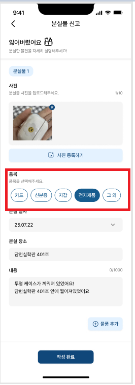
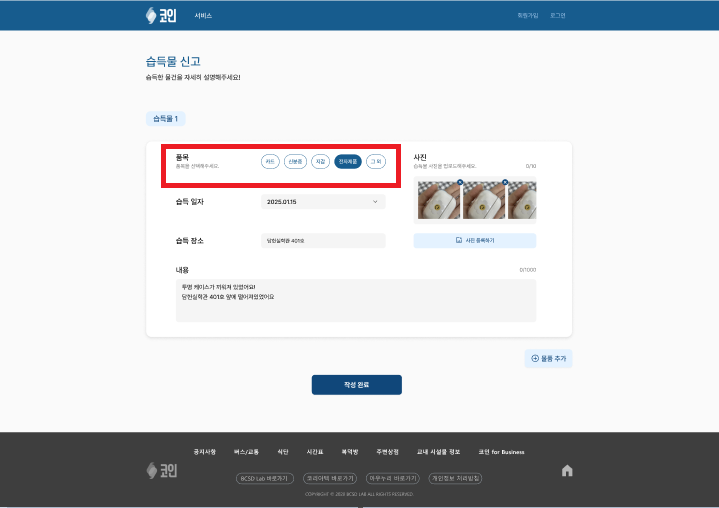

# 11-9.분실물_분실물신고_품목선택_클릭

원문 페이지 ID: 35c0221954bc8387b86f01410d4c06e7

> 누락 원본 복구 스냅샷. 원본의 과거값·검토 기록을 보존하며 생성 계약으로 자동 승인하지 않습니다.

대조 기록: [87개 원본 복구 및 8개 차이 정리](../recovery-review.md)

관련 기존 보관본: [11-9.분실물_분실물신고_품목선택_클릭](f930221954bc8248a881019231c98461.md), [11-9.분실물_분실물신고_품목선택_클릭](76f0221954bc82558fa501024dbd0c83.md)

## 원문 속성

```json
{
  "platform": [
    "ANDROID",
    "IOS",
    "WEB"
  ],
  "url": "source-page-id:35c0221954bc8387b86f01410d4c06e7",
  "상태": "완료",
  "이름": "11-9.분실물\\_분실물신고\\_품목선택\\_클릭"
}
```

<ul>
<li>
설명: 분실물 신고 글쓰기 페이지에서 특정 품목을 클릭
</li>
<li>
event\_label : “lost\_item\_category”
</li>
<li>
value :  \{”카드”, ”신분증”, ”지갑”, ”전자제품”, ”<s>그 외</s>”\} 5가지 값을 추가
</li>
<li>
→ “그 외”를 “기타”로 변경(2025-02-23) 
</li>
<li>
event\_category : “click”
</li>
<li>
참고사진
</li>
</ul>

mobile\_view, mobile\_Web\_view





WEB : 예시 화면이 습득물 신고인데 분실물 신고랑 기능이 동일해서 넣었습니다.



