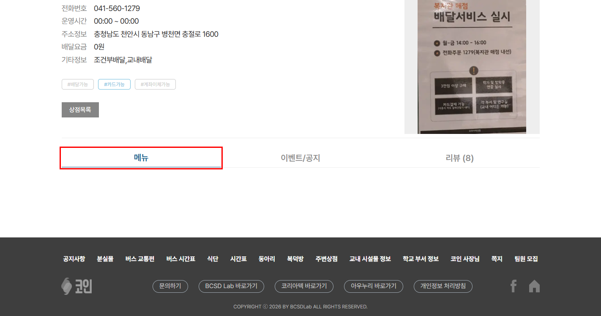
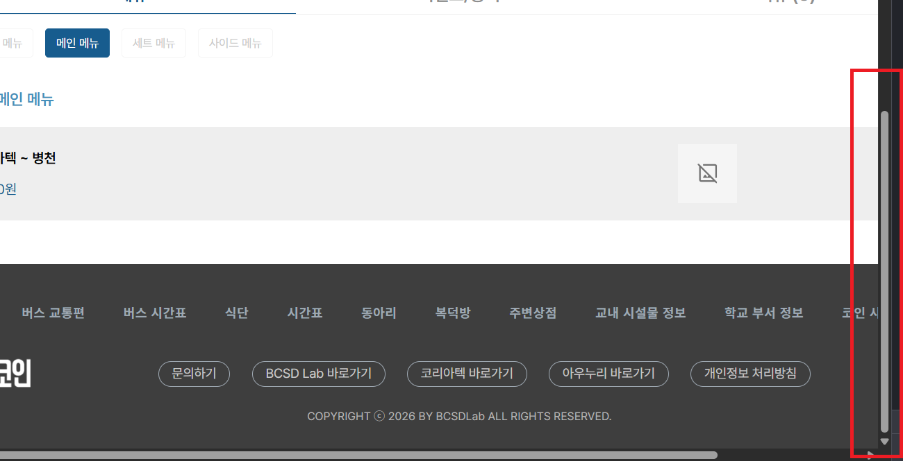
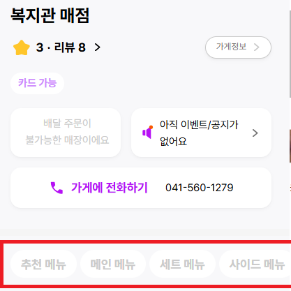
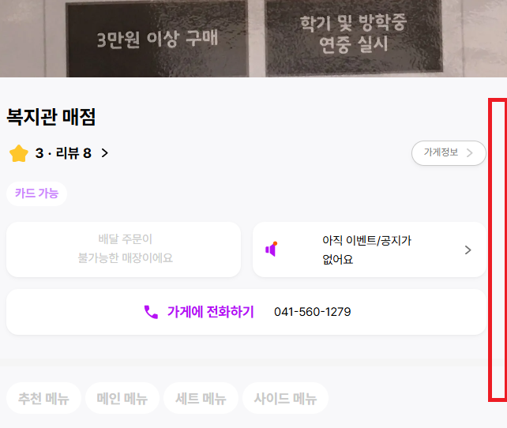

# 3-4, 4.5 상점상세 메뉴 (클릭,스크롤) 

원문 페이지 ID: 36d0221954bc8351905b01b7a103bd60

> 원문 스냅샷. 명세 확정·앱 배포·수집 완료를 뜻하지 않습니다.

## 원문 속성

```json
{
  "platform": [
    "WEB",
    "ANDROID",
    "IOS"
  ],
  "url": "source-page-id:36d0221954bc8351905b01b7a103bd60",
  "상태": "완료",
  "생성일": "2026-11-08T10:51:49.630Z",
  "이벤트 이름": "<p>\n3-4, 4.5 상점상세 메뉴 (클릭,스크롤) \n</p>",
  "태그": [
    "3. 상점 상세 페이지"
  ]
}
```

<details>
<summary>이전 로깅</summary>

<span color="orange">event\_params.key</span>

<ul>
<li>
event\_label : shop\_detail\_view
</li>
<li>
value : \{상점이름\} 
</li>
<li>
event\_category : 

- scroll
- click
</li>
</ul>


---

<p>
상점 상세에서 아래로 내려가면 찍히는 이벤트 입니다. 
</p>

<p>
또한 메뉴탭을 누르면 클릭 이벤트를 발생시킵니다. 
</p>

---

<h3>
오류사항 
</h3>


---

<p>
안드로이드 
</p>

<ol>
<li>
메뉴를 누르는 이벤트가 있지 않음. 
</li>
</ol>


[해결 (1)](60e0221954bc823c9716013b73fdc632.md)
</details>

<details>
<summary>새 로깅 (26.10.17)</summary>

① 메뉴 탭 클릭

- 설명: 상점 상세 화면에서 메뉴 탭을 클릭하는 경우
- screen\_view: <code>shop_detail</code>
- event\_name: <code>DA1</code>
- event\_label: <code>shop__shop_detail__shop_menu__entry__click</code>
- value: \{상점이름\} (예: 복지관 매점)
- event\_category: <code>click</code>

② 메뉴 스크롤

- 설명: 상점 상세 화면에서 메뉴 목록을 아래로 스크롤하는 경우
- screen\_view: <code>shop_detail</code>
- event\_name: <code>DA1</code>
- event\_label: <code>shop__shop_detail__shop_menu__scroll</code>
- value: \{상점이름\} (예: 복지관 매점)
- event\_category: <code>scroll</code>

<details>
<summary>검토사항</summary>

- 통합 가이드: [로깅 통합 가이드](3c30221954bc8214b1c481c5bbb6fba5.md)
- 이 페이지는 ① 클릭 / ② 스크롤 두 이벤트를 포함한다.
- label DA2 기준 정렬 (2026-10-27): <code>shop__shop_detail__menu__click</code> → <code>shop__shop_detail__shop_menu__entry__click</code>
- label DA2 기준 정렬 (2026-10-27): <code>shop__shop_detail__menu__scroll</code> → <code>shop__shop_detail__shop_menu__scroll</code>
</details>

### 참고사진 (상점 상세 메뉴)

<columns>
<column ratio="50">
<b>웹</b>

<details>
<summary>참고사진 · 웹</summary>

웹 — ① 메뉴 탭 클릭 (출처: stage 실제 캡처, 빨간 네모 = 클릭 위치)



웹 — ② 메뉴 스크롤 (출처: 기존 캡처)


</details>
</column>
<column ratio="50">
<b>모바일</b>

<details>
<summary>참고사진 · 모바일</summary>

모바일 — ① 메뉴 탭 클릭 (출처: 기존 캡처)



모바일 — ② 메뉴 스크롤 (출처: 기존 캡처)


</details>
</column>
</columns>
</details>
