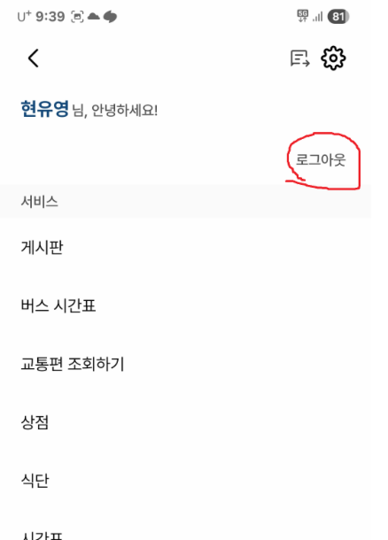

# [레거시] 4-2 로그아웃(클릭)

원문 페이지 ID: 3740221954bc8321a299018ab3941242

> 원문 스냅샷. 명세 확정·앱 배포·수집 완료를 뜻하지 않습니다.

## 원문 속성

```json
{
  "platform": [
    "ANDROID",
    "IOS"
  ],
  "url": "source-page-id:3740221954bc8321a299018ab3941242",
  "구분": "로그아웃",
  "상태": "레거시",
  "생성일": "2026-11-12T05:07:33.322Z",
  "이벤트 이름": "\\[레거시\\] 4-2 로그아웃(클릭)",
  "태그": [
    "로그아웃"
  ]
}
```

<callout icon="📁" color="gray_bg">
<b>레거시 보존 · 현행 기준은 홈화면 리디자인</b>

- 2026-11-05 사용자 지시: 홈화면 리디자인의 로깅은 모두 유지하고, 겹치는 다른 서비스 명세를 레거시로 보존한다.
- 프로필 로그아웃의 현행 기준: [4-3 로그아웃 클릭](4210221954bc83489f4081147833e51f.md).
- 이 페이지는 별도 신규 구현·추가 전송 대상이 아니다. 아래 라벨·value·category·event\_name·screen\_view·사진·플랫폼과 이전 로깅은 이력으로 보존한다.
- 이전의 ‘이 페이지가 대표’·‘두 문서 별개 유지’·‘같은 라벨 문서 계약’ 설명은 이 최신 결정으로 대체한다. 홈 명세의 라벨·값·필드는 이번 작업에서 변경하지 않는다.
- 실제 SDK의 옛 라벨 중단·전환·단일 전송은 미확인이다. 이 문서 정리는 운영 코드나 데이터의 삭제·변경을 뜻하지 않는다.
</callout>

<details>
<summary>이전 로깅</summary>

- event\_label : “hamburger”
- value : “로그아웃<b>”</b>
- event\_category : “click”



</details>
