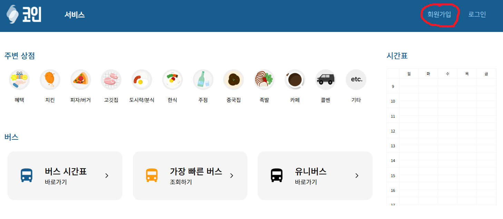

# 1-1 회원가입 진입(클릭)

원문 페이지 ID: 3820221954bc83e9a8f50186b8ee2721

> 원문 스냅샷. 명세 확정·앱 배포·수집 완료를 뜻하지 않습니다.

## 원문 속성

```json
{
  "platform": [
    "WEB"
  ],
  "url": "source-page-id:3820221954bc83e9a8f50186b8ee2721",
  "상태": "완료",
  "생성일": "2026-11-12T05:08:07.377Z",
  "이벤트 이름": "1-1 회원가입 진입(클릭)",
  "태그": [
    "로그아웃"
  ]
}
```

<details>
<summary>과거 로깅</summary>

- event\_label : “header”
- value : “회원가입 시작<b>”</b>
- event\_category : “click”


</details>

<details>
<summary>새 로깅</summary>

- 레거시: V1 명세. 새 로깅은 V2 페이지로 대체한다.
- 대체 로깅: [1-1 헤더_회원가입진입(클릭)](5e50221954bc83e297ee01b01fe94a7b.md) (<code>account__header__sign_up__header_entry__click</code>)
</details>
