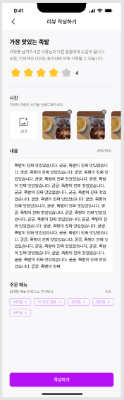

# 4-3 상점상세 리뷰 작성 들어간 후 작성하기 (클릭)  

원문 페이지 ID: 3970221954bc831f8c6a81171d7cae05

> 원문 스냅샷. 명세 확정·앱 배포·수집 완료를 뜻하지 않습니다.

## 원문 속성

```json
{
  "platform": [
    "ANDROID",
    "IOS",
    "WEB"
  ],
  "url": "source-page-id:3970221954bc831f8c6a81171d7cae05",
  "상태": "완료",
  "생성일": "2026-11-12T05:07:41.667Z",
  "이벤트 이름": "<p>\n4-3 상점상세 리뷰 작성 들어간 후 작성하기 (클릭)  \n</p>",
  "태그": [
    "4. 리뷰 페이지"
  ]
}
```




리뷰 작성 페이지에 들어오고 내용 작성 후 작성하기 버튼 클릭 로깅입니다


<span color="orange">event\_params.key</span>

<ul>
<li>
event\_label : shop\_detail\_view\_review\_write\_done
</li>
<li>
value : \{상점이름\} 
</li>
<li>
event\_category : click
</li>
<li>
duration\_time : 작성 페이지로 들어와서 쓰기 까지 걸린시간
</li>
</ul>


---


