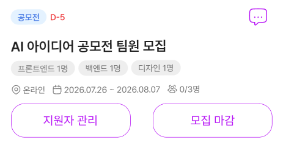
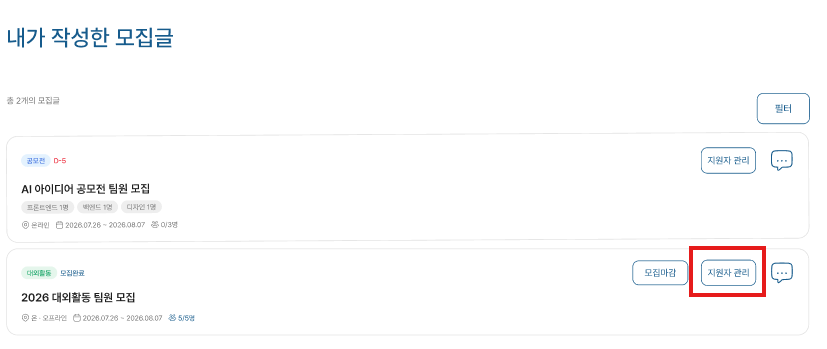
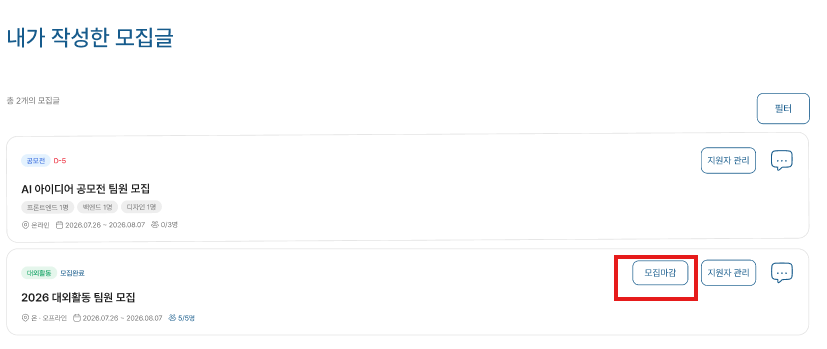
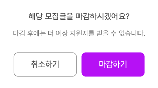
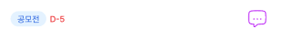
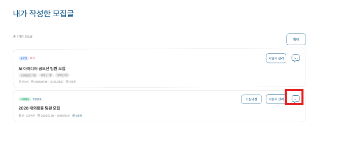
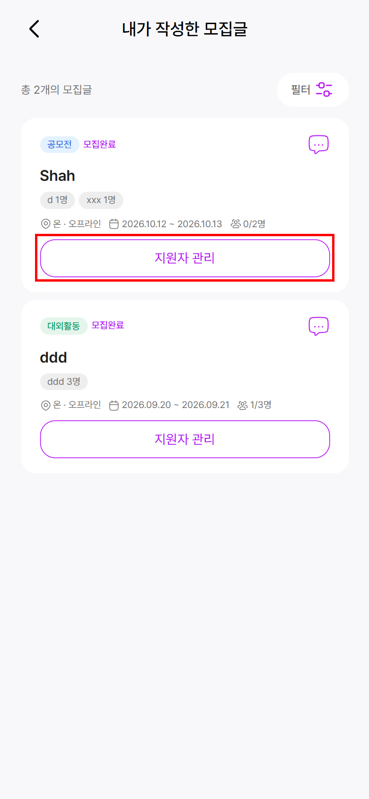
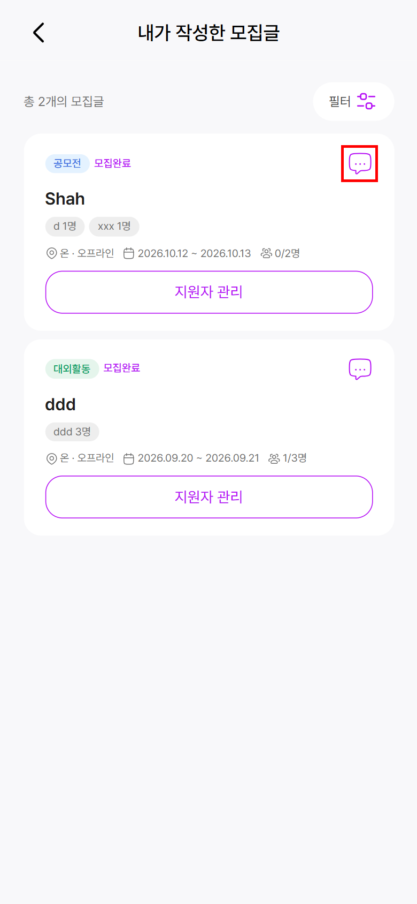

# 9. 내가 작성한 모집글

원문 페이지 ID: 39a0221954bc82a5949e01d87ac2aad7

> 원문 스냅샷. 명세 확정·앱 배포·수집 완료를 뜻하지 않습니다.

## 원문 속성

```json
{
  "platform": [
    "WEB",
    "ANDROID",
    "IOS"
  ],
  "url": "source-page-id:39a0221954bc82a5949e01d87ac2aad7",
  "구분": "내가 작성한 모집글",
  "상태": "로깅 필요",
  "생성일": "2026-11-08T10:52:16.454Z",
  "이벤트 이름": "9\\. 내가 작성한 모집글"
}
```

<details>
<summary>이전 로깅</summary>

① 지원자 관리 클릭

- event\_label : team\_recruitment\_created\_post\_applicant
- value : 사용자가 선택한 모집글 이름
- event\_category : click





② 모집 마감 버튼 클릭

- event\_label : team\_recruitment\_created\_post\_close
- value : 사용자가 마감하려는 모집글 이름
- event\_category : click




③ 모집 마감 취소

- <b> web 로깅 X </b>
  - → 디자인이 없어서 사진 첨부를 못했습니다 기능을 구현하게 된다면 로깅 심어주시면 감사하겠습니다!
- event\_label : team\_recruitment\_created\_post\_close\_cancel
- value : 취소하기
- event\_category : click




<p>
④ 모집 마감 확인 
</p>

- <b>web 로깅 X </b>
  - → 디자인이 없어서 사진 첨부를 못했습니다 기능을 구현하게 된다면 로깅 심어주시면 감사하겠습니다!
- event\_label : team\_recruitment\_created\_post\_close\_confirm
- value : 마감하기
- event\_category : click


⑤ 채팅 클릭

- event\_label : team\_recruitment\_created\_post\_chat
- value : 사용자가 채팅을 선택한 모집글 이름
- event\_category : click




</details>

<details>
<summary>새 로깅 (26.10.17)</summary>

① 지원자 관리 클릭

- 설명: 내가 작성한 모집글 화면에서 모집글 카드의 지원자 관리 버튼을 클릭해 지원자 관리 화면으로 들어가는 경우
- screen\_view: <code>team_created</code>
- event\_name: <code>DA1</code>
- event\_label: <code>team_recruit__team_created__team_applicant__entry__click</code>
- value: \{카테고리\}\_\{모집글 id\} (예: 프로젝트\_103)
- event\_category: <code>click</code>

② 모집 마감 버튼 클릭

- 설명: 내가 작성한 모집글 화면에서 모집 마감 버튼을 클릭하는 경우 (mobile은 마감 확인 팝업이 뜸)
- screen\_view: <code>team_created</code>
- event\_name: <code>DA1</code>
- event\_label: <code>team_recruit__team_created__team_deadline__open__click</code>
- value: \{카테고리\}\_\{모집글 id\} (예: 프로젝트\_103)
- event\_category: <code>click</code>

③ 모집 마감 취소

- 설명: 모집 마감 확인 팝업에서 취소하기를 클릭해 마감하지 않고 닫는 경우
- screen\_view: <code>team_created</code>
- event\_name: <code>DA1</code>
- event\_label: <code>team_recruit__team_created__team_deadline__cancel__click</code>
- value: 취소하기
- event\_category: <code>click</code>

④ 모집 마감 확인

- 설명: 모집 마감 확인 팝업에서 마감하기를 클릭해 모집글을 최종 마감하는 경우
- screen\_view: <code>team_created</code>
- event\_name: <code>DA1</code>
- event\_label: <code>team_recruit__team_created__team_deadline__confirm__click</code>
- value: 마감하기
- event\_category: <code>click</code>

⑤ 채팅 클릭

- 설명: 내가 작성한 모집글 화면에서 모집글 카드의 채팅 버튼을 클릭해 채팅방으로 들어가는 경우
- screen\_view: <code>team_created</code>
- event\_name: <code>DA1</code>
- event\_label: <code>team_recruit__team_created__chat_entry__entry__click</code>
- value: \{카테고리\}\_\{모집글 id\} (예: 프로젝트\_103)
- event\_category: <code>click</code>

<details>
<summary>검토사항</summary>

- 통합 가이드·후속: [로깅 통합 가이드](3c30221954bc8214b1c481c5bbb6fba5.md)
- ③ ④ 웹: 없음 (web은 마감 확인 팝업 디자인이 없음. 모바일 웹 포함 여부는 명세 담당자 결정 필요)
- label DA2 기준 정렬 (2026-10-27): <code>team_recruit__team_created__applicant__click</code> → <code>team_recruit__team_created__team_applicant__entry__click</code>
- label DA2 기준 정렬 (2026-10-27): <code>team_recruit__team_created__deadline__click</code> → <code>team_recruit__team_created__team_deadline__open__click</code>
- label DA2 기준 정렬 (2026-10-27): <code>team_recruit__team_created__deadline__cancel__click</code> → <code>team_recruit__team_created__team_deadline__cancel__click</code>
- label DA2 기준 정렬 (2026-10-27): <code>team_recruit__team_created__deadline__confirm__click</code> → <code>team_recruit__team_created__team_deadline__confirm__click</code>
- label DA2 기준 정렬 (2026-10-27): <code>team_recruit__team_created__chat__click</code> → <code>team_recruit__team_created__chat_entry__entry__click</code>
- ② 참고사진: 테스트 계정의 모집글이 모두 모집완료 상태라 모집 마감 버튼이 보이지 않아 캡처 못 함
- ③ ④ 참고사진: 마감 확인 팝업은 모집 마감을 눌러야 열려서 캡처하지 않음
- ⑤ 사진은 stage에서 카드 우측 상단 말풍선 아이콘 '팀 채팅방으로 이동' (stage 로그인 상태). 사진 플랫폼 확인 완료 (이미지 비율 기준: 모바일, 780x1688). 웹 사진 추가 필요
</details>

### 참고사진 (내가 작성한 모집글)

① 지원자 관리 클릭

<columns>
<column ratio="50">
<b>웹</b>

<details>
<summary>참고사진 · 웹</summary>

웹 — 사진 없음 (추가 필요)
</details>
</column>
<column ratio="50">
<b>모바일</b>

<details>
<summary>참고사진 · 모바일</summary>

모바일 — 지원자 관리 (출처: stage 실제 캡처, 빨간 네모 = 클릭 위치)


</details>
</column>
</columns>

② 모집 마감 버튼 클릭

<columns>
<column ratio="50">
<b>웹</b>

<details>
<summary>참고사진 · 웹</summary>

웹 — 사진 없음 (추가 필요)
</details>
</column>
<column ratio="50">
<b>모바일</b>

<details>
<summary>참고사진 · 모바일</summary>

모바일 — 사진 없음 (추가 필요)
</details>
</column>
</columns>

③ 모집 마감 취소

<columns>
<column ratio="50">
<b>웹</b>

<details>
<summary>참고사진 · 웹</summary>

웹 — 해당 없음 (디자인 없음)
</details>
</column>
<column ratio="50">
<b>모바일</b>

<details>
<summary>참고사진 · 모바일</summary>

모바일 — 사진 없음 (추가 필요)
</details>
</column>
</columns>

④ 모집 마감 확인

<columns>
<column ratio="50">
<b>웹</b>

<details>
<summary>참고사진 · 웹</summary>

웹 — 해당 없음 (디자인 없음)
</details>
</column>
<column ratio="50">
<b>모바일</b>

<details>
<summary>참고사진 · 모바일</summary>

모바일 — 사진 없음 (추가 필요)
</details>
</column>
</columns>

⑤ 채팅 클릭

<columns>
<column ratio="50">
<b>웹</b>

<details>
<summary>참고사진 · 웹</summary>

웹 — 사진 없음 (추가 필요)
</details>
</column>
<column ratio="50">
<b>모바일</b>

<details>
<summary>참고사진 · 모바일</summary>

모바일 — 채팅 클릭 (출처: stage 실제 캡처, 빨간 네모 = 클릭 위치)


</details>
</column>
</columns>
</details>
