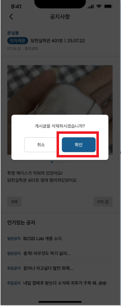
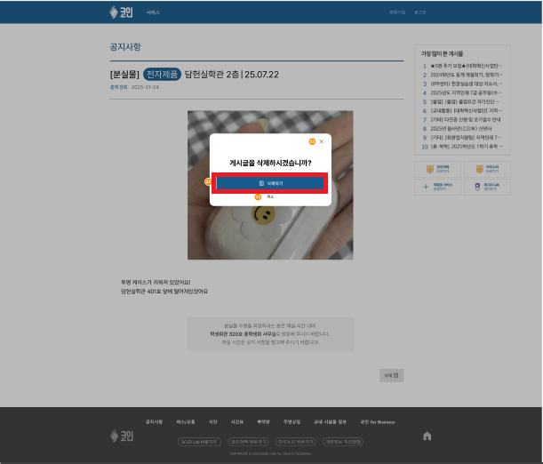
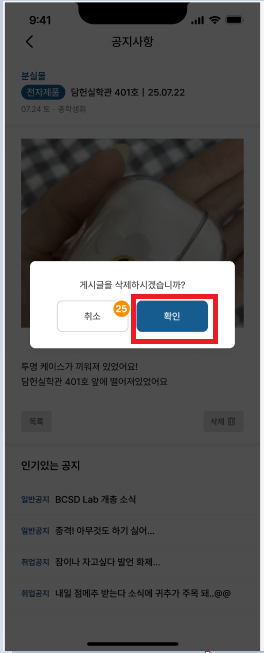

# 11-6.분실물_습득물신고_삭제확인_클릭

원문 페이지 ID: 39f0221954bc83bc95290130914c47c2

> 사용자 제공 ZIP 내보내기 보관본. 레거시·동결·검토 상태는 원문을 따르며 코드 생성 승인·앱 배포 완료를 뜻하지 않습니다.

platform: ANDROID, IOS, WEB
상태: 완료

- 설명:  글 작성자가 습득물 신고 게시물을 삭제버튼을 클릭하고, 나타나는 창에서 확인 버튼을 클릭
- event_label : “find_user_delete_confirm”
- value : “확인”
- event_category : “click”
- 참고사진

WEB Mobile View

