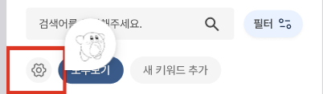
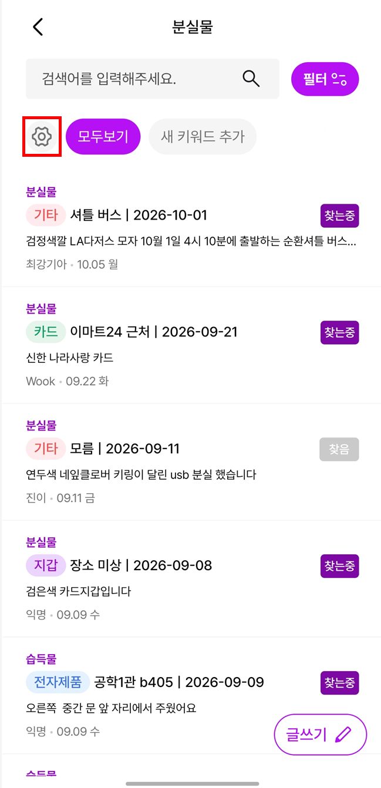

# 12-1. 키워드 설정_클릭

원문 페이지 ID: 3be0221954bc82c092010185aecf35a6

> 원문 스냅샷. 명세 확정·앱 배포·수집 완료를 뜻하지 않습니다.

## 원문 속성

```json
{
  "platform": [
    "ANDROID",
    "IOS"
  ],
  "url": "source-page-id:3be0221954bc82c092010185aecf35a6",
  "상태": "로깅 필요",
  "이름": "12-1. 키워드 설정\\_클릭",
  "태그": [
    "12. 분실물 키워드"
  ]
}
```

<details>
<summary>이전 로깅</summary>

- 설명: 화면 상단의 설정 버튼 클릭
- event\_label: “lost\_item\_keyword\_setting”
- value: “키워드 설정”
- event\_category: “click”
- 참고 사진


</details>

<details>
<summary>새 로깅 (26.10.12) — 초안</summary>

- 설명: 분실물 화면 상단의 키워드 설정 버튼을 클릭하여 키워드 관리로 진입.
- screen\_view: <code>lost_item_list</code>
- event\_name: <code>DA2</code>
- event\_label: <code>board__lost_item_list__keyword_manage__entry__click</code>
- value: 키워드 설정
- event\_category: <code>click</code>

<details>
<summary>검토사항</summary>

- 통합 가이드·후속: [로깅 통합 가이드](3c30221954bc8214b1c481c5bbb6fba5.md)
- label 통일 (2026-10-27): <code>board__lost_item_list__keyword_manage__entry</code> → <code>board__lost_item_list__keyword_manage__entry__click</code>
- 화면 정의의 분실물 리스트에서 설정 톱니바퀴를 클릭하는 시점이므로 <code>lost_item_list</code>를 사용합니다. 키워드 관리 화면으로 이동하기 전의 화면명입니다.
</details>

### 참고사진 (기능 표시)

<columns>
<column ratio="50">
<b>웹</b>

화면 정의에 웹 화면 없음.
</column>
<column ratio="50">
<b>모바일</b>

<details>
<summary>참고사진 · 모바일</summary>

모바일 — 키워드 설정 톱니바퀴


</details>
</column>
</columns>
</details>
