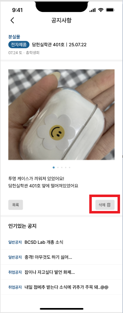
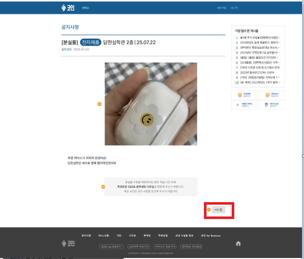
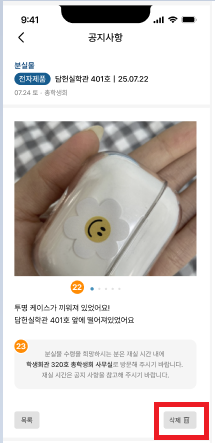

# 11-5.분실물_습득물신고_삭제_클릭

원문 페이지 ID: 3c00221954bc835f816d8121b59607eb

> 누락 원본 복구 스냅샷. 원본의 과거값·검토 기록을 보존하며 생성 계약으로 자동 승인하지 않습니다.

대조 기록: [87개 원본 복구 및 8개 차이 정리](../recovery-review.md)

관련 기존 보관본: [11-5.분실물_습득물_삭제_클릭](eb20221954bc832981c081c4c9f7b5ce.md), [11-5.분실물_습득물_삭제_클릭](b4d0221954bc8391b13f010fc3d6a83f.md), [5-1. (Android / iOS) 알림설정_클릭](1190221954bc83939928017b5b644090.md), [1-7.메인_식단_2캠퍼스_클릭](15e0221954bc835a969901001f9897ae.md)

## 원문 속성

```json
{
  "platform": [
    "ANDROID",
    "IOS",
    "WEB"
  ],
  "url": "source-page-id:3c00221954bc835f816d8121b59607eb",
  "상태": "완료",
  "이름": "11-5.분실물\\_습득물신고\\_삭제\\_클릭"
}
```

- 설명:  글 작성자가 습득물 신고 게시물에서 삭제버튼을 클릭
- event\_label : “find\_user\_delete”
- value : “삭제”
- event\_category : “click”
- 참고사진








WEB Mobile View



