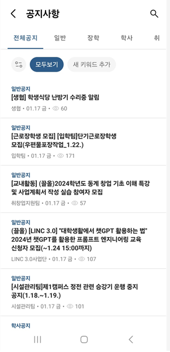

# 게시판

원문 페이지 ID: 3c70221954bc82cba7cf819a5dfe956d

> 사용자 제공 ZIP 내보내기 보관본. 레거시·동결·검토 상태는 원문을 따르며 코드 생성 승인·앱 배포 완료를 뜻하지 않습니다.

- 추가 로깅 검토 — 태그 1~9의 퍼널
    
    기존 32개 항목에 없는 아래 행동은 현재 UI와 기존 구현을 확인한 뒤 추가 여부를 검토합니다.
    
    ### 공지사항 목록의 일반 게시글 클릭
    
    - screen_view: `main_notice`
    - event_name: `DA2`
    - event_label: `board__main_notice__notice_detail__entry__click`
    - value: “{공지명}”
    - event_category: `click`
    - 발생 조건: 공지 목록의 일반 게시글을 눌러 상세 화면으로 이동.
    - 확인사항: 현재 5-1은 목록으로 돌아가는 동작이므로 일반 게시글 선택 이벤트의 기존 적용 여부를 확인합니다.
    
    ### 공지 검색 결과의 게시글 클릭
    
    - screen_view: `notice_search`
    - event_name: `DA2`
    - event_label: `board__notice_search__notice_detail__entry__click`
    - value: “{공지명}”
    - event_category: `click`
    - 발생 조건: 검색 실행 후 결과 목록의 게시글을 선택.
    - 확인사항: 검색 실행과 결과 선택을 구분합니다. 검색 결과의 실제 노출 화면을 확인해 페이지 구간과 추가 여부를 확정합니다.

💡

- Firebase (**screen_view**) 공지사항
    
    
    ### IOS
    
    - 공지사항  페이지:   NoticeListViewController
    - 키워드 설정 : ManageNoticeKeywordViewController
    
    
    
    ### ANDROID
    
    - 공지사항 페이지:  ArticleActivity

- Firebase (**screen_view**) 시설물 정보
    
    
    ### IOS
    
    -시설물 정보  페이지:   FacilityInfoViewController
    
    ### ANDROID
    
    - 시설물 정보 페이지:  OperatingInfoActivity

[커뮤니티 로깅](b260221954bc8333acdd81a556416db7.md)

- 게시판 로깅 — 기능 및 세부 기능·행동 구분
    
    정리 기준: 2026.10.05, 태그 1~9의 현재 활성 명세 28개. event_label의 기능 구간은 11개입니다. 레거시 항목과 상단의 추가 로깅 검토 후보는 이 표의 집계에 포함하지 않습니다.
    
    기준 문서: [화면 정의 및 로깅 검수](0e40221954bc823d92c301f83b5f68d0.md)
    
    ### 구분 기준
    
    - 기본 구조: `서비스명__페이지__기능__category`(4구간); 필요하면 기능 뒤에 `__세부기능_또는_세부행동`을 하나 추가합니다(5구간: `서비스명__페이지__기능__세부__category`). 마지막 구간은 항상 event_category 단어(click, select, scroll, swipe, submit, fail, exposure, toggle)입니다.
    - 서비스명: 해당 기능의 소속입니다. 공지사항 기능은 `board`, 로그인 팝업 기능은 `account`로 구분합니다.
    - 페이지: 이벤트가 발생하는 화면입니다. 공용 헤더·푸터만 예외로 header·footer 고정값을 사용합니다. 그 외에는 실제 발생 화면별로 구분합니다.
    - 기능: event_label의 세 번째 구간입니다(category는 마지막 구간). 페이지가 달라도 같은 기능명을 사용하면 기능 단위로 묶어 볼 수 있습니다.
    - 세부 기능·행동: 5구간 label일 때 event_label의 네 번째 구간입니다(선택, 최대 1구간). 진입 위치, 선택한 영역, 실행 동작 등을 구분합니다. 생략된 4구간 label은 실제 행동을 명세 설명과 마지막 구간의 category로 확인합니다.
    - 예시: `board__main__notice_entry__more_entry__click` → 게시판 서비스 / 메인 화면 / 공지사항 진입 기능 / 더보기 진입 / click.
    
    ### 기능상 구분
    
    | 서비스 | 기능 | 기능 범위 | 발생 페이지 | 관련 명세 |
    | --- | --- | --- | --- | --- |
    | `board` | `notice_entry` | 공지사항 목록으로 진입하는 기능 | `main`
    `header`
    `footer` | 1-1, 1-2, 2-1, 2-2, 2-3 |
    | `board` | `notice_detail` | 공지 게시글을 선택하여 상세 화면으로 진입하는 기능 | `main`
    `main_notice`
    `notice_detail`
    `notice_search`
    `from_external` | 1-3, 3-1, 3-3, 4-3, 5-2, 6-4, 9-1 |
    | `board` | `external_link` | 외부 사이트 또는 공지 원본으로 이동하는 기능 | `main_notice`
    `notice_detail` | 3-2, 5-3 |
    | `board` | `filter` | 공지사항 목록의 탭 선택 및 목록의 키워드 필터 선택 | `main_notice` | 4-1, 7-2 |
    | `board` | `notice_list` | 공지사항 목록을 탐색하는 기능 | `main_notice` | 4-2 |
    | `board` | `navigation` | 공지 상세 화면에서 목록으로 돌아가는 기능 | `notice_detail` | 5-1 |
    | `board` | `search` | 공지 검색 화면 진입, 검색 키워드 선택 및 검색 실행 | `main_notice`
    `notice_search` | 6-1, 6-2, 6-3 |
    | `board` | `keyword_manage` | 키워드 관리 화면 진입, 직접 입력·추천 키워드 선택으로 키워드 추가, 키워드 알림 수신 상태 변경 | `main_notice`
    `notification_config`
    `notice_keyword_manage` | 7-1, 7-3, 7-5, 7-8, 7-9 |
    | `account` | `login_popup` | 로그인 안내 팝업의 로그인하기 및 닫기 기능 | `notice_keyword_manage` | 7-6, 7-7 |
    
    ### 세부 기능 및 행동별 구분
    
    아래 페이지·기능·세부 구간을 서비스명과 `__`로 연결하고 끝에 표의 event_category를 붙이면 각 명세의 event_label이 됩니다(세부가 '생략'이면 4구간). 7-6·7-7은 `account`, 나머지는 `board`입니다.
    
    | 명세 | 페이지 | 기능 | 세부 기능·행동 | 실제 행동 및 event_category |
    | --- | --- | --- | --- | --- |
    | [1-1.메인_공지사항_더보기_클](e7b0221954bc822eb95881572a1be4c8.md) | `main` | `notice_entry` | `more_entry` | 공지사항 더보기 클릭
    event_category: `click` |
    | [1-2. 메인_공지사항_클릭](91d0221954bc83f09b5781f3a918e947.md) | `main` | `notice_entry` | `title_entry` | 공지사항 제목 클릭
    event_category: `click` |
    | [1-3. 메인_공지사항_상세_클릭](1d30221954bc82458de78134c112d361.md) | `main` | `notice_detail` | `entry` | 메인 화면의 공지 게시글 클릭
    event_category: `click` |
    | [2-1. 헤더_공지사항_클릭](1ef0221954bc831ab54781d65126045e.md) | `header` | `notice_entry` | `header_entry` | 헤더의 공지사항 메뉴 클릭
    event_category: `click` |
    | [2-2. 푸터_공지사항_클릭](0a90221954bc82898d4d8125f9edc616.md) | `footer` | `notice_entry` | `footer_entry` | 푸터의 공지사항 메뉴 클릭
    event_category: `click` |
    | [2-3. 공지사항_클릭 (레거시)](d300221954bc8330be2381687a8f27c1.md) | `main` | `notice_entry` | `navigation_entry` | 앱 하단 내비게이션의 게시판 클릭
    event_category: `click` |
    | [3-1. 공지사항_가장 많이 본 게시물_클릭](7660221954bc83098e7a81419ceec56f.md) | `main_notice` | `notice_detail` | `popular_post_entry` | 가장 많이 본 공지 게시글 클릭
    event_category: `click` |
    | [3-2. 공지사항_바로가기_클릭](30c0221954bc83e9b620818e1ae2d53b.md) | `main_notice` | `external_link` | `shortcut_entry` | 코리아텍 등 외부 사이트 바로가기 클릭
    event_category: `click` |
    | [3-3·4-3. 공지사항_상세_클릭 (웹·앱)](4e00221954bc822f87038164dd7f4415.md) | `main_notice` | `notice_detail` | `entry` | 공지사항 목록의 일반 게시글 클릭 (WEB) — 3-3·4-3 통합
    event_category: `click` |
    | [4-1. 탭 메뉴바_클릭](f380221954bc83319946015c7d177803.md) | `main_notice` | `filter` | `tab` | 공지사항 목록 상단의 탭 선택
    event_category: `select` |
    | [4-2. 공지사항 페이지_스크롤(상하)](eef0221954bc83b3bf318176737e00a6.md) | `main_notice` | `notice_list` | 생략 | 공지사항 목록을 위·아래로 스크롤
    event_category: `scroll` |
    | [3-3·4-3. 공지사항_상세_클릭 (웹·앱)](4e00221954bc822f87038164dd7f4415.md) | `main_notice` | `notice_detail` | `entry` | 공지사항 목록의 일반 게시글 클릭 (ANDROID, IOS) — 3-3·4-3 통합
    event_category: `click` |
    | [5-1. 목록_클릭](4710221954bc82bdad73016b2c6063d9.md) | `notice_detail` | `navigation` | `notice_list_return` | 목록 버튼을 눌러 공지사항 목록으로 돌아가기
    event_category: `click` |
    | [5-2. 인기있는 공지_클릭](a130221954bc8344a21a01c1ebb158b0.md) | `notice_detail` | `notice_detail` | `popular_post_entry` | 공지 상세 화면의 인기 공지 클릭
    event_category: `click` |
    | [5-3. 공지 원본 바로가기_클릭](6010221954bc83d88650811c9b177501.md) | `notice_detail` | `external_link` | `original_entry` | 공지 원본 또는 관련 외부 사이트 바로가기 클릭
    event_category: `click` |
    | [6-1. 공지글 검색_클릭](cec0221954bc83fb80878101caf9ec11.md) | `main_notice` | `search` | `entry` | 돋보기 버튼을 눌러 검색 화면 진입
    event_category: `click` |
    | [6-2. 많이 검색되는 키워드_클릭](5570221954bc8242ad13016e7163ad53.md) | `notice_search` | `search` | `popular_keyword` | 많이 검색되는 키워드 선택
    event_category: `select` |
    | [6-3. 공지글 검색_검색하기_클릭](9ee0221954bc8247badd01d88c248db9.md) | `notice_search` | `search` | 생략 | 입력한 검색어로 검색 실행
    event_category: `submit` |
    | [6-4. 공지글 검색_공지상세_클릭 ](6900221954bc83c19cd4816a488a3488.md) | `notice_search` | `notice_detail` | `entry` | 검색 결과의 공지 게시글 클릭
    event_category: `click` |
    | [7-1. 키워드 관리_클릭](21b0221954bc83df9625811c79c56819.md) | `main_notice` | `keyword_manage` | `entry` | 키워드 관리 아이콘 또는 새 키워드 추가로 관리 화면 진입
    event_category: `click` |
    | [7-2. 모두 보기_클릭](1280221954bc83fc9b0d01305e66e95b.md) | `main_notice` | `filter` | `keyword` | 공지사항 목록의 모두보기 키워드 필터 선택
    event_category: `select` |
    | [7-3. 키워드_추가_클릭](a530221954bc838f842681cfc7571099.md) | `notice_keyword_manage` | `keyword_manage` | `add` | 직접 입력한 키워드 추가
    event_category: `submit` |
    | [7-5. 추천 키워드_클릭](d3c0221954bc82b384f6018365f7f75c.md) | `notice_keyword_manage` | `keyword_manage` | `recommended_keyword` | 추천 키워드 선택
    event_category: `select` |
    | [7-6. 로그인팝업_로그인하기_클릭](92b0221954bc8351ac0601705df4922d.md) | `notice_keyword_manage` | `login_popup` | `login_entry` | 로그인 안내 팝업에서 로그인하기 클릭
    event_category: `click` |
    | [7-7. 로그인팝업_닫기_클릭](3dc0221954bc8212999901a990961940.md) | `notice_keyword_manage` | `login_popup` | `close` | 로그인 안내 팝업 닫기
    event_category: `click` |
    | [7-8. 키워드 알림받기_토글](b190221954bc83039ca4016d14761051.md) | `notice_keyword_manage` | `keyword_manage` | `notification` | 키워드 알림 수신 켜기·끄기
    event_category: `toggle` |
    | [7-9. 알림설정_공지사항 키워드 알림_클릭](bc70221954bc82ebb8a001134a251684.md) | `notification_config` | `keyword_manage` | `entry` | 알림 설정의 공지사항 키워드 알림에서 관리 화면 진입
    event_category: `click` |
    | [9-1. 키워드 게시물_알림](1440221954bc83988396811229e6f2a9.md) | `from_external` | `notice_detail` | `keyword_notification_entry` | 키워드 게시물 알림을 눌러 공지 상세로 진입
    event_category: `click` |
    
    ### 현재 묶음의 해석
    
    - 3-3(WEB)과 4-3(ANDROID, IOS)은 한 페이지로 통합되어 `board__main_notice__notice_detail__entry__click`으로 같은 행동을 공유합니다. 행동은 통합 집계하고 플랫폼으로 구분할 수 있습니다.
    - 7-2의 목록 키워드 필터 선택은 현재 `filter` 기능(세부 `keyword`, 끝 `select`)에 포함합니다. 관리 화면으로 진입하는 7-1은 `keyword_manage` / `entry`로 구분합니다.
    - 5-1의 목록으로 돌아가기는 현재 `navigation` / `notice_list_return`으로 구분합니다. `notice_detail` 기능만 집계하면 5-1은 포함되지 않습니다.
    - 7-8은 `keyword_manage` / `notification`(알림 수신 설정), 9-1은 `notice_detail` / `keyword_notification_entry`(키워드 알림을 통한 상세 진입)으로 구분합니다.
