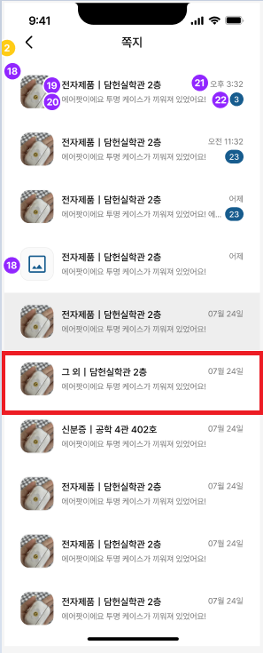
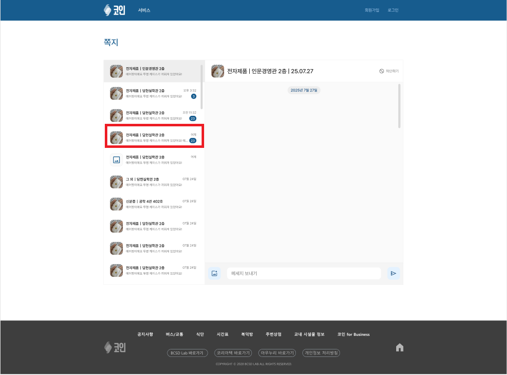

# 11-16.쪽지리스트_대화창_클릭

원문 페이지 ID: 3d30221954bc8340af35815fad5295d0

> 누락 원본 복구 스냅샷. 원본의 과거값·검토 기록을 보존하며 생성 계약으로 자동 승인하지 않습니다.

대조 기록: [87개 원본 복구 및 8개 차이 정리](../recovery-review.md)

관련 기존 보관본: [11-16.쪽지리스트_대화창_클릭](d830221954bc82c6a9cb01cafff6884f.md), [11-16.쪽지리스트_대화창_클릭](cb20221954bc8335977e012e2347e4ee.md)

## 원문 속성

```json
{
  "platform": [
    "ANDROID",
    "IOS",
    "WEB"
  ],
  "url": "source-page-id:3d30221954bc8340af35815fad5295d0",
  "상태": "완료",
  "이름": "11-16.쪽지리스트\\_대화창\\_클릭"
}
```

- 설명:  쪽지 리스트에서 특정 대화창을 클릭
- event\_label : “message\_list\_select”
- value : “쪽지”
- event\_category : “click”
- 참고사진

Mobile, Mobile\_Web\_VIEW





WEB





<details>
<summary>검토사항</summary>


- 후속 수정 (2026-10-27): ※ 옛 사본: 현행 명세는 게시판 DB의 같은 번호 페이지 [11-16.쪽지리스트_대화창_클릭](d830221954bc82c6a9cb01cafff6884f.md). 이 사본은 새 로깅이 없어 변환하지 않음.

</details>
