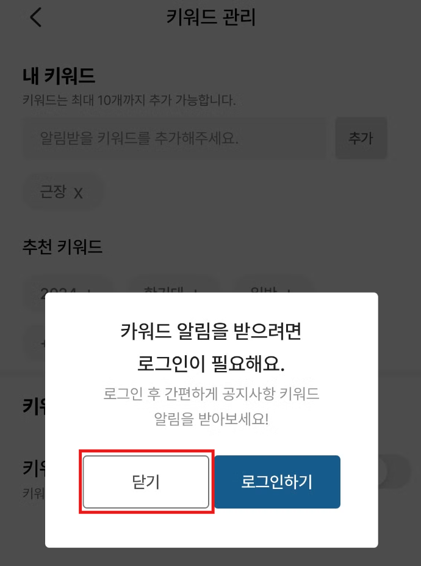

# 7-7. 로그인팝업_닫기_클릭

원문 페이지 ID: 3dc0221954bc8212999901a990961940

> 원문 스냅샷. 명세 확정·앱 배포·수집 완료를 뜻하지 않습니다.

## 원문 속성

```json
{
  "platform": [
    "ANDROID",
    "IOS"
  ],
  "url": "source-page-id:3dc0221954bc8212999901a990961940",
  "상태": "로깅 필요",
  "이름": "7-7. 로그인팝업\\_닫기\\_클릭",
  "태그": [
    "7. 키워드 관리(APP)"
  ]
}
```

<details>
<summary>이전 로깅</summary>


</details>

<details>
<summary>새 로깅 (26.10.05) — 초안</summary>

- 설명: 키워드 관리 화면의 로그인 안내 팝업에서 닫기 버튼 클릭.
- screen\_view:<code>notice_keyword_manage</code>
- event\_name: <code>DA2</code>
- event\_label: <code>account__notice_keyword_manage__login_popup__close__click</code>
- value: 닫기
- event\_category: <code>click</code>

<details>
<summary>검토사항</summary>

- 통합 가이드·후속: [로깅 통합 가이드](3c30221954bc8214b1c481c5bbb6fba5.md)
- 참고사항
  - 팝업 닫기를 로그인하기 클릭과 구분합니다. 로그인 팝업 기능의 서비스 구분은 account로 통일합니다.
- label 통일 (2026-10-27): <code>account__notice_keyword_manage__login_popup__close</code> → <code>account__notice_keyword_manage__login_popup__close__click</code>
</details>

<details>
<summary>참고사진 · 모바일</summary>

<b>모바일</b>

파란색 구버전 모바일 사진 제거 (2026-10-30).
</details>
</details>
