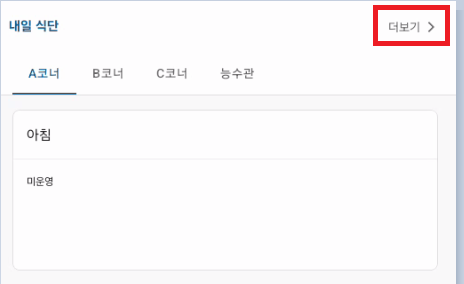
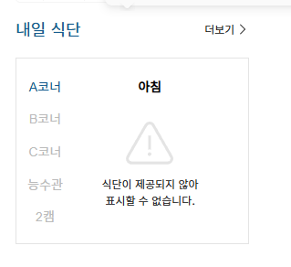
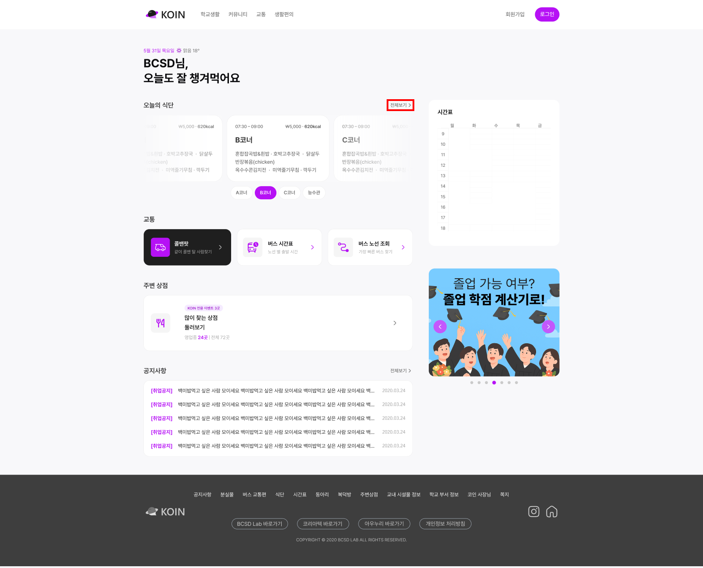
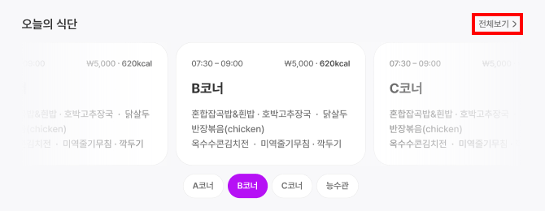
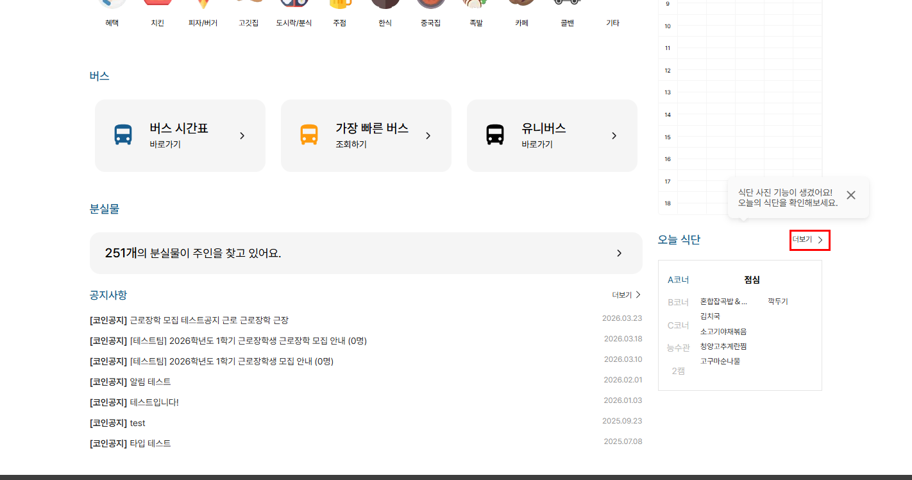
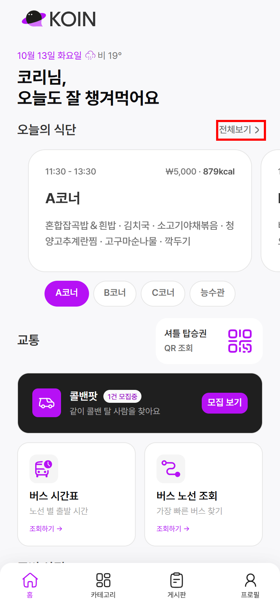

# 1-1.메인_식단_더보기버튼_클릭 (홈화면 리디자인 로깅으로 찍히고 있음) → 따라서  1-1부터 1-7까지 전부 다 수정할 필요 없음 (레거시)

원문 페이지 ID: 3df0221954bc833a9f6381766084d23b

> 누락 원본 복구 스냅샷. 원본의 과거값·검토 기록을 보존하며 생성 계약으로 자동 승인하지 않습니다.

대조 기록: [87개 원본 복구 및 8개 차이 정리](../recovery-review.md)

관련 기존 보관본: [1-1.메인_식단_더보기버튼_클릭 (홈화면 리디자인 로깅으로 찍히고 있음) → 따라서  1-1부터 1-7까지 전부 다 수정할 필요 없음 (레거시)](7090221954bc828fa8bc813fab79d534.md), [레거시 메인_식단_더보기버튼_클릭(확인필요)](3d50221954bc8228a8ed81c51f8aa5d6.md), [1-2.메인_식단_클릭 (레거시)](5a80221954bc8265a92e01bcddeea491.md), [1-3 메인 식단 진입 클릭](1f10221954bc82f6a17401f823455276.md)

## 원문 속성

```json
{
  "platform": [
    "ANDROID",
    "IOS",
    "WEB"
  ],
  "url": "source-page-id:3df0221954bc833a9f6381766084d23b",
  "상태": "완료",
  "생성일": "2026-11-08T10:51:34.303Z",
  "이름": "1-1.메인\\_식단\\_더보기버튼\\_클릭 (홈화면 리디자인 로깅으로 찍히고 있음) → 따라서  1-1부터 1-7까지 전부 다 수정할 필요 없음 (레거시)",
  "태그": [
    "1. 메인_식단"
  ]
}
```

<b>레거시 보존 · 현행 새 로깅은 홈으로 이관</b>

- 2026-11-04 사용자 지시로 이 페이지는 이력만 보존한다.
- 현행 기준 명세: [1-3 오늘의 식단 전체보기 클릭](2430221954bc839da344811d15eaa112.md).
- 이관 후 event\_label: <code>main__main__more__click</code>. 아래 이관 전 라벨·값·사진은 보존 기록이며 별도 신규 구현·추가 전송 대상으로 사용하지 않는다.
- 실제 SDK 전환·배포·수집 중단 여부는 미확인이다. 기존 플랫폼과 상태 속성은 유지했다.


<details>
<summary>이전 로깅</summary>


- 설명 : 메인화면에서 더보기 버튼 클릭
- event\_label : “main\_menu\_moveDetailView”
- value : “오늘 식단, 내일 식단<b>”</b>
- event\_category : “click”
- 참고사진





- 웹





</details>


<details>
<summary>이관 전 새 로깅 (26.10.17) — 레거시 보존</summary>


- 설명: WEB 리디자인에서는 홈 ‘오늘 식단’ 영역의 ‘전체보기’를 클릭해 식단 페이지로 진입하는 경우. ANDROID·IOS는 기존 메인 식단 위젯(오늘 식단 / 내일 식단) 클릭 정의를 유지한다.
- screen\_view: <code>main</code>
- event\_name: <code>DA1</code>
- event\_label: <code>cafeteria__main__more__click</code>
- value: \{아침, 점심, 저녁\}\_더보기 (예: 점심\_더보기)
- event\_category: <code>click</code>

<details>
<summary>검토사항</summary>


- WEB 참고사진 반영 (2026-11-04 사용자 요청 정정): 아래 새 WEB 캡처와 빨간 네모·확대본을 기준으로 클릭 위치를 확인한다. 리디자인 전 WEB 사진은 이력으로 보존하며 모바일 사진·명세와 이전 로깅은 유지한다.
- WEB 리디자인 반영 (2026-11-04 사용자 승인): WEB: 리디자인 홈 ‘오늘 식단’ 영역의 ‘전체보기’를 클릭해 식단 페이지로 진입할 때 적용한다. 코너 선택·카드 표시만으로 발생시키지 않는다. 기존 cafeteria\_\_main\_\_more\_\_click, DA1, 시간대별 value와 category는 유지한다. 모바일의 기존 오늘/내일 식단 위젯 정의는 유지한다.
- WEB 설계 근거: [Figma 참고 / 실제 화면 미확인](https://www.figma.com/design/DPlcYuiFxhyT5ULbqec59i/KOIN-Web?node-id=11541-33352). 기존 사진은 교체하지 않았으며 리디자인 화면의 위치 근거로 사용하지 않는다. SDK 구현·배포 시점·실제 수집은 미확인이다. 이 WEB 규정은 해당 화면의 과거 WEB 설명보다 우선하며 모바일·이전 로깅·기존 필드 값·DB 플랫폼 속성은 보존한다.
- 통합 가이드·후속: [로깅 통합 가이드](3c30221954bc8214b1c481c5bbb6fba5.md)
- 홈화면 리디자인 로깅으로 찍히고 있어 1-1\~1-7 수정 불필요 (페이지 제목 참고)
- 명세 중복 정리 (2026-10-27): <code>cafeteria__main__more__click</code>의 기준 명세는 [1-1.메인_식단_더보기버튼_클릭 (홈화면 리디자인 로깅으로 찍히고 있음) → 따라서  1-1부터 1-7까지 전부 다 수정할 필요 없음 (레거시)](3df0221954bc833a9f6381766084d23b.md). 기존 1-1의 같은 더보기 이벤트를 설명하는 중복 참고 명세다. 같은 사용자 동작은 한 번만 전송하며, 문서가 여러 개라는 이유로 추가 이벤트를 보내지 않는다. 기존 value·플랫폼·발생 시점은 유지한다.
- 참고사진 모바일 파일명이 caf\_1-1\_all\_mobile.png(전체 화면)이다. 사진 플랫폼 확인 완료 (이미지 비율 기준: 모바일 780x1688, 웹 1422x748)

</details>


### 참고사진 (메인 식단 더보기 클릭)

<b>웹</b>

<details>
<summary>참고사진 · 웹</summary>


WEB 리디자인 · [Figma 시안](https://www.figma.com/design/DPlcYuiFxhyT5ULbqec59i/KOIN-Web?node-id=11541-33352) · 2026-11-04. 빨간 네모는 이 명세의 클릭 위치다. 원본 캡처에 코드로 테두리만 표시했으며 실제 서비스 캡처·배포 완료를 의미하지 않는다.

<b>전체 화면</b>





<b>클릭 위치 확대</b>





<details>
<summary>이전 WEB 참고사진 (리디자인 전)</summary>


웹 — 메인 식단 더보기 클릭 (출처: stage 실제 캡처, 빨간 네모 = 클릭 위치)





</details>


</details>


<b>모바일</b>

<details>
<summary>참고사진 · 모바일</summary>


모바일 — 메인 식단 더보기 클릭 (출처: stage 실제 캡처, 빨간 네모 = 클릭 위치)





</details>


</details>
