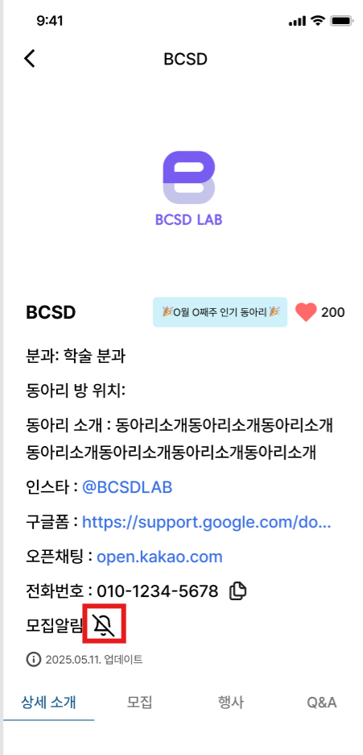

# 5.14동아리_모집알림 클릭

원문 페이지 ID: 3e70221954bc824896c281f3c8ac92ff

> 필터 밖 원본 행 복구 스냅샷. 중복·빈 페이지도 원본 ID와 속성, 본문을 개별 보존합니다. 명세 승인이나 앱 적용 완료를 뜻하지 않습니다.

대조 기록: [숨겨진 원본 42개 복구](../hidden-recovery.md)

관련 기존 보관본: [레거시 5.14동아리_모집알림 클릭](1210221954bc8285b6eb81f8d4e3ac0a.md), [레거시 5.14동아리_모집알림 클릭](cbb0221954bc83158050819f58b601eb.md)

## 원문 속성

```json
{
  "platform": [
    "ANDROID",
    "IOS"
  ],
  "url": "source-page-id:3e70221954bc824896c281f3c8ac92ff",
  "상태": "로깅 필요",
  "이름": "5.14동아리\\_모집알림 클릭"
}
```

<ul>
<li>
설명: 동아리 소개 화면에서 모집알림 버튼 클릭
</li>
<li>
event\_name : “CAMPUS”
</li>
<li>
event\_label : “club\_recruitment\_noti”
</li>
<li>
value : \{동아리명\}
</li>
<li>
event\_category : “click” 
</li>
<li>
참고사진
</li>
</ul>



