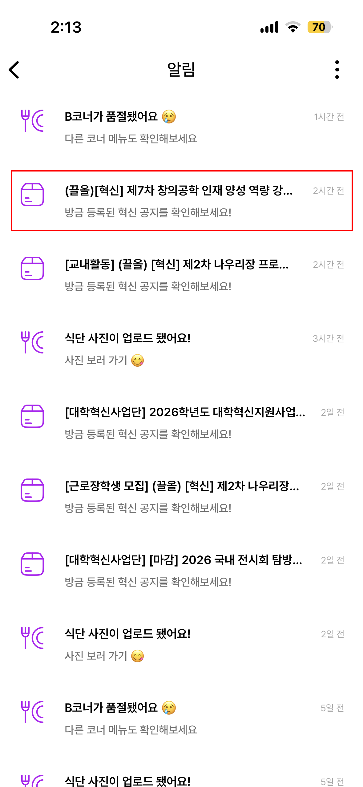
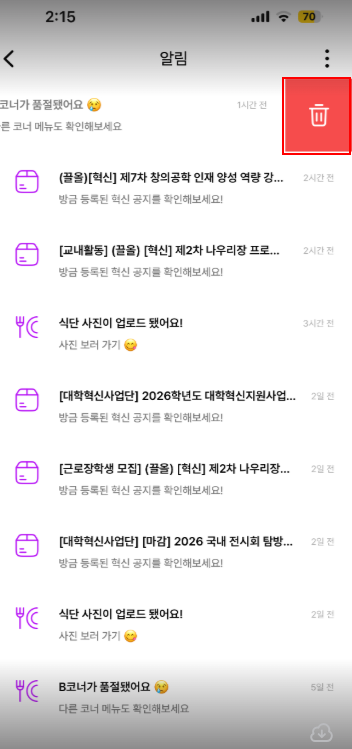

# 앱 내 알림 동작 · 사용자 제공 참고사진 (2026-10-28)

원문 페이지 ID: 4070221954bc813d96a1d7e3e5926faf

> 원문 스냅샷. 명세 확정·앱 배포·수집 완료를 뜻하지 않습니다.

## 원문 속성

```json
{
  "title": "앱 내 알림 동작 · 사용자 제공 참고사진 (2026-10-28)"
}
```

2026-10-28 사용자 제공 앱 화면과 “왼쪽으로 스와이프하면 삭제하기 버튼이 나온다”는 확인 내용을 기록한다. 빨간 네모만 코드로 추가했으며 원본 해상도와 테두리 밖 픽셀을 보존했다.

## 확인된 UI와 기존 명세

| 행동 | 확인 내용 | 기존 명세·전송 상태 |
| --- | --- | --- |
| 앱 내 알림 항목 누르기 | 제공한 첫 사진은 앱 안의 알림 목록이다. 표시한 공지 알림 행은 클릭 위치 참고용이다. 해당 공지가 키워드 푸시로 수신됐는지는 확인되지 않았다. | 1-2 알림 클릭 내부 (원문 ID: 0aa0221954bc8284a76a8157e539e7bd)의 기존 label은 notification\_list, category는 click이다. 개별 알림 이동 결과·SDK 전송은 미검증. |
| 왼쪽 스와이프 | 사용자 확인: 알림 행을 왼쪽으로 밀면 우측 휴지통 버튼이 나타난다. | 삭제를 실행한 상태가 아니다. 별도 swipe 이벤트 전송 계약은 이번에 생성하거나 확정하지 않는다. |
| 휴지통 버튼 누르기 | 두 번째 사진의 빨간 영역은 개별 알림 삭제 버튼이다. | 1-2-1 알림 클릭 내부 (원문 ID: 7c80221954bc8271aa6a01ce2be6582f)의 기존 label은 notification\_list\_delete, value는 알림 삭제, category는 click이다. 실제 삭제 성공·SDK 발화는 미검증. |

기존 완료 명세의 label·value·category·속성·원본 사진은 수정하지 않았다. 이 페이지는 참고사진과 UI 동작 증거이며, 새 로깅 계약이나 담당자 배정을 의미하지 않는다. 신규 네이밍 전환 시에는 확정된 공통 룰 안에서 별도 계약을 정한다.

## 참고사진 · 앱 내 알림 클릭

사용자 제공 File.png. 빨간 네모는 일반 공지 알림 행의 클릭 위치다. 휴대폰 알림센터 화면이나 외부 푸시 진입의 증거로 사용하지 않는다.



## 참고사진 · 스와이프 후 개별 삭제 버튼

사용자 제공 스와이프 상태 사진. 빨간 네모는 노출된 휴지통 버튼이다. 첫 행의 품절 문구는 화면 예시일 뿐 품절 제보·알림의 동결 명세를 수정하거나 전송 조건을 바꾸는 근거가 아니다.



## 유지한 예외와 미확인 항목

- 품절 관련 동결 5페이지와 팀원 모집 페이지는 수정하지 않는다.
- 1-2-2 알림 클릭 내부  (원문 ID: 8190221954bc831e9f0301de872fec2b)의 모두 읽음·알림 전체 삭제는 별도 기존 계약이며 개별 삭제와 합치지 않는다.
- 9-1. 키워드 게시물_알림 (원문 ID: ae50221954bc83b697ef01c87e276c72)는 from\_external의 키워드 게시물 알림 진입이다. 앱 내 알림함 클릭과 구분하며 외부 푸시 사진 대기는 유지한다.
- 스와이프 자체의 별도 수집 여부, 알림 행 클릭 후 실제 이동 대상, 개별 삭제의 API 성공 시점과 SDK 한 번 전송은 미확인이다.
