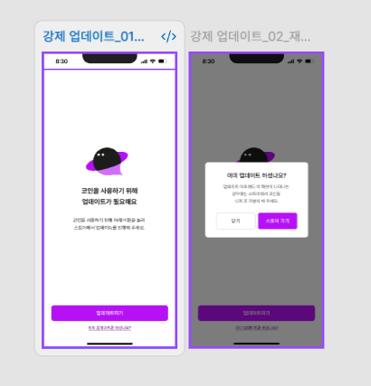

# 강제 업데이트 · 로깅 명세

원문 페이지 ID: 4150221954bc81658736d9971120feaa

> 원문 스냅샷. 명세 확정·앱 배포·수집 완료를 뜻하지 않습니다.

## 원문 속성

```json
{
  "title": "강제 업데이트 · 로깅 명세"
}
```

## 참고사진

<b>모바일 · 강제 업데이트 화면</b>

빨간 네모: 업데이트하기 버튼과 이미 업데이트를 하셨나요? 링크.

<b>모바일 · 업데이트 확인 팝업</b>

빨간 네모: 닫기 버튼과 스토어 가기 버튼.

웹 (PC·모바일 웹) 실제 화면 사진은 미확보다. 위 이미지는 사용자 제공 앱 디자인에 표시한 참고사진이다.

## 로깅별 상세 페이지

동작별로 아래 6개 페이지에서 확인한다. 각 페이지는 <b>과거 로깅 → 새 로깅 → 참고사진(웹·모바일)</b> 순서다. 같은 동작의 새 event\_label은 IOS·ANDROID·WEB에서 공통으로 사용한다.

[1. 강제 업데이트 화면 표시](4150221954bc8126ab91fa403975d406.md)

[2. 업데이트하기 클릭](4150221954bc81abb0fff0dc3714fcee.md)

[3. 이미 업데이트했나요 클릭](4150221954bc81a28e0fc946e1e57c27.md)

[4. 업데이트 확인 팝업 닫기](4150221954bc81eda804ff10d5d301bf.md)

[5. 업데이트 확인 팝업 스토어 가기](4150221954bc81c4bd1ec8bb60a227e2.md)

<details>
<summary>공통 기준 · 코드 근거 · 이전 검토 이력</summary>

## 새 공통 로깅 · IOS / ANDROID / WEB

2026-11-11 사용자 정정 요청 반영. 같은 기능은 모든 지원 플랫폼에서 동일 event\_label을 사용한다. service=<code>main</code>, screen\_view=<code>forced_update</code>, event\_name=<code>DA2</code>다. 아래는 문서의 새 기준이며 웹 기능 지원·SDK 배포 완료를 뜻하지 않는다.

| 동작 | 공통 event\_label | event\_category |
| --- | --- | --- |
| 화면 표시 | <code>main__forced_update__app_update__exposure</code> | <code>exposure</code> |
| 업데이트하기 클릭 | <code>main__forced_update__app_update__store_entry__click</code> | <code>click</code> |
| 이미 업데이트했나요 클릭 | <code>main__forced_update__app_update__already_done__click</code> | <code>click</code> |
| 업데이트 확인 팝업 닫기 | <code>main__forced_update__update_popup__close__click</code> | <code>click</code> |
| 업데이트 확인 팝업 스토어 가기 | <code>main__forced_update__update_popup__store_entry__click</code> | <code>click</code> |

화면 이탈은 클릭이 아닌 lifecycle 이벤트이므로 기존 <code>forced_update_exit</code>를 과거 수집 계약으로 보존하고 신규 네이밍은 전환 보류한다. 임의의 click 이벤트나 page\_exit 예외를 만들지 않는다.

### 참고사진 · 웹 (PC·모바일 웹)

해당 웹 화면의 실제 사진은 미확보다. 아래 앱 이미지를 웹 사진으로 재분류하지 않는다.

### 참고사진 · 모바일 앱

사용자 제공 이미지의 클릭 영역에 빨간 네모를 추가한 편집 참고사진 2장이다. 실기기·수집 검증 사진은 아니다.

<b>업데이트하기 · 이미 업데이트했나요</b>

빨간 박스 수정본은 이 페이지 상단 참고사진에 표시한다.

<b>팝업 닫기 · 스토어 가기</b>

빨간 박스 수정본은 이 페이지 상단 참고사진에 표시한다.

## 과거 코드에서 확인한 동작 · 이력 보존

| 동작 | 기존 event\_label | 의미 |
| --- | --- | --- |
| 강제 업데이트 화면 생성 | <code>forced_update_page_view</code> | Android 화면 생성 시 기록. iOS 동일 로그는 확인 못 함 |
| 화면 이탈·백그라운드 진입 | <code>forced_update_exit</code> | 홈 버튼만의 증거가 아니며 스토어 이동 시 함께 발생할 수 있음 |
| 업데이트하기 버튼 | <code>forced_update_confirm</code> | 스토어 이동 시도이며 업데이트 완료가 아님 |
| 이미 업데이트했나요? | <code>forced_update_already_done</code> | 확인 팝업을 열기 위한 사용자 클릭이며 업데이트 완료 판정이 아님 |
| 팝업 닫기 | <code>already_update_popup</code> | value로 닫기 동작 구분 |
| 팝업 스토어 가기 | <code>already_update_popup</code> | value로 스토어 이동 시도 구분. 팝업 노출 로그가 아님 |

## 주의사항

- <code>already_update_popup</code>은 한 label에서 value로 2개 버튼을 구분한다. 두 명세를 동시에 호출하는 구조가 아니다.
- iOS 닫기 버튼의 실제 value는 <code>확인</code>, Android는 <code>닫기</code>다. 스토어 버튼도 iOS <code>스토어로 가기</code> / Android <code>스토어로_가기</code> 차이를 보존한다.
- 조회한 Android의 screen\_view 파라미터 추출은 DA1/DA2에서만 실행된다. force\_update에 screen\_view가 전송된다고 가정하지 않는다. iOS는 해당 필드 전송 미확인이다.
- Android debug 빌드는 event\_name에 <code>_debug</code>, event\_label에 <code> (debug)</code>, category에 <code>_debug</code>를 붙인다. 이를 별도 사용자 동작으로 중복 등록하지 않는다.
- 화면·팝업 노출은 재생성·중복 콜백·실제 노출 시점을 별도 검증한다. 앱 백그라운드 진입을 사용자 이탈·업데이트 거절·업데이트 완료로 단정하지 않는다.

### 참고사진 · 강제 업데이트 화면 및 확인 팝업

<b>웹 (PC·모바일 웹)</b>

참고사진 없음. 이번 이미지는 네이티브 앱 디자인이며 웹 지원의 증거가 아니다.

<b>모바일 앱</b>

사용자가 제공한 Figma 디자인 캡처. 왼쪽은 강제 업데이트 화면, 오른쪽은 이미 업데이트했나요? 확인 팝업이다. 실기기 캡처·배포 확인 사진은 아니다. 원본 이미지를 변경하지 않고 첨부했다.



## 코드 근거

- [Android 화면](https://github.com/BCSDLab/KOIN_ANDROID/blob/69f66e28eabb1e992b8b7143424db8a32e175783/koin/src/main/java/in/koreatech/koin/ui/forceupdate/ForceUpdateActivity.kt)
- [Android 팝업](https://github.com/BCSDLab/KOIN_ANDROID/blob/69f66e28eabb1e992b8b7143424db8a32e175783/koin/src/main/java/in/koreatech/koin/ui/forceupdate/ForceUpdateDialog.kt)
- [iOS 화면·팝업](https://github.com/BCSDLab/KOIN_iOS/blob/54c14cc3420e65d1bffe8394e322aafe2f018083/Koin/Presentation/Core/ForceUpdate/ForceUpdateViewController.swift)

실제 수집·플랫폼별 적용 버전·한 번 전송은 미확인이다.


</details>

[6. 강제 업데이트 화면 이탈](4150221954bc814f8744f126ce0902f5.md)
