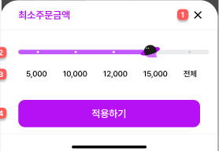

# 2-18 상점 카테고리 최소주문금액 설정

원문 페이지 ID: 42d0221954bc834c89b80154ece61dd5

> 원문 스냅샷. 명세 확정·앱 배포·수집 완료를 뜻하지 않습니다.

## 원문 속성

```json
{
  "platform": [
    "ANDROID",
    "IOS"
  ],
  "url": "source-page-id:42d0221954bc834c89b80154ece61dd5",
  "상태": "로깅 필요",
  "생성일": "2026-11-08T10:51:48.773Z",
  "이벤트 이름": "2-18 상점 카테고리 최소주문금액 설정",
  "태그": [
    "2. 상점 카테고리"
  ]
}
```

<details>
<summary>이전 로깅</summary>




금액을 설정하고 적용하기를 눌렀을 때 발생하는 로깅


<span color="orange">event\_params.key</span>

<ul>
<li>
event\_label : min\_amount\_set
</li>
<li>
value : 금액
</li>
<li>
event\_category : click 
</li>
</ul>
</details>

<details>
<summary>새 로깅 (26.10.17)</summary>

- 설명: (앱 주문 기능) 상점 목록 화면에서 최소주문금액을 설정하고 적용하기를 누르는 경우
- screen\_view: <code>shop_list</code>
- event\_name: <code>DA1</code>
- event\_label: <code>shop__shop_list__filter__min_amount__select</code>
- value: \{금액\} (예: 10000원)
- event\_category: <code>select</code>

<details>
<summary>검토사항</summary>

- 통합 가이드: [로깅 통합 가이드](3c30221954bc8214b1c481c5bbb6fba5.md)
- 참고사진: 앱 전용 화면 (웹 없음), 앱 캡처 필요
- label DA2 기준 정렬 (2026-10-27): <code>shop__shop_list__min_amount__select</code> → <code>shop__shop_list__filter__min_amount__select</code>
</details>

### 참고사진 (최소주문금액 설정)

<columns>
<column ratio="50">
<b>웹</b>

<details>
<summary>참고사진 · 웹</summary>

해당 없음 (앱 전용)
</details>
</column>
<column ratio="50">
<b>모바일</b>

<details>
<summary>참고사진 · 모바일</summary>

앱 전용 화면 (웹 없음), 앱 캡처 필요
</details>
</column>
</columns>
</details>
