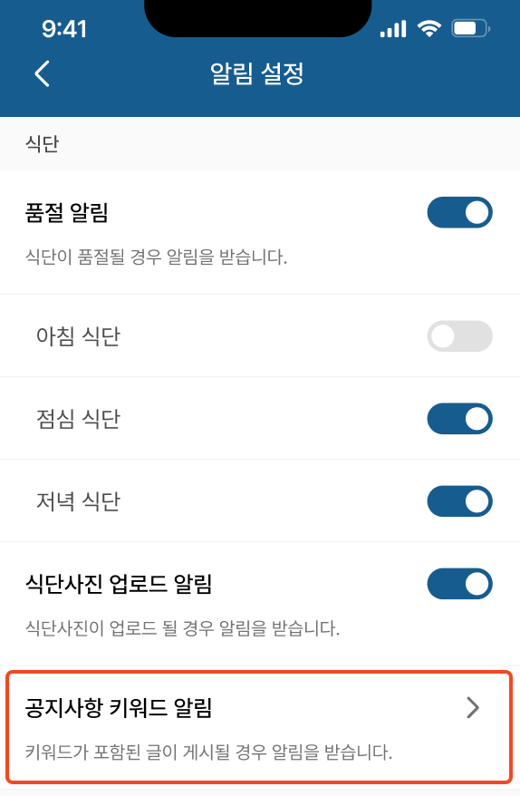

# 7-9. 알림설정_공지사항 키워드 알림_클릭

원문 페이지 ID: 44b0221954bc83669fd4013b52482bfb

> 원문 스냅샷. 명세 확정·앱 배포·수집 완료를 뜻하지 않습니다.

## 원문 속성

```json
{
  "platform": [
    "ANDROID",
    "IOS"
  ],
  "url": "source-page-id:44b0221954bc83669fd4013b52482bfb",
  "상태": "로깅 필요",
  "이름": "7-9. 알림설정\\_공지사항 키워드 알림\\_클릭",
  "태그": [
    "7. 키워드 관리(APP)"
  ]
}
```

<details>
<summary>과거 로깅</summary>

<ul>
<li>
설명 : <u>공지사항/키워드</u> 관리 페이지로 이동
</li>
<li>
<span color="yellow">주의사항</span> : 클릭 가능한 모든 요소(텍스트, 화살표) 로깅
</li>
<li>
event\_label : “notification\_manage\_keyword”
</li>
<li>
value : “공지사항 키워드 알림<b>”</b>
</li>
<li>
event\_category : “click” 
</li>
<li>
참고사진


</li>
</ul>
</details>

<details>
<summary>새 로깅</summary>

- 설명: 알림 설정 화면에서 공지사항 키워드 알림 항목을 눌러 관리 화면 진입.
- screen\_view:<code>notification_config</code>
- event\_name: <code>DA2</code>
- event\_label: <code>board__notification_config__keyword_manage__entry__click</code>
- value: 공지사항 키워드 알림
- event\_category: <code>click</code>

<b>참고사진 · 모바일</b>

<b>모바일</b>

파란색 구버전 모바일 사진 제거 (2026-10-30).
</details>
