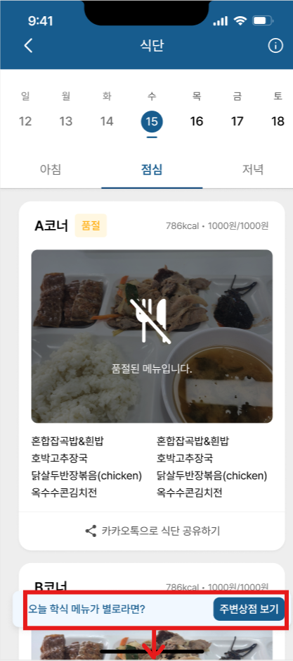
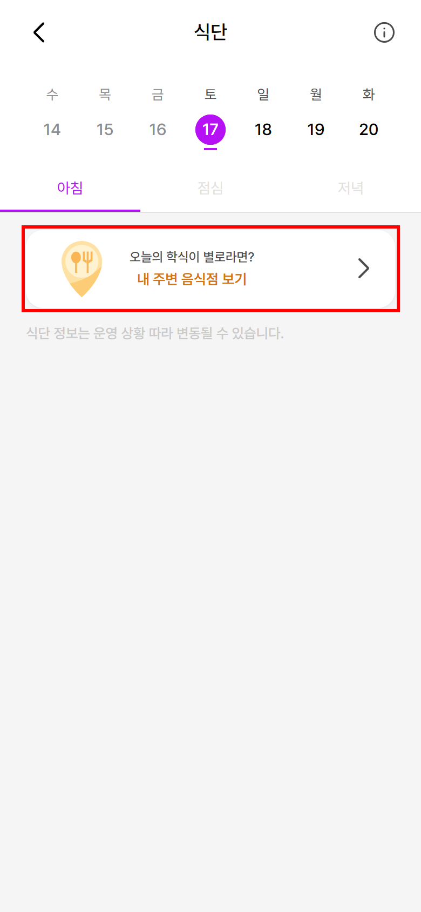

# 0-3. 식단_ABtest_상점가기_닫기

원문 페이지 ID: 44f0221954bc83d88b810140c5f0751e

> 원문 스냅샷. 명세 확정·앱 배포·수집 완료를 뜻하지 않습니다.

## 원문 속성

```json
{
  "platform": [
    "ANDROID",
    "IOS"
  ],
  "url": "source-page-id:44f0221954bc83d88b810140c5f0751e",
  "상태": "완료",
  "생성일": "2026-11-08T10:51:35.590Z",
  "이름": "0-3. 식단\\_ABtest\\_상점가기\\_닫기",
  "태그": [
    "0. A/B TEST"
  ]
}
```

<details>
<summary>이전 로깅</summary>

- event\_label : “dining\_to\_shop\_close”
- value : “\{아침 or 점심 or 저녁\}<b>”</b>
- event\_category : “swipe”
- custom\_session\_id : \{dining2shop\}\_\{0\}\_\{플랫폼\}\_\{세션시작시간\}\_\{랜덤값\}
- 세션 설명: 커스텀 세션 아이디는 0-1과 같이 세션 아이디를 유지하는 방식으로 작업해주시면 됩니다.
- 로깅 설명: 상점 바로가기 버튼을 아래로 내려 없앨 때 발생하는 이벤트입니다.
- 참고사진


</details>

<details>
<summary>새 로깅 (26.10.17)</summary>

- 설명: 식단 화면에서 상점가기 배너를 아래로 스와이프해 닫는 경우 (A/B 테스트, service는 shop)
- screen\_view: <code>cafeteria</code>
- event\_name: <code>DA1</code>
- event\_label: <code>shop__cafeteria__shop_banner__swipe</code>
- value: \{식사 시간\} → 아침 / 점심 / 저녁 (예: 저녁)
- event\_category: <code>swipe</code>

<details>
<summary>검토사항</summary>

- 통합 가이드·후속: [로깅 통합 가이드](3c30221954bc8214b1c481c5bbb6fba5.md)
- 웹: 없음 (앱 전용)
- 참고: custom\_session\_id는 과거 정의 그대로 유지 (0-1과 같은 세션 아이디)
- 참고사진은 stage 모바일 웹 캡처(빨간 네모 = 배너 위치). 스와이프로 닫기는 앱 동작
</details>

### 참고사진 (상점가기 배너 스와이프)

<columns>
<column ratio="50">
<b>웹</b>

<details>
<summary>참고사진 · 웹</summary>

해당 없음 (앱 전용)
</details>
</column>
<column ratio="50">
<b>모바일</b>

<details>
<summary>참고사진 · 모바일</summary>

모바일 — 상점가기 배너 (출처: stage 모바일 웹 캡처, 빨간 네모 = 배너 위치)


</details>
</column>
</columns>
</details>
