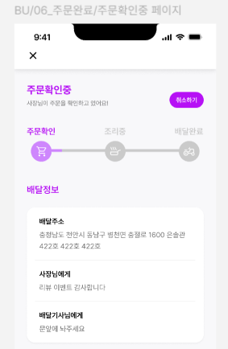

# 8-1 주문 완료 페이지 이탈

원문 페이지 ID: 4530221954bc83618df381704dd0bbdb

> 원문 스냅샷. 명세 확정·앱 배포·수집 완료를 뜻하지 않습니다.

## 원문 속성

```json
{
  "platform": [
    "WEB"
  ],
  "url": "source-page-id:4530221954bc83618df381704dd0bbdb",
  "상태": "로깅 필요",
  "생성일": "2026-11-08T10:51:56.170Z",
  "이벤트 이름": "8-1 주문 완료 페이지 이탈"
}
```




좌측 상단의 x 버튼 로깅입니다


event\_params.key

- event\_label : order\_complete\_back
- value :
- event\_category :
  - click
