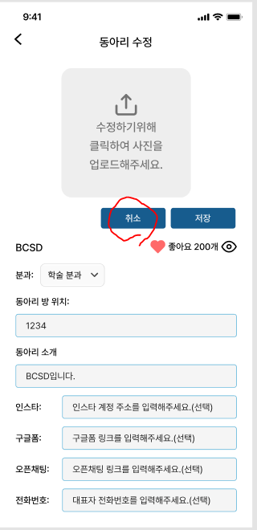
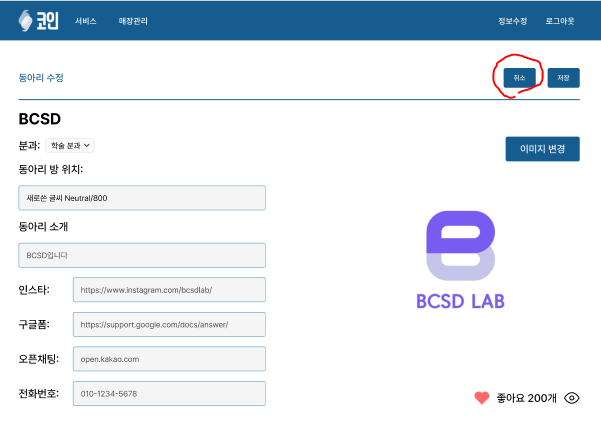

# 5-3.동아리_정보수정 취소

원문 페이지 ID: 4590221954bc829ab506011b828959eb

> 필터 밖 원본 행 복구 스냅샷. 중복·빈 페이지도 원본 ID와 속성, 본문을 개별 보존합니다. 명세 승인이나 앱 적용 완료를 뜻하지 않습니다.

대조 기록: [숨겨진 원본 42개 복구](../hidden-recovery.md)

관련 기존 보관본: [레거시 5-3.동아리_정보수정 취소](7330221954bc82ef9c9e81172fa03a97.md), [레거시 5-3.동아리_정보수정 취소](1360221954bc83c5bff581cb6fb03a9f.md)

## 원문 속성

```json
{
  "platform": [
    "ANDROID",
    "IOS",
    "WEB"
  ],
  "url": "source-page-id:4590221954bc829ab506011b828959eb",
  "상태": "완료",
  "이름": "5-3.동아리\\_정보수정 취소"
}
```

<ul>
<li>
설명: 동아리 수정 화면에서 취소 버튼 클릭
</li>
<li>
event\_name : “CAMPUS”
</li>
<li>
event\_label : “club\_correction\_cancel”
</li>
<li>
value : “취소”
</li>
<li>
event\_category : “click” 
</li>
<li>
참고사진
</li>
</ul>





- 웹 참고사진



