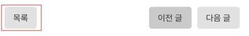
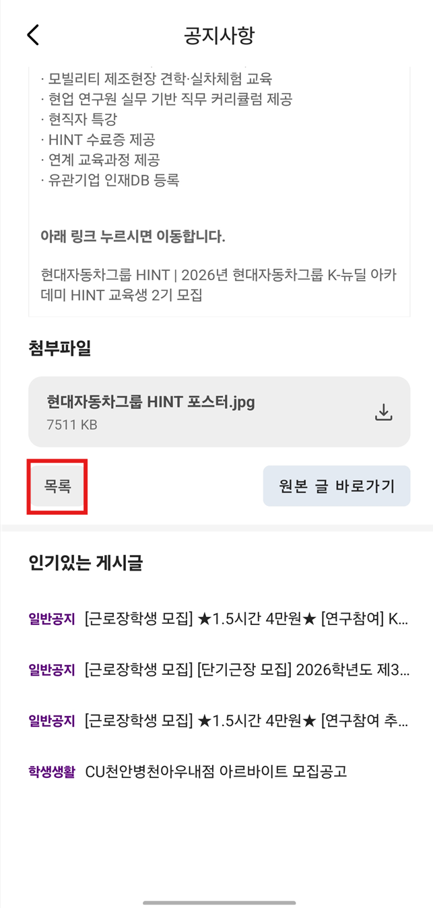

# 5-1. 목록_클릭

원문 페이지 ID: 4710221954bc82bdad73016b2c6063d9

> 원문 스냅샷. 명세 확정·앱 배포·수집 완료를 뜻하지 않습니다.

## 원문 속성

```json
{
  "platform": [
    "ANDROID",
    "IOS"
  ],
  "url": "source-page-id:4710221954bc82bdad73016b2c6063d9",
  "상태": "로깅 필요",
  "이름": "5-1. 목록\\_클릭",
  "태그": [
    "5. 공지사항 내용(APP)"
  ]
}
```

<details>
<summary>이전 로깅</summary>




</details>

<details>
<summary>새 로깅 (26.10.05) — 초안</summary>

- 설명: 공지 상세 화면의 목록 버튼을 눌러 공지사항 목록으로 돌아가기.
- screen\_view: <code>notice_detail</code>
- event\_name: <code>DA2</code>
- event\_label: <code>board__notice_detail__navigation__notice_list_return__click</code>
- value: 목록으로 돌아가기
- event\_category: <code>click</code>

<details>
<summary>검토사항</summary>

- label 통일 (2026-10-27): <code>board__notice_detail__navigation__notice_list_return</code> → <code>board__notice_detail__navigation__notice_list_return__click</code> (event\_category 값 back은 표준 8개 목록 밖이라 label은 click으로 붙였고, event\_category는 변경 안 함: 협의 필요 → 2026-10-27 해소)
- 후속 수정 (2026-10-27): event\_category <code>back</code> → <code>click</code> (label 마지막 단어 기준, 위 협의 필요 메모 대체)
</details>

<details>
<summary>참고사진 · 모바일</summary>

<b>모바일</b>


</details>
</details>
