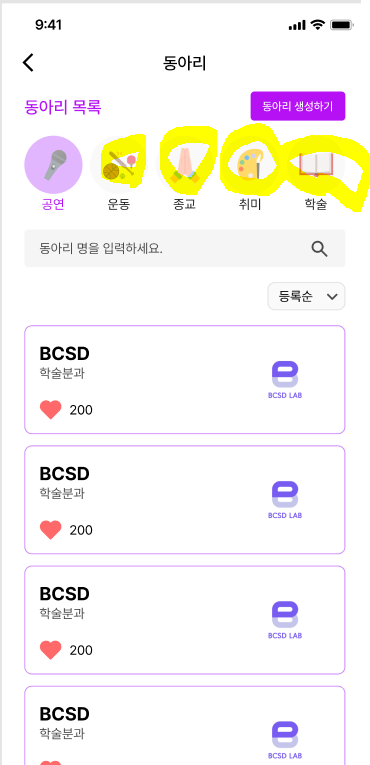
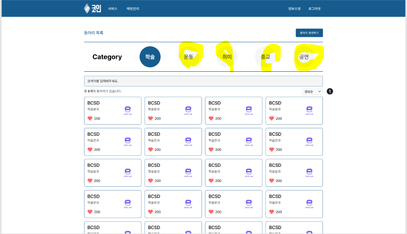

# 2-3.동아리_동아리 카테고리 클릭

원문 페이지 ID: 4710221954bc839ea4d801a78abdcf7e

> 필터 밖 원본 행 복구 스냅샷. 중복·빈 페이지도 원본 ID와 속성, 본문을 개별 보존합니다. 명세 승인이나 앱 적용 완료를 뜻하지 않습니다.

대조 기록: [숨겨진 원본 42개 복구](../hidden-recovery.md)

관련 기존 보관본: [레거시 2-3.동아리_동아리 카테고리 클릭](7f90221954bc83c394860174ee79624d.md), [레거시 2-3.동아리_동아리 카테고리 클릭](dd70221954bc82ca921f8172327a3bd5.md)

## 원문 속성

```json
{
  "platform": [
    "WEB",
    "ANDROID",
    "IOS"
  ],
  "url": "source-page-id:4710221954bc839ea4d801a78abdcf7e",
  "상태": "완료",
  "이름": "2-3.동아리\\_동아리 카테고리 클릭"
}
```

<ul>
<li>
설명: 동아리 메인화면에서 동아리 카테고리 클릭
</li>
<li>
event\_name : “CAMPUS”
</li>
<li>
event\_label : “club\_main\_category”
</li>
<li>
value : \{”공연”,”운동”,”종교”,”취미”,”학술”\}
</li>
<li>
event\_category : “click” 
</li>
<li>
참고사진
</li>
</ul>





- 웹 참고사진



