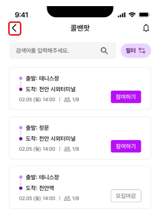
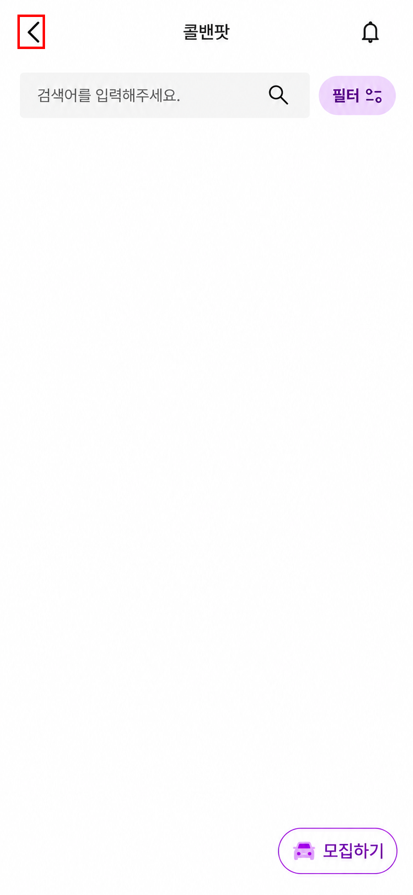

# 2-11  콜밴팟 찾기 이탈

원문 페이지 ID: 4790221954bc839492e8816a511d21a6

> 원문 스냅샷. 명세 확정·앱 배포·수집 완료를 뜻하지 않습니다.

## 원문 속성

```json
{
  "platform": [
    "ANDROID",
    "IOS"
  ],
  "url": "source-page-id:4790221954bc839492e8816a511d21a6",
  "상태": "로깅 필요",
  "이름": "2-11  콜밴팟 찾기 이탈",
  "태그": [
    "2. 콜밴팟 찾기"
  ]
}
```

<details>
<summary>이전 로깅</summary>


<ul>
<li>
event\_name : CAMPUS
</li>
<li>
event\_category

- click
- swipe
- event\_label : ㅊ
</li>
<li>
value : 
</li>
</ul>





</details>

<details>
<summary>새 로깅 (2026-10-14) — 초안</summary>

- 설명: 콜밴팟 목록의 화면 내 뒤로가기 버튼을 클릭해 이탈할 때 1회 기록한다. OS 뒤로가기 스와이프는 이 click 명세에 포함하지 않는다.
- screen\_view: <code>callvan_list</code>
- event\_label: <code>callvan__callvan_list__navigation__back__click</code>
- event\_name: <code>DA2</code>
- value: 기존 미기재 유지
- event\_category: <code>click</code>

<details>
<summary>검토사항</summary>

- 현재 적용 기준 (2026-11-05): 이 새 라벨과 click category는 화면 내 뒤로가기 버튼 클릭에만 적용한다. iOS OS 스와이프는 실제로 별도 swipe category로 수집되므로 click으로 변환하지 않는다. 기존 스와이프 승계 계약은 후속 확정 대상으로 남기며 이 작업에서 새 로깅을 만들지 않는다.
- 실제 옛 라벨 확인 (2026-11-05): 코드와 GA4 원천에서 확인한 옛 라벨은 callvan\_back이다. 이전 로깅 원문의 ‘ㅊ’은 이력 보존을 위해 그대로 두며 실제 수집 라벨로 사용하지 않는다. 2026-10-05\~11-03 원천에서 iOS click 344건·swipe 182건, Android click 26건이 관측됐다. 근거: [iOS 라벨](https://github.com/BCSDLab/KOIN_iOS/blob/f9286701b52668451840aa4b3432a3bcc8bd7aa8/Koin/Core/Logger/EventParameter.swift#L225), [click/swipe 분기](https://github.com/BCSDLab/KOIN_iOS/blob/f9286701b52668451840aa4b3432a3bcc8bd7aa8/Koin/Core/View/UIKit/CustomNavigationController.swift#L26).
- 개발 검증 필요 (2026-11-05): Android 확인 경로는 상단 버튼 click이다. OS 뒤로가기 발화 여부와 iOS 목록→상세 진입 시 이탈 오기록 여부는 실기기 확인이 필요하다. 확인 전 정상 전송 완료로 표시하지 않는다.
- 통합 가이드·후속: [로깅 통합 가이드](3c30221954bc8214b1c481c5bbb6fba5.md)
- 이전 검토 기록 (현재 적용 기준으로 대체): 당시 기존 label ‘ㅊ’의 실제 수집 여부와 click/swipe를 확인 대기로 남겼다. 실제 옛 라벨 및 버튼·스와이프 구분은 위 현재 기준을 따른다.
- 이전 변경 이력 (2026-10-27, 현재 발생 조건은 위 기준 적용): back 라벨에 click 접미를 붙였으나 당시 click/swipe가 미확정이었다. 이 이력을 OS 스와이프를 click으로 바꾸라는 지시로 사용하지 않는다.
- 이전 변경 이력 (2026-10-27, 현재 발생 조건은 위 기준 적용): 모호한 category 표기를 click으로 정리했다. 현재 click은 버튼 클릭만 뜻하며 스와이프 수집 의미를 대체하지 않는다.
</details>

### 참고사진 (기능 표시)

<b>모바일 (ANDROID, IOS) / 캡처 출처는 아래 참조</b>

<details>
<summary>참고사진 · 모바일</summary>

화면 정의의 Android 실제 캡처(2026-10-13), 선명도 개선본. 이번 작업은 기존 캡처를 사용. 박스는 뒤로가기 클릭 대상이며 OS 제스처 위치를 뜻하지 않음.


</details>
</details>
